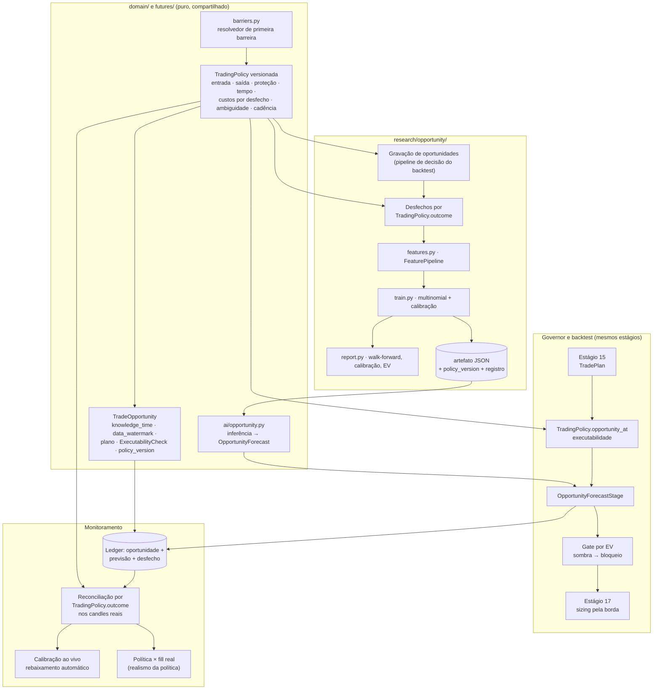

# Alphora — Plano da previsão de oportunidade

> **A pergunta que a IA responde:** *qual a probabilidade de esta compra (ou venda) atingir o take profit antes do
> stop loss, considerando taxas, slippage, volatilidade e condições de mercado?*  
> **Regra central:** *toda previsão precisa estar associada a uma oportunidade que poderia ter sido conhecida e
> executada naquele momento, com resultado calculado pela mesma política de negociação que será utilizada
> operacionalmente.* A §2 transforma essa regra em propriedades verificáveis; todas as etapas seguintes a obedecem.  
> **O que é este documento:** o plano, em ordem de prioridade, para construir essa previsão na arquitetura atual e
> colocá-la no caminho de decisão do Governor.  
> **Relação com o [plano de confiabilidade da IA](AI_SIGNAL_RELIABILITY_PLAN.md):** aquele plano continua sendo o
> guarda-chuva (dados, validação, ciclo de vida). Este detalha, para esta pergunta, as fases de rótulo (IA3), modelo
> (IA4) e integração (IA6), e passa a ser **o caminho principal da IA** — a previsão direcional atual vira uma
> estratégia secundária.  
> **Base:** código da `main` em 17/11/2026. A IA0 e as prioridades 1, 2 e 3 estão entregues no código (§7).

---

## Sumário

- [1. Resposta curta](#1-resposta-curta)
- [2. Regra central: a oportunidade operável](#2-regra-central-a-oportunidade-operável)
- [3. O que a pergunta exige](#3-o-que-a-pergunta-exige)
- [4. O que o repositório já tem e o que falta](#4-o-que-o-repositório-já-tem-e-o-que-falta)
- [5. Como a resposta é calculada](#5-como-a-resposta-é-calculada)
- [6. Arquitetura](#6-arquitetura)
- [7. Etapas em ordem de prioridade](#7-etapas-em-ordem-de-prioridade)
- [8. Critérios para usar a previsão de verdade](#8-critérios-para-usar-a-previsão-de-verdade)
- [9. Backlog](#9-backlog)
- [10. Riscos](#10-riscos)

---

## 1. Resposta curta

A pergunta é bem definida e cabe no Alphora: toda entrada aprovada já vira um `TradePlan` com preço de referência,
stop, alvo e custos estimados (`src/trading/plan.py:20`), e o backtest já sabe decidir, candle a candle, qual
barreira foi tocada primeiro (`src/backtesting/engine/execution.py:275-440`). O que falta é:

1. **uma política de negociação única e versionada** — entrada, saídas, proteção, tempo máximo, custos e regra de
   trajetória — que o Governor, o backtest, o gerador de dados e a reconciliação ao vivo usem igualmente;
2. **oportunidades operáveis**: cada amostra de treino e cada previsão nascem de um candidato que o robô poderia ter
   conhecido e executado naquele instante, não de uma grade arbitrária de preços;
3. **o rótulo calculado por essa política** (alvo, stop, tempo esgotado ou não preenchida), com custos por desfecho;
4. **um modelo calibrado** que estime `P(alvo primeiro)` a partir da geometria do trade, da volatilidade e das
   condições de mercado no momento da decisão;
5. **uma regra de decisão por valor esperado** no Governor, no lugar do R:R mínimo fixo — hoje um trade com R:R 1,5
   e 30% de chance de acerto é aprovado, embora perca dinheiro em média.

A ordem importa: sem a política única e o rótulo certo, qualquer modelo aprende a pergunta errada.

---

## 2. Regra central: a oportunidade operável

> *Toda previsão precisa estar associada a uma oportunidade que poderia ter sido conhecida e executada naquele
> momento, com resultado calculado pela mesma política de negociação que será utilizada operacionalmente.*

### 2.1. As quatro propriedades

| Propriedade | Definição | Como se verifica |
|---|---|---|
| **Conhecível** | A oportunidade usa só o que existia no instante da decisão `t`: candles fechados até `t` (com a latência de dados do live), funding publicado antes de `t`, regras de exchange em vigor em `t`, símbolo listado em `t` | `knowledge_time` e `data_watermark` gravados; teste de prefixo: a mesma oportunidade a partir do histórico e do stream; nenhuma feature lê dado com carimbo > `t` |
| **Executável** | Passa nas restrições duras da política em `t`: arredondamento de preço e quantidade, notional mínimo, proteção posicionável (stop e alvo além do buffer), cadência anti-HFT, timeframe permitido no modo, regra de preenchimento da entrada | `ExecutabilityCheck` gravado com cada oportunidade; candidato reprovado não recebe previsão nem entra no treino, só é contado |
| **Mesma política** | Entrada, saídas, proteção, tempo máximo, custos e regra de candle ambíguo vêm do mesmo objeto `TradingPolicy` usado pelo Governor | `policy_version` (hash dos parâmetros + versão do código) no dataset, no artefato e em cada previsão; o resolver recusa modelo de outra versão de política |
| **Rastreável** | Cada previsão aponta para uma oportunidade (`opportunity_id`) e, depois, para o desfecho calculado pela política | Teste de reprodução: recalcular o desfecho a partir do registro dá o mesmo resultado; 100% das previsões com `opportunity_id` |

### 2.2. O que a regra muda

| Antes (rascunho) | Com a regra |
|---|---|
| Grade sintética de stops/alvos em ATR em todo candle | Só **variantes implantáveis da política** (por exemplo, multiplicadores de ATR que o planejador de saída aceita), marcadas como tal; o modelo de produção treina e valida na política que vai operar |
| Entrada no fechamento do candle de decisão | Entrada pela **regra de preenchimento da política** (`NEXT_OPEN` a mercado com slippage, ou limit com tempo-limite) |
| Três desfechos | Quatro: `TP_FIRST`, `SL_FIRST`, `TIMEOUT` e **`NOT_FILLED`** (entrada limit que não preencheu no prazo) — a chance de preencher também entra no valor esperado |
| Lógica de rótulo própria na pesquisa | Rótulo = `TradingPolicy.outcome(oportunidade, candles seguintes)`, o mesmo código do backtest e da reconciliação |
| Previsão registrada com o score | Previsão registrada com a oportunidade completa: entradas, plano, checagens de executabilidade, versão da política e dos dados |

### 2.3. Restrições que dependem do caminho

Limites de portfólio (posições abertas, exposição por grupo, orçamento de checagens pesadas) dependem das decisões
anteriores do próprio robô. Eles **não** removem amostras do treino — removê-los faria o dataset depender de uma
trajetória específica —, mas são gravados como contexto da oportunidade e aplicados no live **depois** da previsão,
como hoje. Restrições que não dependem do caminho (regras de exchange, cadência por símbolo, timeframe permitido,
viabilidade da proteção) **removem** a oportunidade, porque o robô não poderia tê-la executado.

---

## 3. O que a pergunta exige

| Parte da pergunta | Significado operacional | Onde mora hoje |
|---|---|---|
| “esta compra” | Uma oportunidade operável: lado, entrada pela regra de preenchimento, stop, alvo, tamanho arredondado | `TradeOpportunity` (`domain/opportunity.py`) e `TradingPolicy` (`futures/trading_policy.py`) no estágio 15 |
| “atingir o take profit antes do stop loss” | Ordem da primeira barreira tocada, com regra para gap e para stop e alvo no mesmo candle; tempo máximo como terceira barreira | `domain/barriers.py` e `TradingPolicy.outcome`, compartilhados com o `ExecutionSimulator` |
| “considerando taxas” | Taxa maker/taker por perna; a saída no alvo pode ser maker, a do stop é taker | `futures/costs/outcome.py` (`OutcomeCosts`) integrado na `TradingPolicy` |
| “slippage” | Deslizamento de entrada e, principalmente, de stop em mercado rápido | `OutcomeCosts` aceita slippage próprio para o stop; calibração por volatilidade pendente (OPP-020) |
| “volatilidade” | Distância das barreiras em unidades de volatilidade; regime de volatilidade | ATR existe no `exit_model`; não é entrada de nenhum modelo |
| “condições de mercado” | Tendência e regime por candles, fluxo, funding, mercado (BTC), horário | Regime por candles entregue (IA0.4); funding ao vivo no `TradeContext` entregue (OPP-028); fluxo e OI ainda não coletados |
| “qual a probabilidade” | Número calibrado (70% acontece ~70% das vezes), com incerteza | Nenhum modelo prevê isso |

---

## 4. O que o repositório já tem e o que falta

### 4.1. Reaproveitável

| Peça | Onde | Uso nesta previsão |
|---|---|---|
| `TradePlan` com stop, alvo, custos, R:R | `src/trading/plan.py` | Corpo da oportunidade |
| Planejador de saída (percentual fixo ou ATR) e `PlannedExit` das estratégias | `futures/planning/exit_planner.py`, `futures/planned_exit.py` | Barreiras da política |
| Regras de exchange e arredondamento | `domain/symbol_rules.py`, `futures/risk_manager.py` | Checagem de executabilidade |
| Cadência anti-HFT e timeframe mínimo para dinheiro real | `trading_cadence.py`, `domain/timeframe.py` | Checagem de executabilidade |
| Modelo de custos (taxas, spread, slippage, funding) | `futures/costs/model.py` | Base dos custos por desfecho |
| Trajetória do backtest: gap, stop/alvo intracandle, ambiguidade, liquidação, alvo maker | `backtesting/engine/execution.py:275-440` | Base do resolvedor de barreiras (`domain/barriers.py`) |
| Política de candle ambíguo e de entrada (`NEXT_OPEN`, limit com tempo-limite) | `backtesting/domain/policies.py` | Parte da política única |
| Walk-forward, purga, embargo, PSR e Deflated Sharpe mínimos | `backtesting/domain/realism.py`, `backtesting/domain/config.py` | Validação (PBO ainda não existe) |
| Ajuste logístico convergente, contrato OHLCV, schema de features versionado | `domain/ai/model.py`, IA0 | Primeiro modelo; modelo para o guarda de versão de política |
| Estágios compartilhados live/backtest | `governor/stages/decision_kernel.py` (M6) | Mesma previsão nos dois mundos |
| API de eventos e `JournalRegistry` | `utils/events.py`, `utils/journals.py` (M7) | Registro das oportunidades e previsões |

### 4.2. Lacunas

| # | Lacuna | Consequência |
|---:|---|---|
| L1 | Nenhum modelo prevê a ordem das barreiras | A IA não responde à pergunta |
| L2 | ~~A política de negociação está espalhada~~ *(resolvida em P1: `TradingPolicy` única e versionada)* | Treino, backtest e live agora compartilham o mesmo objeto e `policy_version` |
| L3 | ~~Não existe o conceito de oportunidade com identidade, instante de conhecimento e checagem de executabilidade~~ *(resolvida em P1: `TradeOpportunity` + `ExecutabilityCheck`)* | Toda avaliação candidata gera oportunidade auditável e causal |
| L4 | ~~Custos iguais para todo desfecho; funding de um período, sem sinal nem duração~~ *(resolvida em P3: `OutcomeCosts` + funding ao vivo)*; slippage de stop por volatilidade aguarda calibração (OPP-020) | Custos assimétricos já entram no plano e na oportunidade |
| L5 | O gate econômico aprova por R:R líquido ≥ 1,5 e ganho ≥ 5 bps, sem probabilidade (`futures/planning/economic_gate.py:42-163`) | Trades de EV negativo passam |
| L6 | Candle grosso (15m/1h) tem stop e alvo no mesmo candle com frequência | Rótulo ambíguo; a regra conservadora subestima acertos |
| L7 | Condições de mercado pobres: sem fluxo comprador, OI ou contexto do BTC | Pouca informação para separar bons e maus candidatos |
| L8 | Nenhuma previsão é reconciliada com o resultado | Não dá para saber se “45%” é 45% |

---

## 5. Como a resposta é calculada

### 5.1. Os desfechos

Para uma oportunidade com entrada `E` (pela regra de preenchimento), stop `S`, alvo `T` e tempo máximo `H`:

| Desfecho | Quando |
|---|---|
| `NOT_FILLED` | A entrada limit não preencheu dentro do tempo-limite da política (não existe com entrada a mercado) |
| `TP_FIRST` | O preço toca `T` antes de `S` e antes de `H` |
| `SL_FIRST` | O preço toca `S` antes de `T` e antes de `H` (inclui gap através do stop) |
| `TIMEOUT` | Nenhuma barreira em `H` candles; sai a mercado no fechamento |

O modelo devolve as probabilidades calibradas condicionadas ao preenchimento (`p_tp + p_sl + p_timeout = 1`) e,
para entradas limit, `p_fill`.

### 5.2. Custos por desfecho, em unidades de risco

Com `R = |E − S|` (o risco bruto por unidade):

- `R_win  = (|T − E| − custo_tp) / R` — entrada (taker ou maker) + saída maker no alvo + spread + funding até a saída
  esperada;
- `R_loss = (|E − S| + custo_sl) / R` — entrada + saída taker no stop + **slippage de stop** (função da volatilidade
  e do spread) + funding;
- `R_timeout` — média histórica do R líquido dos timeouts naquele contexto.

Funding entra com sinal e duração: número esperado de cobranças até a saída × taxa prevista × lado (compra paga
funding positivo, venda recebe). Todos esses custos vêm da `TradingPolicy`, não de constantes da pesquisa.

### 5.3. Valor esperado e probabilidade de equilíbrio

```text
EV_R = p_fill · (p_tp · R_win − p_sl · R_loss + p_timeout · R_timeout)
p*   = R_loss / (R_win + R_loss)        (probabilidade mínima de alvo, ignorando timeout)
```

Exemplo: stop a 1,0 ATR, alvo a 1,5 ATR, custos de 0,08 R no alvo e 0,15 R no stop → `R_win = 1,42`,
`R_loss = 1,15`, `p* = 44,7%`. Com `p_tp = 52%`, `p_sl = 38%`, `p_timeout = 10%`, `R_timeout ≈ −0,2` e entrada a
mercado (`p_fill = 1`), `EV_R = 0,52·1,42 − 0,38·1,15 − 0,10·0,2 ≈ +0,28 R`. Um modelo que diga 52% (intervalo
47–57%) aprova; um que diga 46% (41–51%) não, porque o limite inferior fica abaixo de `p*`.

### 5.4. Forma da resposta

Cada previsão produz um `OpportunityForecast` tipado, ligado a uma `TradeOpportunity`, e uma frase para o operador:

```text
Oportunidade opp-BTCUSDT-20261117T1415Z-donchian · conhecida em 14:15:00Z (candle 15m fechado 14:14:59.999)
BTCUSDT COMPRA a mercado na próxima abertura · stop 63.580 · alvo 65.155 · tempo máximo 16 × 15m
Executável: notional 120 USDT ≥ 100 · proteção a 0,98% ≥ buffer · cadência OK · política trading-policy@3f2a91
P(alvo antes do stop) = 52% (IC 90%: 47–57%) · P(stop) = 38% · P(tempo) = 10%
Equilíbrio 44,7% · EV +0,28 R líquido (+28 bps) · custos: 8 bps no alvo, 15 bps no stop
Volatilidade: ATR 0,98% (percentil 62) · regime TREND_UP moderado · funding +0,010%
Principais fatores: tendência 4h a favor (+), alvo abaixo da máxima de 20 candles (+), volume relativo baixo (−)
Decisão: APROVADA para sombra · modelo opp-15m-v1 (SHADOW, treinado em trading-policy@3f2a91)
```

---

## 6. Arquitetura



**Regras de arquitetura:**

1. **Uma só política de negociação** (`TradingPolicy`), versionada, construída a partir da configuração operacional.
   O Governor, o backtest, o gravador de oportunidades e a reconciliação a recebem pronta; nenhum deles calcula
   entrada, saída ou custo por conta própria.
2. **Um só resolvedor de barreiras** (`domain/barriers.py`), peça da política. O `ExecutionSimulator` passa a
   chamá-lo, com teste de equivalência dos resultados atuais.
3. **Oportunidade antes de previsão.** O `OpportunityForecastStage` só roda sobre uma `TradeOpportunity` aprovada na
   checagem de executabilidade; sem oportunidade não há previsão.
4. **Versão de política no artefato.** Um modelo treinado em `trading-policy@A` não decide sob `trading-policy@B`; o
   resolver recusa com `AI_MODEL_POLICY_MISMATCH`, como já faz com o schema de features.
5. **A previsão é um estágio do `DecisionKernel`**, então o backtest roda exatamente o mesmo código do live.

---

## 7. Etapas em ordem de prioridade

Tamanho: P ≤ 2 dias, M ≤ 1 semana, G > 1 semana.

### Prioridade 0 — Base (IA0) · entregue no código

| Passo | Estado |
|---|---|
| IA0.1 candles OHLCV no live e no backtest | `4515643` |
| IA0.2 ajuste convergente (IRLS) | `72d56d5` |
| IA0.3 limiar acima do custo, padrões únicos | `1dab033` |
| IA0.4 regime por candles fechados, igual no live e no backtest | `84e470e` |
| IA0.5 permanência pelo horizonte do modelo | `39fef13` |
| IA0.6 schema de features versionado | `30bf5c9` |
| IA0.7 um evento por avaliação de IA | `e0a73c4` |
| AI-007 relatório de linha de base honesta | Pendente: exige dados históricos e espaço em disco |

### Prioridade 1 — Política de negociação única e oportunidade operável · M–G · entregue (`a323bfc`, `4d12c2f`, `55a7b75`)

**Por quê primeiro:** é a regra central. Sem ela não há como provar que uma amostra ou uma previsão corresponde a
algo que o robô poderia ter feito.

1. **`TradingPolicy`** (domínio): compõe a regra de preenchimento da entrada, o planejador de saída, a regra de
   proteção, o tempo máximo, os custos por desfecho (P3), a política de candle ambíguo, a cadência e as regras de
   exchange. Construída de uma só fonte: a configuração operacional (`AppConfig` e o perfil do símbolo). Expõe:
   - `opportunity_at(contexto) → TradeOpportunity | NotExecutable`;
   - `outcome(oportunidade, candles seguintes, sub-candles opcionais) → OpportunityOutcome`;
   - `version` — hash estável dos parâmetros normalizados + versão do código da política.
2. **`TradeOpportunity`**: `opportunity_id`, símbolo, lado, origem (estratégia, variante de política),
   `knowledge_time`, `data_watermark`, plano (entrada esperada, stop, alvo, tempo máximo, quantidade arredondada),
   `ExecutabilityCheck` (cada checagem com resultado e motivo), contexto dependente do caminho (posições,
   exposição, orçamento) e `policy_version`.
3. **Governor e backtest passam a obter o plano pela política** (o estágio 15 continua sendo o lugar), e o
   `ExecutionSimulator` usa `TradingPolicy.outcome` para entradas e saídas.

**Pronto quando:** Governor, backtest e testes usam a mesma `TradingPolicy`; um teste diferencial mostra a mesma
oportunidade (mesmo `opportunity_id`, plano e checagens) no live e no backtest para o mesmo candle; os resultados de
backtest existentes não mudam (salvo diferenças explicadas e rotuladas `behavior-change`).

**Situação:** `domain/opportunity.py` (`TradeOpportunity`, `NotExecutable`, `ExecutabilityCheck`,
`PathDependentContext`, `OpportunityOutcome`, `OutcomeDistribution`) e `futures/trading_policy.py` (`TradingPolicy`
versionada com hash `trading-policy@<12-hex>`, `from_config`, `for_symbol`, `with_variant`, `opportunity_at`,
`outcome` e `summarize_outcomes`) entregues. O estágio 15 (`TradePlanStage`) no Governor e no `GovernorSimulator` do
backtest constrói o `TradePlan` e a `TradeOpportunity` pela mesma `TradingPolicy`, preservando restrições dependentes
do caminho (`position_open`, exposição, alavancagem) como contexto (§2.3) e reprovando violações duras
(`ExecutabilityCheck` → `NotExecutable`). Entradas limit suportam `NOT_FILLED` (`LIMIT_EXPIRED`), `LIMIT_PENDING`,
fallback para mercado, preenchimento intracandle e `p_fill` em `OutcomeCosts.expected_r` e `summarize_outcomes`.
Paridade diferencial verificada entre `DecisionKernel` (live) e `GovernorSimulator` (backtest) no mesmo candle.

### Prioridade 2 — Resolvedor único de barreiras · M · entregue (`34619c5`, `66dbe4c`, `a323bfc`)

- `domain/barriers.py`: funções puras `hit_at_open`, `hit_within_candle`, `first_barrier`, `limit_entry_touched` e
  `hit_after_limit_fill`, com a ordem de verificação do simulador (gap, liquidação, candle ambíguo, stop, alvo com
  *trade-through*).
- O `ExecutionSimulator` delega a elas; prova: todos os testes de backtest atuais idênticos.
- **Resolução fina:** candle que contém stop e alvo é resolvido pelos candles de 1m daquele intervalo quando houver;
  sem eles vale a política de ambiguidade.

**Pronto quando:** testes de casos-limite (gap no stop, gap além do alvo, ambíguo com e sem 1m, liquidação antes do
stop, timeout, posição ainda aberta) e simulador delegando sem mudança de resultado.

**Situação:** `domain/barriers.py` entregue com os testes de casos-limite; o `ExecutionSimulator` delega a ele,
inclusive na saída de entrada limit no mesmo candle (`maybe_close_after_limit_fill` → `hit_after_limit_fill`,
`a323bfc`). A equivalência foi verificada por uma execução diferencial do simulador anterior contra o novo em 7.764
candles aleatórios (as quatro políticas de ambiguidade, *trade-through* ligado e desligado, alavancagem de 1 a 50):
saídas, preços, horários, PnL e contadores idênticos. `first_barrier` já aceita os candles de 1m de um candle
ambíguo; falta carregá-los no gerador de dados (OPP-006).

### Prioridade 3 — Custos por desfecho · P–M · entregue (`7c77930`, `dba1c57`, `be1f1dd`, `55a7b75`)

- `outcome_costs(plano, custos, contexto, permanência esperada) → OutcomeCosts` com `R_win`, `R_loss`,
  `R_timeout_estimate`, `breakeven_probability`; peça da `TradingPolicy`.
- Saída no alvo como maker quando a ordem de alvo for limit; saída no stop como taker; slippage de stop
  proporcional à volatilidade (`k × ATR%`, mínimo = slippage configurado), com `k` calibrado depois por fills de
  testnet (RES-05); funding com sinal e número esperado de cobranças.
- O gate econômico registra `breakeven_probability` e `EV_R` em sombra.

**Pronto quando:** casos calculados à mão; o `TradePlan` e a oportunidade carregam os novos campos.

**Situação:** `futures/costs/outcome.py` calcula custo, `R_win`, `R_loss`, `p*` e `expected_r(..., p_fill)` por
desfecho (alvo maker, stop taker com slippage próprio, funding com sinal); o `TradePlan`, a `TradeOpportunity` e o
gate econômico registram esses valores em sombra, sem mudar decisões. O `HeavyMarketSnapshot` e o `TradeContext` ao
vivo agora carregam `funding_rate`, `next_funding_time` e `index_price` vindos de `/fapi/v1/premiumIndex`
(`be1f1dd`, OPP-028). Pendência: o fator de volatilidade do slippage de stop aguarda calibração com fills de testnet
(OPP-020).

### Prioridade 4 — Gravação de oportunidades e desfechos · G

- O pipeline de decisão do backtest ganha o modo **“gravar oportunidades”**: em cada candle de decisão, para cada
  estratégia configurada, chama `TradingPolicy.opportunity_at` exatamente como o Governor; grava toda oportunidade
  executável (e conta as não executáveis por motivo), sem aplicar limites de portfólio (§2.3).
- **Variantes de política:** para ampliar a amostra, a mesma gravação pode rodar com variantes implantáveis da
  política (por exemplo, multiplicadores de ATR permitidos no planejador). Cada variante tem sua `policy_version`;
  o modelo de produção é validado na versão que vai operar.
- **Desfecho:** `TradingPolicy.outcome` sobre os candles seguintes (e 1m, se houver). Cada linha guarda o candle de
  saída para purga e pesos por unicidade.
- **Manifesto** com símbolos, janelas, hash dos dados, `policy_version` e versão do resolvedor.
- **Dados:** OHLCV de 15m/1h/4h e, para resolução fina, 1m do mesmo período (~40 MB por símbolo por ano em CSV; a
  máquina tem ~1 GB livre).

**Pronto quando:** dataset reprodutível; as taxas de `TP_FIRST`/`SL_FIRST`/`TIMEOUT`/`NOT_FILLED` de uma estratégia
batem com o backtest da mesma estratégia, na mesma política e período.

### Prioridade 5 — Features de condição de mercado · M (paralelo a P4)

Todas calculadas até o `knowledge_time` da oportunidade, pelo mesmo pipeline no treino, no backtest e no live
(paridade e causalidade testadas como em IA0.1).

| Família | Features | Por que ajuda a responder |
|---|---|---|
| Geometria | distância ao stop e ao alvo em ATR, R:R bruto e líquido, custo ÷ alvo, `p*` | O mesmo mercado dá probabilidades muito diferentes para alvos diferentes |
| Volatilidade | ATR% e seu percentil, volatilidade realizada 1h/4h/1d, razão vol curta/longa, expansão da amplitude | Volatilidade alta torna o stop mais provável no curto prazo |
| Tendência e regime | `TrendContext` por candles no timeframe primário e no maior, inclinação de EMA, eficiência de Kaufman, chop | Alvo a favor da tendência é mais provável |
| Estrutura | distância do alvo à máxima/mínima de N candles, posição no canal Donchian | Alvo atrás de resistência é menos provável |
| Fluxo | razão taker buy, volume relativo por horário (exige estender o `Candle`, AI-009) | Pressão compradora |
| Derivativos | funding atual e variação, premium; OI quando houver histórico | Posicionamento e custo de carregar |
| Mercado | retorno e volatilidade do BTC, correlação móvel | Risco sistêmico |
| Tempo | hora e dia da semana (seno/cosseno), minutos até o próximo funding | Sazonalidade |

### Prioridade 6 — Modelo e calibração · M

1. **Linhas de base:** taxa histórica de acerto da estratégia na política; taxa por faixa de R:R; modelo só com
   geometria.
2. **Modelo 1:** logística **multinomial** (três desfechos condicionados ao preenchimento) com IRLS; `p_fill` em
   modelo separado quando a política usar entrada limit.
3. **Calibração** isotônica ou temperatura nos folds de validação, verificada por faixa — principalmente perto de
   `p*`, onde a decisão acontece.
4. **Incerteza:** bootstrap por blocos ou previsão conformal; se o intervalo cruza `p*`, a previsão é `ABSTAIN`.
5. **Modelo 2 (só se vencer o 1 fora da amostra):** árvores com gradiente na pesquisa, exportadas para JSON e lidas
   por um interpretador puro no live.
6. O artefato grava `policy_version`, schema de features, dataset hash e métricas por fold.

### Prioridade 7 — Validação · M

- Walk-forward no tempo com re-treino por fold, purga pelo candle de saída e embargo.
- **Qualidade da probabilidade:** Brier, Brier skill, ECE, curva de confiabilidade e erro na faixa `p* ± 10 p.p.`.
- **Valor econômico** medido **como a política opera**: expectancy em R e em bps das oportunidades aprovadas pela
  regra de EV, contra todas as oportunidades da mesma estratégia e contra as linhas de base; custos +50% e +100%;
  slippage de stop dobrado.
- **Controle de sorte:** tentativas registradas, Deflated Sharpe (já existe) e PBO (a acrescentar).
- **Recortes:** símbolo, lado, regime de tendência, regime de volatilidade, mês, variante de política.

### Prioridade 8 — Integração no Governor e no backtest · M

- `OpportunityForecastStage` logo depois do estágio 15, sobre a `TradeOpportunity` aprovada na executabilidade, e
  antes do sizing; entra em `build_decision_kernel_stages` para rodar igual no backtest.
- **Modo sombra primeiro:** calcula, registra e não bloqueia. Depois, **gate por EV**: aprova se `EV_R ≥ mínimo` e o
  limite inferior de `p_tp` ≥ `p*` + margem; o R:R mínimo fixo vira só piso de sanidade.
- **Sizing pela borda** no estágio 17 (Kelly fracionado, descontado pela incerteza, dentro dos tetos atuais).
- **Ranking** por EV ajustado ao risco quando há mais oportunidades que vagas.
- Guarda de versão: modelo com `policy_version` diferente da política em execução → `AI_MODEL_POLICY_MISMATCH`, sem
  previsão.

### Prioridade 9 — Registro e reconciliação · M (pode começar junto com P8)

- O ledger grava, nesta ordem, a **oportunidade** (com executabilidade), a **previsão** (ou o motivo de não haver) e,
  quando a política fecha, o **desfecho**; tudo ligado por `opportunity_id`, em
  `data/opportunity_forecasts_<ambiente>.jsonl` (dono no `JournalRegistry`) e na API de eventos.
- A reconciliação calcula o desfecho com **`TradingPolicy.outcome` nos candles reais**, inclusive das oportunidades
  não executadas, para medir o valor do filtro.
- Para as executadas, compara o desfecho da política com o fill real (entrada, saída, slippage) — medida contínua
  do realismo da política; divergência acima do limite rebaixa o modelo.
- Monitor: hit rate observado por faixa de `p_tp`, Brier móvel, EV realizado contra previsto; fora dos limites, o
  modelo volta para sombra automaticamente.

### Prioridade 10 — Promoção · contínua

Pesquisa → sombra → paper → testnet → real, com a evidência da §8 em cada passo e aprovação registrada.

---

## 8. Critérios para usar a previsão de verdade

| Etapa | Critério |
|---|---|
| Sair da pesquisa | ≥ 300 oportunidades não sobrepostas fora da amostra, **na versão de política que vai operar**; ECE ≤ 0,03 e erro ≤ 0,05 na faixa `p* ± 10 p.p.`; Brier skill > 0 em todos os folds; oportunidades aprovadas com expectancy líquida > 0 e limite inferior do IC 95% > 0; PF ≥ 1,20 com custos +50%; PBO ≤ 0,20 |
| Sombra → paper | ≥ 4 semanas em sombra; 100% das previsões com `opportunity_id` e desfecho reconciliado; hit rate observado dentro do intervalo previsto por faixa; zero divergência de oportunidade entre live e backtest no mesmo candle |
| Paper → testnet | ≥ 50 trades paper com expectancy > 0; desfecho da política igual ao fill real em ≥ 95% dos trades; slippage de stop observado ≤ o usado nos custos |
| Testnet → real | ≥ 100 trades testnet; critérios de pesquisa refeitos em dados novos; aprovação humana registrada; capital inicial reduzido |

---

## 9. Backlog

| ID | P | Item | Tam. | Depende | Pronto quando |
|---|---|---|---|---|---|
| OPP-001 | P0 | IA0.4 regime por candles | P | — | Entregue (`84e470e`) |
| OPP-002 | P0 | IA0.5 permanência pelo horizonte | P | — | Entregue (`39fef13`) |
| OPP-003 | P0 | IA0.7 um evento por avaliação | P | — | Entregue (`e0a73c4`) |
| OPP-004 | P1 | `domain/barriers.py` com resolvedor de primeira barreira | M | — | Entregue (`34619c5`) |
| OPP-005 | P1 | `ExecutionSimulator` usa o resolvedor | M | OPP-004 | Entregue (`66dbe4c`); diferencial de 7.764 candles sem diferença |
| OPP-006 | P1 | Resolução fina com candles de 1m | P | OPP-004 | Resolvedor pronto (`sub_candles`); falta carregar 1m no gerador de dados |
| OPP-007 | P1 | `outcome_costs`: maker no alvo, taker no stop, slippage por volatilidade, funding com sinal e duração | M | — | Entregue (`7c77930`); fator de volatilidade do slippage depende de OPP-020 |
| OPP-008 | P1 | Gate econômico registra `p*` e `EV_R` em sombra | P | OPP-007 | `p*`, `R_win` e `R_loss` registrados (`dba1c57`); `EV_R` entra com a previsão (OPP-015) |
| OPP-022 | P1 | `TradingPolicy` versionada (entrada, saída, proteção, tempo, custos, ambiguidade, cadência) | G | OPP-004, OPP-007 | Entregue (`a323bfc`) |
| OPP-023 | P1 | `TradeOpportunity` com `knowledge_time`, `data_watermark` e `ExecutabilityCheck` | M | OPP-022 | Entregue (`4d12c2f`); teste diferencial live × backtest idêntico |
| OPP-024 | P1 | Desfecho `NOT_FILLED` e `p_fill` para entradas limit | M | OPP-022 | Entregue (`55a7b75`) |
| OPP-009 | P1 | Modo “gravar oportunidades” no pipeline do backtest, com variantes de política | G | OPP-023 | Dataset reprodutível com manifesto e `policy_version` |
| OPP-010 | P1 | Desfechos por `TradingPolicy.outcome` com R líquido e tempo de saída | M | OPP-009 | Taxas batem com o backtest da estratégia |
| OPP-011 | P1 | Pipeline de features da §7 P5 com teste de paridade e causalidade | G | IA0 | Três consumidores, mesmas features |
| OPP-012 | P1 | `Candle` com volume comprador, trades e quote volume; downloader de 1m | M | — | Campos gravados; compatível com CSV antigo |
| OPP-013 | P1 | Logística multinomial IRLS + calibração + abstenção | M | OPP-010, OPP-011 | Calibração por faixa medida |
| OPP-014 | P1 | Relatório walk-forward da previsão (§7 P7) | M | OPP-013 | Relatório reproduzível com todos os recortes |
| OPP-025 | P1 | Guarda `AI_MODEL_POLICY_MISMATCH` no resolver | P | OPP-022, OPP-013 | Modelo de outra política não decide |
| OPP-015 | P1 | `OpportunityForecast` tipado e `OpportunityForecastStage` no `DecisionKernel`, em sombra | M | OPP-013, OPP-023 | Mesma previsão no live e no backtest; golden novo |
| OPP-016 | P1 | Ledger oportunidade → previsão → desfecho, reconciliado pela política | M | OPP-015 | Toda previsão com `opportunity_id` e desfecho, inclusive não executadas |
| OPP-026 | P1 | Teste de reprodução: desfecho recalculado a partir do ledger | P | OPP-016 | Amostra recalculada idêntica |
| OPP-027 | P2 | Comparação desfecho da política × fill real | M | OPP-016 | Divergência medida e limite de rebaixamento |
| OPP-017 | P2 | Gate por EV e sizing pela borda | M | OPP-014, OPP-016 | Ativação só depois do critério de sombra |
| OPP-018 | P2 | Ranking de oportunidades por EV | P | OPP-015 | Ranking usa EV ajustado ao risco |
| OPP-019 | P2 | Árvores com gradiente exportadas para JSON | G | OPP-014 | Vence o modelo 1 fora da amostra |
| OPP-020 | P2 | Calibrar slippage de stop com fills de testnet (RES-05) | M | OPP-027 | `k` de slippage medido e versionado |
| OPP-021 | P2 | Frase de resposta e explicação na interface | M | OPP-015 | Previsão legível no painel |
| OPP-028 | P1 | Funding real no `TradeContext` do live (hoje `None`) | P | — | Entregue (`be1f1dd`) |

---

## 10. Riscos

| Risco | Mitigação |
|---|---|
| Amostra que o robô não poderia ter operado (preço não arredondável, notional mínimo, proteção inviável, cadência) | `ExecutabilityCheck` obrigatório; não executável não entra no treino nem recebe previsão |
| Vazamento de futuro na construção da oportunidade | `knowledge_time` e `data_watermark`; teste de prefixo; features só até `t` |
| Política de treino diferente da política operada | `policy_version` no artefato e guarda `AI_MODEL_POLICY_MISMATCH`; mudança de política exige novo treino |
| Política simulada diferente do fill real | Comparação contínua política × fill (OPP-027); rebaixamento automático acima do limite |
| Dataset dependente da trajetória do robô | Limites de portfólio gravados como contexto, não usados para remover amostras (§2.3) |
| Rótulo otimista por candle ambíguo | Resolução fina com 1m; regra conservadora sem 1m; contagem de ambíguos no relatório |
| Custos do stop subestimados | Slippage de stop por volatilidade, estresse dobrado, calibração com fills reais |
| Amostras sobrepostas inflando a evidência | Purga pelo candle de saída, pesos por unicidade, contagem de oportunidades não sobrepostas |
| Variantes de política muito diferentes da política operada | Treino e relatório separados por `policy_version`; aprovação só na versão que vai operar |
| Probabilidade bem calibrada no geral e mal calibrada perto de `p*` | Métrica específica na faixa `p* ± 10 p.p.` |
| Modelo que só aprende a geometria | Linha de base “só geometria” obrigatória |
| Disco insuficiente para dados de 1m | Liberar espaço ou gravar fora do C: antes de OPP-006/OPP-009 |
