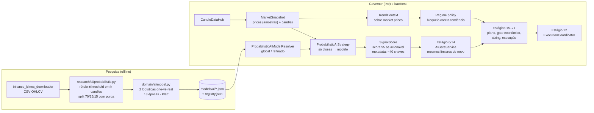
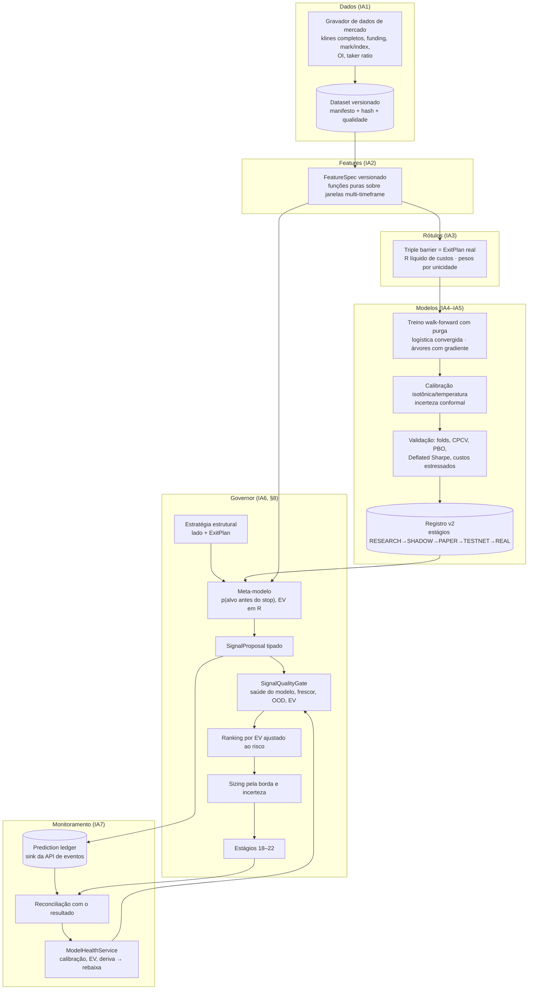
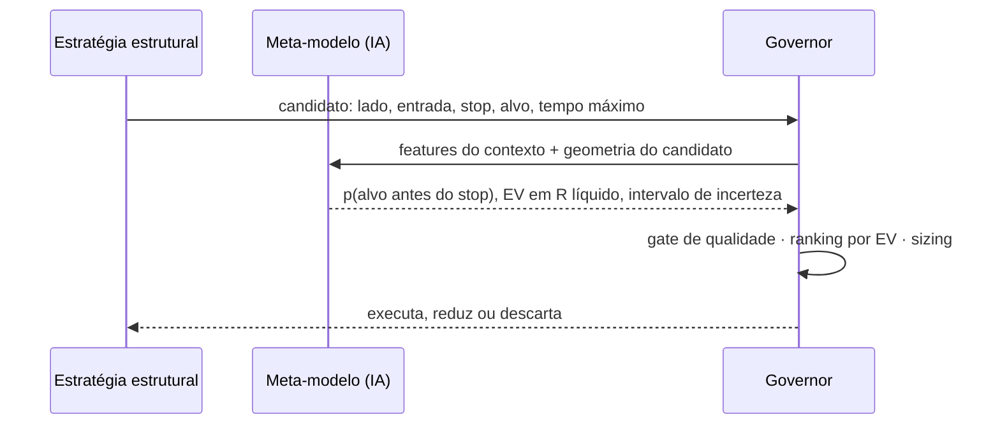
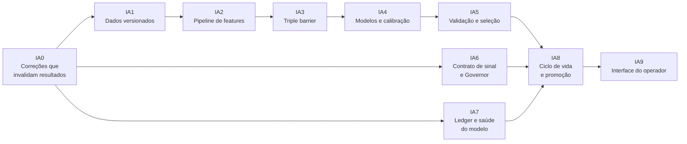

# Alphora — Plano de confiabilidade da IA e dos sinais

> **O que é:** o diagnóstico da IA probabilística e da cadeia de sinais do Governor, e o plano para torná-los
> confiáveis: o que corrigir primeiro, a arquitetura-alvo, as fases com critério de saída e o backlog.  
> **Base:** código da `main` em 16/11/2026 (depois da M7). Toda afirmação aponta para o arquivo que a demonstra;
> os achados marcados **[medido]** foram reproduzidos com um experimento descrito no texto.  
> **Relação com outros planos:** concretiza os itens RES-01 a RES-08 do
> [roadmap de prontidão](REAL_MARKET_READINESS_ROADMAP.md) e o OPT-020 do
> [Plano Diretor](ALPHORA_SOFTWARE_ENGINEERING_OPTIMIZATION_PLAN.md); usa a API de eventos da M7
> ([ADR-006](architecture/ADR-006-single-event-api.md)) e os estágios compartilhados da M6.  
> **Regra que vale para o plano inteiro:** nenhum modelo ou sinal é promovido por calibração ou por retorno
> dentro da amostra. Promoção exige edge líquido fora da amostra, com os critérios da §7 fixados **antes** da pesquisa.

---

## Sumário

- [1. Resumo executivo](#1-resumo-executivo)
- [2. Como a IA e os sinais funcionam hoje](#2-como-a-ia-e-os-sinais-funcionam-hoje)
- [3. Diagnóstico](#3-diagnóstico)
- [4. O que é um sinal confiável](#4-o-que-é-um-sinal-confiável)
- [5. Arquitetura-alvo](#5-arquitetura-alvo)
- [6. Fases](#6-fases)
- [7. Critérios de promoção e métricas](#7-critérios-de-promoção-e-métricas)
- [8. O Governor em conjunto com a IA](#8-o-governor-em-conjunto-com-a-ia)
- [9. Decisões de arquitetura a registrar](#9-decisões-de-arquitetura-a-registrar)
- [10. Backlog](#10-backlog)
- [11. Os primeiros 12 PRs](#11-os-primeiros-12-prs)
- [12. Riscos e o que não fazer](#12-riscos-e-o-que-não-fazer)

---

## 1. Resumo executivo

**Veredito.** A IA atual não produz um sinal em que se possa confiar, e o motivo não é falta de sofisticação do
modelo: há defeitos que invalidam os números medidos até hoje.

1. **O modelo ao vivo não vê os mesmos dados do treino [medido].** O treino calcula as 12 features sobre candles
   OHLCV; a estratégia entrega ao modelo só os preços de fechamento. Cinco features (amplitude, corpo, posição do
   fechamento, ATR e z-score de volume) viram zero ou mudam de escala no live **e no backtest**. As métricas de
   prontidão do treino descrevem outro modelo.
2. **O otimizador não converge [medido].** 18 épocas de gradiente com passo 0,04 recuperam ~6,5% do peso verdadeiro
   num problema sintético (0,052 contra 0,8). O “modelo logístico” é, na prática, uma pontuação de correlação
   reescalada pela calibração.
3. **Rótulo, saída e decisão descrevem trades diferentes.** O rótulo pergunta “o fechamento daqui a *h* candles passou
   de ±*x* bps?”; a posição sai por stop/take fixo (1%/2% por padrão) **ou** quando a probabilidade cai abaixo de
   0,44, o que costuma acontecer no candle seguinte. O modelo é avaliado num trade que o robô não faz.
4. **O regime do Governor é medido numa escala de tempo que muda sozinha.** A tendência (MA20/MA50, volatilidade,
   chop) é calculada sobre amostras de preço acrescentadas a cada avaliação — a cada 2 s para um símbolo HOT, a cada
   90 s para um COLD —, enquanto o backtest usa fechamentos de candle. O filtro de contra-tendência não é o mesmo
   nos dois mundos.
5. **Não há caminho de promoção nem monitoramento.** O treino bloqueia TESTNET e REAL por construção, nada mede o
   desempenho real das previsões e nada rebaixa um modelo que deixou de funcionar.

**O que o plano entrega.** Em ordem:

- **IA0 (dias):** corrigir os cinco defeitos e provar paridade treino = backtest = live. Os resultados anteriores da IA
  passam a ser tratados como inválidos.
- **IA1–IA3:** dados versionados e mais ricos (fluxo de ordens, funding, open interest, múltiplos timeframes), um
  pipeline de features único e rótulos *triple barrier* iguais à política de saída real.
- **IA4–IA5:** modelos fortes o bastante para o problema (logística convergida, árvores com gradiente), calibração e
  incerteza explícitas, validação walk-forward com purga, CPCV e controle de testes múltiplos.
- **IA6–IA8:** um contrato de sinal tipado consumido pelo Governor (gate de qualidade, ranking por valor esperado,
  sizing pela borda e pela incerteza), registro de previsões com reconciliação de resultado, rebaixamento automático
  e ciclo de vida com champion/challenger.

**Mudança de papel recomendada.** Usar a IA primeiro como **meta-rotulador** das estratégias estruturais
(Donchian/ADX e liquidity sweep): a estratégia propõe lado, stop e alvo; a IA estima a probabilidade de o alvo vir
antes do stop e o valor esperado líquido, e o Governor só executa e dimensiona com base nisso. A IA direcional
continua como uma segunda estratégia, promovida em separado (RES-07).

---

## 2. Como a IA e os sinais funcionam hoje

| Peça | Onde | O que faz |
|---|---|---|
| Features | `src/domain/ai/model.py:31` (`extract_ai_features`) | 12 features de uma janela de 20 candles de um timeframe: retornos 1/3/5, distância a MA5/MA20, volatilidade, momentum 10, amplitude, corpo, posição do fechamento, ATR 14, z-score de volume |
| Treino | `src/research/ai/probabilistic.py:72` | Rótulos long/short por retorno de fechamento em `horizon_candles`; split cronológico 70/15/15 com purga de `horizon` linhas; duas logísticas independentes; calibração Platt na validação; métricas no teste |
| Ajuste | `src/domain/ai/model.py:196` | Gradiente em lote, 18 épocas, passo 0,04 decaindo, L2 0,02 |
| Probabilidades | `src/domain/ai/probabilistic.py:172` | Sigmoide de cada lado; se a soma passa de 0,99 é reescalada; neutro = resto |
| Prontidão | `src/research/ai/probabilistic.py:578` | `PAPER_CANDIDATE` se ≥ 2.000 linhas de treino, ≥ 500 de teste, ECE ≤ 0,10, ≥ 100 trades selecionados, expectancy > 0 e PF ≥ 1,10; TESTNET e REAL sempre bloqueados |
| “Refino” por símbolo | `src/research/ai/probabilistic.py:391` | Treina do zero com os dados do símbolo; o modelo global aparece só como metadado (`parent_global_model_id`) |
| Estratégia | `src/strategies/futures/ai/probabilistic_strategy.py` | Abre com `p ≥ 0,62`, gap ≥ 0,18 e EV ≥ 3 bps; fecha long se `p_short ≥ 0,62` **ou** `p_long ≤ 0,44` |
| Score | `probabilistic_strategy.py:522` | 95 para qualquer sinal acionável; senão `10 + 75·p` |
| Gate | `src/governor/services/ai_gate.py` | Repete limiares, exige modelo aprovado para o modo (DRY_RUN sempre passa) |
| Regime | `src/governor/services/trend_context.py:60` | `TrendContextEngine` sobre `market.prices` |
| Ranking | `src/governor/opportunity_ranker.py` | Score base + bônus fixos (prioridade, fast lane, posição aberta), sem valor esperado |
| Learning | `src/trading/learning*.py` (~4.050 linhas) | Estatísticas por balde de resultados de planos; quase tudo em modo sombra; não conhece as previsões da IA |

---

## 3. Diagnóstico

Severidade: **S1** invalida resultados ou decisões; **S2** reduz a qualidade do sinal de forma sistemática;
**S3** limita evolução, auditoria ou operação.

### 3.1. Dados e features

| # | Achado | Evidência | Consequência | Sev. |
|---:|---|---|---|---|
| D1 | **Descompasso treino/inferência [medido].** A estratégia passa `[c.close for c in series]` ao modelo; o treino passa objetos `Candle`. | `probabilistic_strategy.py:259`; `research/data_loader.py:21`. Experimento: mesma janela de 20 candles → `range_pct_1`, `body_pct_1`, `close_location_1` e `volume_zscore_20` viram 0 no formato live; `atr_pct_14` cai de 0,0058 para 0,0023. | Depois da padronização, os zeros viram deslocamentos de várias σ: as probabilidades do live e do backtest são enviesadas e as métricas do treino não se aplicam. O rótulo de origem (`data_source = candle_ohlcv_…`) mente. | S1 |
| D2 | Nenhum teste compara features do treino com as do live/backtest. | `tests/strategies/test_probabilistic_ai.py` (13 testes, nenhum de paridade) | D1 passou despercebido. | S1 |
| D3 | Informação pobre: um timeframe, 20 candles, só OHLCV; o `Candle` descarta `quote_volume`, número de trades e volume comprador (*taker buy*) que a Binance já entrega no kline. | `domain/candle.py:9`; `research/binance_klines_downloader.py` | Sem contexto de timeframe maior, fluxo de ordens, funding, open interest, base ou mercado (BTC). Doze features de preço de curto prazo têm pouco poder num mercado eficiente. | S2 |
| D4 | Features em escala absoluta, padronizadas com estatísticas do treino inteiro, misturando símbolos com volatilidades diferentes. | `_feature_stats` em `domain/ai/model.py:146`; treino global concatena séries | O modelo global aprende a volatilidade de cada moeda, não o padrão; a padronização envelhece quando o regime muda. | S2 |
| D5 | Dados de open interest, long/short e taker ratio da Binance (`/futures/data/*`) só têm ~30 dias de histórico. | API pública da Binance | Se não começarmos a gravá-los agora, nunca haverá histórico para treinar com eles. | S3 |

### 3.2. Rótulos e objetivo

| # | Achado | Evidência | Consequência | Sev. |
|---:|---|---|---|---|
| L1 | Rótulo por retorno de fechamento a fechamento, sem trajetória. | `research/ai/probabilistic.py:444-469` | Não diz se o stop seria atingido antes; um trade “vencedor” no rótulo pode ter sido stopado. | S1 |
| L2 | **Rótulo, saída e fechamento descrevem trades diferentes.** Rótulo: ±`threshold` em `horizon` candles. Saída: stop/take do `exit_model` (1%/2% ou ATR). Fechamento antecipado: `p_long ≤ min_long − gap = 0,44`. | `probabilistic_strategy.py:72-85`, `config/sections/trading.py` | A probabilidade de entrada vale ~0,62 e a taxa-base do evento fica bem abaixo disso: a regra de fechamento tende a disparar no candle seguinte, muito antes do horizonte previsto. A expectativa do modelo não é a do trade executado. | S1 |
| L3 | O limiar padrão da biblioteca (10 bps) é menor que o custo padrão (15 bps); CLI usa 40 bps/8 candles, biblioteca 10 bps/5 candles. | `probabilistic.py:39,49,79`; `research/cli.py:214-215` | Com os padrões da biblioteca, todo evento “positivo” pode ser prejuízo líquido. Defaults divergentes tornam experimentos incomparáveis. | S2 |
| L4 | Custo fixo de 15 bps no artefato, separado do modelo de custos do Governor (taxas, spread, slippage, funding por símbolo). | `DEFAULT_ESTIMATED_ROUND_TRIP_COST_BPS`; `futures/costs` | O EV da IA e o gate econômico usam custos diferentes. | S2 |
| L5 | Avaliação econômica fora da amostra conta um “trade” por candle, com horizontes sobrepostos. | `_out_of_sample_economic_metrics` em `probabilistic.py:624-674` | 100 “trades” podem ser 15 eventos independentes; PF e expectancy ficam com variância subestimada. | S2 |

### 3.3. Modelo, calibração e validação

| # | Achado | Evidência | Consequência | Sev. |
|---:|---|---|---|---|
| M1 | **Otimizador sem convergência [medido].** 18 épocas, passo 0,04 com decaimento. | `domain/ai/model.py:10-12,196-240`. Experimento: 3.000 linhas sintéticas com pesos verdadeiros (+0,8, −0,6, +0,5) → após 18 épocas (+0,052, −0,049, +0,034); após 150 épocas, ~17% do valor. | Os pesos ficam proporcionais às correlações univariadas; features correlacionadas (retornos 1/3/5, momentum) não são separadas. A calibração Platt só reescala um eixo. | S1 |
| M2 | Duas logísticas one-vs-rest com probabilidades remendadas (reescala quando a soma passa de 0,99). | `domain/ai/probabilistic.py:172-205` | As três probabilidades não vêm de um modelo coerente; `p_neutral` é um resíduo. | S2 |
| M3 | Um único split cronológico; limiares de decisão (0,62; 0,18; 3 bps) não são escolhidos na validação; nenhuma contagem de tentativas. | `_purged_chronological_split`; `_out_of_sample_economic_metrics` | Alta variância e risco de seleção: um bom resultado num teste pode ser sorte. Não há defesa contra testes múltiplos. | S2 |
| M4 | “Modelo refinado” treinado do zero com menos dados. | `probabilistic.py:391-420` | Mais sobreajuste, não menos; o nome sugere transferência que não existe. | S2 |
| M5 | Sem medida de incerteza ou de “fora da distribuição”. | `predict_probabilistic_event` | O modelo responde com a mesma confiança num regime nunca visto. | S2 |
| M6 | O backtest usa um artefato fixo, sem re-treino por fold. | `backtesting/engine/robustness.py`, `validation.py:55-115` (avisa sobreposição, mas não re-treina) | O período fora da amostra é um único holdout; não há walk-forward do pipeline completo. | S2 |

### 3.4. Integração com o Governor

| # | Achado | Evidência | Consequência | Sev. |
|---:|---|---|---|---|
| G1 | **Regime numa escala de tempo variável.** `market.prices` é um `deque` que ganha uma amostra a cada snapshot montado; o backtest passa um fechamento por candle. | `market_data/market_snapshots.py:44-45`; `governor/services/trend_context.py:60`; `backtesting/adapters/signal.py:83,133` | MA50 cobre 100 s num símbolo HOT e 75 min num COLD; o filtro de contra-tendência do live não é o do backtest. | S1 |
| G2 | Score 95 para todo sinal acionável. | `probabilistic_strategy.py:522-524` | O ranking não distingue um sinal de EV +2 bps de um de EV +40 bps. | S2 |
| G3 | Ranking de oportunidades por bônus fixos, sem valor esperado, custo ou correlação de retorno. | `governor/opportunity_ranker.py` | Capital e orçamento de checagens pesadas vão para quem tem score alto, não para quem tem edge. | S2 |
| G4 | Sizing não usa probabilidade nem incerteza. | `governor/smart_sizing.py` | Sinais fracos e fortes recebem o mesmo risco. | S2 |
| G5 | Limiares repetidos: estratégia (params) e gate (config) aplicam a mesma regra; o contrato é um `dict` de ~40 chaves. | `ai_gate.py:140-180`; `_prediction_metadata` | Duas fontes de verdade; erros de chave silenciosos; nada tipado entre estratégia e Governor. | S3 |
| G6 | Gate não verifica saúde do modelo: idade do artefato, frescor dos candles, features degeneradas, calibração recente. | `ai_gate.py` | Um modelo velho ou com dados quebrados continua decidindo. | S2 |
| G7 | Sem registro de previsões nem reconciliação com o resultado; o learning não conhece a IA. | `trading/learning*.py`; `ai_gate.record_signal` | Impossível medir Brier, calibração ou EV realizados no live; RES-07/RES-08 não têm dados. | S1 |
| G8 | Sem caminho de promoção: `blocked_for` sempre contém TESTNET e REAL. | `probabilistic.py:298-302` | A IA nunca pode passar de paper, mesmo com evidência. | S3 |
| G9 | Três eventos por avaliação leve com o mesmo payload (`ai_probability_signal`, `ai_probability_model_resolved`, `…fallback_used`). | `ai_gate.py:79-83` | Ruído em `governor_events.jsonl`. | S3 |

### 3.5. Evidência de desempenho existente

A [auditoria de lucratividade](auditoria-lucratividade-2026-07-04.md) rejeitou a estratégia estrutural para capital
real (OOS: 24 trades, PF 0,68, expectancy −0,169). Para a IA não há resultado válido: todo backtest de IA feito até
aqui sofreu de D1 e M1. **Ponto de partida honesto: edge desconhecido.**

---

## 4. O que é um sinal confiável

Um sinal só entra no caminho de execução quando cumpre as seis propriedades abaixo, verificadas por teste ou por
monitoramento:

| Propriedade | Definição operacional | Como se verifica |
|---|---|---|
| **Causal** | Usa só dados disponíveis no fechamento do candle de decisão | Teste de prefixo: a mesma decisão a partir do histórico e do stream (RES-02) |
| **Reproduzível** | O mesmo artefato, as mesmas features e a mesma decisão no treino, no backtest e no live | Teste de paridade de features e de decisão; hash de dataset e de schema de features no artefato |
| **Calibrado** | “70%” acontece ~70% das vezes | ECE e Brier fora da amostra; monitorados no live |
| **Com edge líquido** | Valor esperado positivo **depois** de taxas, spread, slippage e funding, no trade realmente executado | Walk-forward com custos estressados, trades não sobrepostos, intervalo de confiança |
| **Estável** | O edge não depende de um período, de um símbolo ou de um parâmetro afinado | Folds, regimes, perturbação de parâmetros, PBO, Deflated Sharpe |
| **Vigiado** | O sistema percebe quando deixa de valer e se rebaixa sozinho | Registro de previsões, deriva de features, calibração e EV realizados, regras de rebaixamento |

---

## 5. Arquitetura-alvo

### 5.1. Visão geral

### 5.2. Princípios

1. **Uma definição de feature, três consumidores.** Treino, backtest e live chamam o mesmo `FeaturePipeline` sobre o
   mesmo tipo de entrada (`CandleWindow`). Quem muda uma feature muda o `feature_schema_version`, e o resolver recusa
   artefatos de outro schema.
2. **O rótulo é o trade.** O alvo do modelo é o resultado da política de saída que o Governor executa, com os mesmos
   custos. Não existe “horizonte do modelo” separado do “horizonte da posição”.
3. **Inferência leve, pesquisa completa.** O live continua sem dependência numérica pesada e lê artefatos JSON
   (logística ou ensemble de árvores serializado). A pesquisa pode usar numpy, scikit-learn e LightGBM como extra
   opcional (ADR, §9).
4. **A IA propõe, o Governor decide.** O modelo devolve probabilidade, EV e incerteza; limiares, sizing e permissão
   pertencem ao Governor, com uma só fonte de configuração.
5. **Tudo o que decide é registrado.** Cada previsão vira um evento com identidade, e o resultado do trade volta
   para ela. Sem esse laço não há promoção.
6. **Rebaixar é automático, promover é deliberado.** Degradação medida tira o modelo do caminho de execução sem
   intervenção; promoção exige evidência registrada e aprovação explícita.

### 5.3. Papel da IA: meta-rotulagem primeiro

Por que primeiro: a estratégia estrutural já define stops e alvos coerentes (`PlannedExit`), então o rótulo
*triple barrier* sai naturalmente; o problema do modelo fica binário e mais fácil (“este candidato vale a pena?”) e
o ganho aparece mesmo com poder preditivo modesto, porque filtrar os piores trades de uma estratégia de PF 0,7 é mais
viável que prever direção do zero. A IA direcional (§6, IA4) segue como estratégia própria, medida e promovida em
separado.

---

## 6. Fases

Cada fase tem objetivo, passos, critério de saída e rollback. **IA0 é pré-requisito de todas.** IA1/IA2 e IA7 podem
andar em paralelo; IA6 pode começar com o contrato e o gate assim que IA0 terminar.

### IA0 — Correções que invalidam os resultados atuais

**Objetivo:** o modelo existente passa a ser medido corretamente. Nada de modelo novo nesta fase.

| Passo | Mudança | Prova |
|---|---|---|
| IA0.1 | A estratégia entrega ao modelo os objetos `Candle` do intervalo do modelo, não `c.close` (`probabilistic_strategy.py:259`). `predict_probabilistic_event` recusa entrada sem OHLCV quando o `input_contract` exige OHLCV. | Teste de paridade: para o mesmo prefixo de candles, as features do treino (`_probabilistic_training_rows_from_values`), do backtest (`HistoricalSignalPort`) e do live (`ProbabilisticAIStrategy`) são idênticas, campo a campo |
| IA0.2 | Ajuste por Newton/IRLS com L2 e critério de convergência (‖Δw‖ < 1e-6 ou 50 iterações) no lugar do gradiente de 18 épocas. Puro Python: Hessiana 12×12 por iteração. | Teste sintético: recupera pesos verdadeiros com erro relativo < 5% em 20.000 linhas; log-loss de validação ≤ a da versão atual |
| IA0.3 | `threshold_bps` precisa ser maior que o custo de ida e volta; defaults únicos num só lugar (constante de domínio usada por biblioteca, CLI e desktop). | Teste de configuração; CLI e desktop leem a mesma constante |
| IA0.4 | Tendência e regime calculados sobre **candles fechados** de um timeframe declarado (`ALPHORA_TREND_TIMEFRAME`, padrão = timeframe primário da estratégia), igual no live e no backtest. | Teste diferencial live × backtest do `TrendContext` sobre os mesmos candles; golden atualizado com rótulo `behavior-change` |
| IA0.5 | Fechamento por probabilidade com histerese coerente: permanência mínima = horizonte do modelo, limiar de saída exposto na configuração e validado no backtest; a regra antiga (`p_long ≤ 0,44`) fica opcional. | Backtest com e sem a regra; distribuição do tempo de permanência registrada |
| IA0.6 | `feature_schema_version` e `algorithm_version` novos; o resolver recusa artefatos antigos com o motivo `AI_MODEL_SCHEMA_OUTDATED`; relatórios de backtest de IA anteriores marcados como inválidos. | Teste do resolver; nota no registro |
| IA0.7 | Um evento por avaliação de IA (sai a duplicata `ai_probability_model_resolved`). | Teste do gate |

**Critério de saída:** paridade de features no CI; teste de convergência; regime por candles; modelos re-treinados
e re-avaliados com o pipeline corrigido; relatório “linha de base honesta” com o resultado (provavelmente sem edge —
e tudo bem, é o ponto de partida).

**Situação (17/11/2026):** IA0.1 `4515643`, IA0.2 `72d56d5`, IA0.3 `1dab033`, IA0.4 `84e470e`, IA0.5 `39fef13`,
IA0.6 `30bf5c9` e IA0.7 `e0a73c4` entregues, com os testes de paridade de features, de convergência, de paridade do
regime live × backtest e da regra de permanência. Falta o relatório de linha de base (AI-007), que exige dados
históricos e espaço em disco. O trabalho seguinte segue o [plano da previsão de
oportunidade](AI_OPPORTUNITY_FORECAST_PLAN.md).  
**Rollback:** cada passo é um PR; IA0.4 e IA0.5 mudam comportamento e entram com o rótulo `behavior-change`.

### IA1 — Dados versionados e mais ricos

**Objetivo:** dados suficientes, causais e auditáveis (RES-01).

1. **Klines completos.** O `Candle` ganha `quote_volume`, `trade_count`, `taker_buy_base_volume` e
   `taker_buy_quote_volume` (campos 7–10 do kline da Binance), opcionais para compatibilidade; downloader e CSV
   passam a gravá-los.
2. **Novas séries:** funding (já existe), mark price e index price klines, premium index, e — por terem só ~30 dias de
   histórico na API — um **gravador contínuo** de open interest, long/short ratio e taker buy/sell ratio, começando já.
3. **Manifesto de dataset:** cada experimento referencia um manifesto com símbolos, intervalos, janelas, cobertura,
   lacunas, duplicatas, fuso, origem e hash; o hash entra no artefato do modelo.
4. **Gates de qualidade:** lacunas, candles duplicados, OHLC inconsistente, volume zero prolongado e desalinhamento
   entre timeframes falham o dataset antes do treino.
5. **Painel multi-símbolo alinhado no tempo**, para features de mercado (retorno e volatilidade do BTC, amplitude do
   mercado).

**Critério de saída:** dataset de ≥ 2 anos em 15m/1h/4h para o universo-alvo, com manifesto, gates aprovados e
gravador rodando.

### IA2 — Pipeline de features único

**Objetivo:** uma definição de feature, usada igual em treino, backtest e live.

- `FeatureSpec` versionado (nome, função pura, janelas e timeframes exigidos, dependências de dados) e um
  `FeaturePipeline` que monta o vetor a partir de um `CandleWindow` multi-timeframe e das séries auxiliares.
- O `StrategyDataRequirements` passa a ser derivado do pipeline (histórico e timeframes exigidos), de modo que o
  Governor busque exatamente o que o modelo precisa.
- **Famílias de features** (escolhidas por hipótese, cada família medida por ablação):

| Família | Exemplos | Por quê |
|---|---|---|
| Retorno e momentum normalizados por volatilidade | retornos 1/4/16 candles ÷ ATR; inclinação de EMA do timeframe maior | Comparáveis entre símbolos e regimes |
| Volatilidade | Parkinson, Garman–Klass, razão vol curta/longa, percentil de ATR | Regime de volatilidade muda o payoff |
| Estrutura | posição no canal Donchian, distância a máximas/mínimas de N candles, contagem de toques | Contexto de rompimento/reversão das estratégias estruturais |
| Fluxo de ordens | razão taker buy, delta de volume, volume relativo por horário | Pressão compradora/vendedora |
| Derivativos | funding e sua variação, premium/base, variação de OI | Posicionamento e custo de carregar |
| Mercado | retorno e volatilidade do BTC, beta, correlação móvel, amplitude | Risco sistêmico |
| Tempo | hora e dia da semana (seno/cosseno), proximidade de funding | Sazonalidade intradiária |
| Regime | rótulo do `TrendContext` por candles, chop, eficiência de Kaufman | Permite modelos condicionais ao regime |
| Geometria do candidato (meta-modelo) | distância ao stop e ao alvo em ATR, R:R, custo/alvo | O meta-modelo julga o trade proposto |

- Normalização causal: z-score rolante por símbolo em vez de estatísticas fixas do treino inteiro.
- Testes: paridade (§IA0.1) para cada feature; causalidade (feature no candle *t* não muda quando chegam candles
  > *t*); estabilidade (PSI por feature entre folds).

**Critério de saída:** pipeline usado pelos três consumidores; teste de paridade e de causalidade por feature; o
modelo de IA0 reproduzido pelo pipeline novo com as mesmas 12 features (equivalência antes de acrescentar).

### IA3 — Rótulos iguais à política de trade

**Objetivo:** o modelo aprende o resultado do trade que o robô executa.

- **Triple barrier**: para cada candidato, barreira superior = alvo, inferior = stop (em ATR, da `PlannedExit` da
  estratégia ou do `exit_model` configurado), vertical = tempo máximo de permanência. O rótulo é qual barreira veio
  primeiro, usando a máxima e a mínima de cada candle (e regra conservadora quando ambas ocorrem no mesmo candle).
- **Alvo econômico:** R realizado **líquido** de taxas, spread, slippage e funding, com os mesmos parâmetros do modelo
  de custos do Governor (`futures/costs`), por símbolo.
- **Sobreposição:** pesos por unicidade (eventos que compartilham candles pesam menos) e avaliação econômica só com
  trades não sobrepostos (corrige L5).
- **Dois conjuntos de rótulos:** meta-rótulos (candidatos das estratégias estruturais) e rótulos direcionais
  (candidato sintético long e short em cada candle) para a IA direcional.
- A política de saída do live usa as mesmas barreiras: o tempo máximo vira uma saída real (hoje inexistente para a
  IA), e saídas antecipadas por probabilidade só existem se validadas.

**Critério de saída:** gerador de rótulos com testes de casos-limite (gap, stop e alvo no mesmo candle, funding no
meio); a taxa de acerto e o R médio dos rótulos reproduzem o backtest da estratégia estrutural no mesmo período.

### IA4 — Modelos, calibração e incerteza

**Objetivo:** o modelo mais simples que vence as linhas de base fora da amostra, com probabilidades confiáveis.

1. **Linhas de base obrigatórias** em todo relatório: não operar; estratégia estrutural sem filtro; filtro aleatório
   com a mesma taxa de seleção; logística convergida com as 12 features antigas.
2. **Candidatos:** logística multinomial convergida (IRLS); logística com interações escolhidas; **árvores com
   gradiente** (LightGBM na pesquisa, ensemble exportado para JSON e avaliado por um interpretador puro no live);
   modelos condicionais ao regime só se a ablação mostrar ganho.
3. **Agrupamento hierárquico no lugar do “refino” do zero:** um modelo global com features normalizadas por símbolo
   e, quando houver dados, ajuste por símbolo com encolhimento em direção ao global (*warm start* + regularização para
   os pesos globais). Símbolo com poucos dados usa o global.
4. **Calibração** em folds de validação (isotônica ou temperatura; Platt só como linha de base) e verificação de
   ECE por fold.
5. **Incerteza:** previsão conformal (conjunto de rótulos com cobertura garantida) ou dispersão de um ensemble; o sinal
   se abstém quando o conjunto é ambíguo. **Fora da distribuição:** distância de Mahalanobis ou PSI do vetor de
   features contra o treino; acima do limite, o sinal sai como `ABSTAIN`.
6. **Explicação por sinal:** contribuição por feature (exata na logística; *tree SHAP* nas árvores) gravada no
   ledger, para auditoria e para a interface.

**Critério de saída:** pelo menos um candidato vence todas as linhas de base em EV líquido fora da amostra, com ECE ≤
0,03 e Brier skill score > 0 em todos os folds; artefato com schema de features, dataset hash, código, semente e
métricas por fold.

### IA5 — Validação e seleção sem se enganar

**Objetivo:** distinguir edge de sorte (RES-03, RES-04, RES-06).

- **Walk-forward do pipeline inteiro** (features → rótulos → treino → calibração → limiares) com purga e embargo, em
  janela expansiva e rolante; o backtest re-treina por fold em vez de usar um artefato fixo (corrige M6).
- **CPCV** (validação cruzada combinatória com purga) para estimar a **probabilidade de sobreajuste de backtest
  (PBO)**.
- **Registro de tentativas:** toda configuração avaliada é contada; o Sharpe é deflacionado pelo número de tentativas
  (**Deflated Sharpe Ratio**).
- **Limiares escolhidos na validação**, nunca no teste; holdout final intocado e de data posterior a toda a pesquisa.
- **Estresse:** custos +50% e +100%, slippage observado (RES-05), atraso de um candle na execução, retirada do melhor
  símbolo e do melhor mês.
- **Recortes obrigatórios:** por símbolo, por regime (tendência/lateral, vol alta/baixa), por lado e por mês.

**Critério de saída:** relatório reproduzível que passa os critérios da §7.1; tentativas e decisões registradas.

### IA6 — Contrato de sinal e integração com o Governor

Detalhada na §8. Entrega o `SignalProposal` tipado, o `SignalQualityGate`, ranking por EV, sizing pela borda e a IA
dentro dos estágios compartilhados live/backtest.

### IA7 — Registro de previsões, reconciliação e saúde do modelo

**Objetivo:** medir o modelo em produção e agir sozinho quando ele piora (RES-07, RES-08).

1. **Prediction ledger**: cada previsão (inclusive `ABSTAIN` e as sombra) vira um registro com `prediction_id`,
   modelo, schema de features, hash do vetor, probabilidades, EV, incerteza, decisão do Governor e motivo. Entra pela
   API de eventos da M7 (canal `AUDIT`) e num journal próprio em `data/predictions_<ambiente>.jsonl`, com dono no
   `JournalRegistry`.
2. **Reconciliação:** quando a barreira (ou o tempo) fecha, o resultado realizado — inclusive dos sinais não
   executados, calculado a partir dos candles — é ligado ao `prediction_id`. Sinais filtrados também precisam de
   resultado, senão não se mede o valor do filtro.
3. **`ModelHealthService`** no Governor, com estados `HEALTHY → DEGRADED → SUSPENDED`, avaliados por janela móvel:
   ECE e Brier, EV realizado contra previsto (com intervalo de confiança), taxa de acerto por faixa de probabilidade,
   PSI por feature, frescor e integridade dos dados de entrada, taxa de abstenção.
4. **Ações:** `DEGRADED` corta o sizing pela metade e alerta; `SUSPENDED` tira o modelo do caminho de execução (vira
   sombra) até nova promoção. O estado alimenta o `SignalQualityGate` e o modo defensivo, e aparece no
   `governor_cycle_metrics` ao lado do `stage_telemetry` (G9).

**Critério de saída:** ledger e reconciliação funcionando em paper; regras de rebaixamento testadas com séries
sintéticas de deriva.

### IA8 — Ciclo de vida e promoção

**Objetivo:** promover com evidência e voltar atrás em segundos.

- **Registro v2** com estágios `RESEARCH → SHADOW → PAPER → TESTNET → REAL`, cada transição exigindo a evidência da
  §7.2 e gravando quem aprovou, quando e o hash da evidência. Sai o bloqueio fixo de TESTNET/REAL no treino.
- **Champion/challenger:** o Governor roda os desafiantes em sombra sobre os mesmos snapshots; o ledger compara.
- **Re-treino periódico** (cadência do walk-forward), sempre como desafiante; nunca substitui o campeão sozinho.
- **Validade do artefato:** idade máxima configurável; vencido, o gate trata como `DEGRADED`.
- **Rollback** por troca de ponteiro no registro, sem reiniciar o processo.

**Critério de saída:** um modelo percorre RESEARCH → SHADOW → PAPER com evidência registrada; rollback testado.

### IA9 — Interface do operador

Página de IA no desktop: cartão do modelo (dados, métricas por fold, calibração), estado de saúde ao vivo, ledger
com explicação por sinal, comparação campeão × desafiante e o fluxo de promoção. Depende do contrato versionado da
ponte (OPT-014).

---

## 7. Critérios de promoção e métricas

### 7.1. Para sair da pesquisa (RESEARCH → SHADOW)

Fixados antes de olhar o holdout; alinhados com a auditoria (PF > 1,20) e o RES-04.

| Critério | Limite |
|---|---|
| Trades fora da amostra, não sobrepostos | ≥ 100 no walk-forward e ≥ 30 no holdout final |
| Expectancy líquida | > 0, com limite inferior do IC 95% (bootstrap por blocos) > 0 |
| Profit factor | ≥ 1,20 no agregado; ≥ 1,0 com custos +50% |
| Folds | Maioria lucrativa; nenhum fold com drawdown > 2× a mediana |
| Calibração | ECE ≤ 0,03; Brier skill score > 0 contra a taxa-base em todos os folds |
| Sobreajuste | PBO ≤ 0,20; Deflated Sharpe ≥ 0,95 |
| Linhas de base | Vence todas as da IA4 em EV líquido |
| Robustez | Sem colapso ao retirar o melhor símbolo ou o melhor mês |

### 7.2. Para avançar no ciclo de vida

| Transição | Evidência |
|---|---|
| SHADOW → PAPER | ≥ 4 semanas em sombra; EV realizado no ledger dentro do IC previsto; ECE ao vivo ≤ 0,05; zero incidentes de paridade |
| PAPER → TESTNET | ≥ 50 trades paper; expectancy > 0 com IC; slippage simulado × observado medido (RES-05) |
| TESTNET → REAL | ≥ 100 trades testnet; critérios de 7.1 refeitos sobre dados novos; aprovação humana registrada; limites de capital iniciais reduzidos |

### 7.3. Métricas que todo relatório e o monitoramento mostram

| Métrica | Por quê |
|---|---|
| Expectancy líquida em R e em bps, com IC | Edge real depois de custos |
| Profit factor, win rate, payoff | Forma da distribuição de resultados |
| Brier, Brier skill, log loss, ECE, curva de confiabilidade | Qualidade das probabilidades |
| EV previsto × realizado por faixa de probabilidade | O sinal mede o que promete? |
| Taxa de seleção e de abstenção | Se o filtro está seletivo demais ou de menos |
| PSI por feature, distância OOD | Deriva de dados |
| Drawdown, tempo de recuperação, sequência de perdas | Risco operacional |
| Recortes por símbolo, regime, lado, mês | Estabilidade |

---

## 8. O Governor em conjunto com a IA

Mudanças no Governor para que ele use bem um sinal confiável — e para que o sinal não seja estragado no caminho.

### 8.1. Contrato de sinal tipado

`domain/signals.py` define o `SignalProposal` (imutável, tipado), que substitui o `SignalScore.metadata` de ~40
chaves no caminho de decisão:

| Campo | Conteúdo |
|---|---|
| `side`, `action` | `LONG`/`SHORT`, `OPEN`/`CLOSE`/`ABSTAIN` |
| `exit_plan` | stop, alvo, tempo máximo (a mesma estrutura usada no rótulo) |
| `p_target_first`, `p_stop_first`, `p_timeout` | Probabilidades calibradas que somam 1 |
| `expected_r_net`, `expected_bps_net` | Valor esperado líquido do modelo de custos do Governor |
| `uncertainty` | Intervalo ou conjunto conformal; flag de fora da distribuição |
| `provenance` | `model_id`, estágio do registro, `feature_schema_version`, `dataset_hash`, `prediction_id` |
| `data_quality` | Idade do último candle, features degeneradas, séries auxiliares ausentes |
| `regime` | `TrendContext` por candles |
| `explanation` | Principais contribuições por feature |

O `SignalScore` continua existindo para o scheduler (prioridade de reavaliação), mas o score passa a ser derivado do
EV e da incerteza, e não um 95 fixo.

### 8.2. Mudanças por estágio

| Estágio | Hoje | Alvo |
|---|---|---|
| 1 Contexto leve | Tendência sobre amostras de preço | `TrendContext` sobre candles fechados (IA0.4); features da IA calculadas uma vez por candle fechado e reutilizadas |
| 6/14 Guards | `AIGateService` repete limiares do `dict` | **`SignalQualityGate`**: estágio do modelo no registro, estado do `ModelHealthService`, frescor, features degeneradas, OOD, incerteza, EV mínimo — uma fonte de limiares (política do artefato + sobreposição limitada pela configuração) |
| 8 Orçamento | Por score/prioridade | Checagens pesadas priorizadas por EV esperado do candidato |
| 10 Decisão | `decide_symbol` devolve `TradeDecision` | Estratégia estrutural → candidato com `exit_plan`; meta-modelo → `SignalProposal` |
| 15 Plano/gate econômico | Stop/take do `exit_model`; custos próprios | Usa o `exit_plan` do proposal; o mesmo modelo de custos do rótulo |
| 17 Smart sizing | R:R e razão custo/recompensa | **Sizing pela borda:** fração de Kelly limitada (¼ Kelly, teto por trade e por grupo), descontada pela incerteza e pelo estado de saúde |
| 18 Risco de portfólio | Limites e grupos de correlação configurados | Seleção entre candidatos simultâneos por EV ajustado ao risco, com correlação de retornos medida (RSK-07) |
| Gestão da posição | Fecha por `p ≤ 0,44` | Saída por barreiras + tempo máximo; saída antecipada só por regra validada no backtest, com permanência mínima |
| Telemetria | `stage_telemetry` (G9) | + estado do modelo, taxa de abstenção e EV previsto agregados no `governor_cycle_metrics` |

### 8.3. Paridade live/backtest

Os estágios de IA (meta-modelo, `SignalQualityGate`, sizing pela borda) entram em `build_decision_kernel_stages`,
como os estágios 17 e 20 na M6, para que o backtest rode **os mesmos objetos**. Um cenário golden novo
(`ai_meta_label_entry`) e um teste diferencial live × backtest com um artefato de IA fixam o comportamento.

### 8.4. Ranking e alocação

O `OpportunityRanker` passa a ordenar por EV líquido ajustado ao risco (`expected_r_net` descontado pela incerteza),
mantendo os bônus operacionais só para atenção a posições abertas e fast lane. Quando o orçamento de posições é menor
que o número de candidatos, escolhe-se o conjunto de maior EV agregado respeitando grupos de correlação.

---

## 9. Decisões de arquitetura a registrar

| ADR | Decisão proposta | Alternativa descartada |
|---|---|---|
| ADR-007 · Pilha numérica | Pesquisa com numpy, scikit-learn e LightGBM como extra opcional (`pip install alphora[research]`); live continua sem dependência numérica, lendo JSON | Levar LightGBM ao live (dependência binária no motor de execução) |
| ADR-008 · Papel da IA | Meta-rotulagem das estratégias estruturais como papel principal; IA direcional como estratégia separada | Só IA direcional (problema mais difícil, sem geometria de trade) |
| ADR-009 · Contrato de sinal | `SignalProposal` tipado em `domain/` no caminho de decisão | Continuar com `metadata: dict` |
| ADR-010 · Rótulo | Triple barrier igual à política de saída, R líquido de custos | Retorno de fechamento em horizonte fixo |
| ADR-011 · Ledger e ciclo de vida | Ledger de previsões como sink da API de eventos; registro v2 com estágios e rebaixamento automático | Promoção manual por arquivo, sem monitoramento |

---

## 10. Backlog

Prioridade: **P0** bloqueia confiança no sinal; **P1** necessário para promover; **P2** evolução.
Tamanho: P (≤ 2 dias), M (≤ 1 semana), G (> 1 semana).

| ID | P | Item | Tam. | Depende | Pronto quando |
|---|---|---|---|---|---|
| AI-001 | P0 | Passar `Candle` ao modelo no live e no backtest (D1) | P | — | Teste de paridade de features treino/backtest/live no CI |
| AI-002 | P0 | Otimizador IRLS convergente (M1) | P | — | Teste sintético recupera pesos com erro < 5% |
| AI-003 | P0 | Limiar > custo e defaults únicos (L3) | P | — | Validação falha com limiar ≤ custo; CLI/desktop/biblioteca usam a mesma constante |
| AI-004 | P0 | Regime por candles fechados (G1) | M | — | Diferencial live × backtest do `TrendContext`; golden atualizado |
| AI-005 | P0 | Saída por probabilidade com histerese e permanência mínima (L2) | P | AI-001 | Regra configurável, validada no backtest |
| AI-006 | P0 | Versionar schema e recusar artefatos antigos | P | AI-001, AI-002 | Resolver devolve `AI_MODEL_SCHEMA_OUTDATED` |
| AI-007 | P0 | Linha de base honesta re-treinada e re-avaliada | M | AI-001…006 | Relatório walk-forward publicado com o resultado, qualquer que seja |
| AI-008 | P0 | Prediction ledger + reconciliação de resultado | M | — | Toda previsão tem `prediction_id` e resultado ligado, inclusive as não executadas |
| AI-009 | P1 | `Candle` com quote volume, trades e taker buy; downloader atualizado | M | — | Campos gravados e lidos; compatível com CSV antigo |
| AI-010 | P1 | Gravador de OI, long/short e taker ratio; mark/index/premium | M | — | Gravação contínua com manifesto e lacunas monitoradas |
| AI-011 | P1 | Manifesto de dataset e gates de qualidade (RES-01) | M | AI-009 | Treino recusa dataset reprovado |
| AI-012 | P1 | `FeatureSpec`/`FeaturePipeline` multi-timeframe | G | AI-001 | Três consumidores usam o pipeline; testes de paridade e causalidade por feature |
| AI-013 | P1 | Rótulos triple barrier com custos e pesos por unicidade | M | AI-012 | Casos-limite testados; reproduz backtest estrutural |
| AI-014 | P1 | Walk-forward do pipeline completo no backtest, re-treino por fold (M6) | G | AI-012, AI-013 | Relatório por fold com purga e embargo |
| AI-015 | P1 | CPCV, PBO, Deflated Sharpe e registro de tentativas | M | AI-014 | Relatório traz PBO, DSR e número de tentativas |
| AI-016 | P1 | Meta-modelo das estratégias estruturais | G | AI-013, AI-014 | Passa a §7.1 ou fica documentado como sem edge |
| AI-017 | P1 | Calibração isotônica/temperatura e incerteza conformal; abstenção | M | AI-014 | ECE por fold; cobertura conformal verificada |
| AI-018 | P1 | `SignalProposal` tipado (ADR-009) | M | AI-001 | Estágios 6–22 leem o proposal; `metadata` só para log |
| AI-019 | P1 | `SignalQualityGate` (substitui `AIGateService`) | M | AI-018, AI-020 | Uma fonte de limiares; checagens de saúde, frescor e OOD |
| AI-020 | P1 | `ModelHealthService` com rebaixamento automático | M | AI-008 | Deriva sintética rebaixa para sombra; estado no `governor_cycle_metrics` |
| AI-021 | P1 | Registro v2 com estágios, evidência e rollback | M | AI-015, AI-020 | Promoção e rollback testados |
| AI-022 | P1 | Estágios de IA no `DecisionKernel` + golden `ai_meta_label_entry` | M | AI-018 | Diferencial live × backtest no CI |
| AI-023 | P2 | Ranking por EV ajustado ao risco | M | AI-018 | Ranking ordena por EV; bônus só operacionais |
| AI-024 | P2 | Sizing pela borda (Kelly fracionado com tetos e desconto de incerteza) | M | AI-018, AI-020 | Backtest mostra drawdown ≤ sizing fixo para a mesma expectancy |
| AI-025 | P2 | Árvores com gradiente exportadas para JSON + interpretador puro | G | AI-014, ADR-007 | Paridade de previsão pesquisa × live ≤ 1e-9 |
| AI-026 | P2 | Modelo global com agrupamento hierárquico por símbolo (M4) | M | AI-012 | Substitui o “refino” do zero; ganho medido por símbolo |
| AI-027 | P2 | Champion/challenger em sombra no Governor | M | AI-008, AI-021 | Desafiante pontuado nos mesmos snapshots |
| AI-028 | P2 | Explicação por sinal no ledger | P | AI-008 | Top contribuições gravadas e exibidas |
| AI-029 | P2 | Página de IA no desktop (IA9) | G | AI-021, OPT-014 | Cartão do modelo, saúde, ledger e promoção na interface |
| AI-030 | P2 | Consolidar o learning sombra com o ledger | M | AI-008 | Recomendações do learning usam o ledger; módulos redundantes listados para remoção em PR próprio |
| AI-031 | P3 | Eventos duplicados do gate (G9) | P | — | Um evento por avaliação |

---

## 11. Os primeiros 12 PRs

| # | Conteúdo | Rótulo | Prova |
|---:|---|---|---|
| 1 | Teste de paridade de features treino × backtest × live (falha hoje, documentando D1) | test | Teste vermelho marcado `xfail` com o motivo |
| 2 | `Candle` ao modelo no live e no backtest (AI-001) | behavior-change | PR 1 verde |
| 3 | IRLS convergente + teste sintético (AI-002) | behavior-change | Recupera pesos com erro < 5% |
| 4 | Limiar > custo e defaults únicos (AI-003) | fix | Testes de validação |
| 5 | Schema/algoritmo versionados; resolver recusa artefatos antigos (AI-006) | behavior-change | Teste do resolver |
| 6 | `TrendContext` por candles fechados (AI-004) | behavior-change | Diferencial live × backtest; golden atualizado com a diferença explicada |
| 7 | Saída por probabilidade com histerese e permanência mínima (AI-005) | behavior-change | Backtest antes/depois |
| 8 | Um evento por avaliação de IA (AI-031) | fix | Teste do gate |
| 9 | Prediction ledger: registro de previsões pela API de eventos (AI-008, parte 1) | feat | Toda previsão com `prediction_id` |
| 10 | Reconciliação de resultado no ledger (AI-008, parte 2) | feat | Resultados ligados, inclusive de sinais não executados |
| 11 | `Candle` com campos do kline completo; downloader (AI-009) | feat | CSV novo e antigo lidos |
| 12 | Relatório de linha de base honesta (AI-007) | docs | Walk-forward com o pipeline corrigido |

Os PRs 1–8 formam a IA0 e devem entrar antes de qualquer feature ou modelo novo.

---

## 12. Riscos e o que não fazer

| Risco | Mitigação |
|---|---|
| Sobreajuste por excesso de experimentos | Registro de tentativas, Deflated Sharpe, PBO, holdout final intocado |
| Vazamento de futuro (features, rótulos sobrepostos, normalização) | Testes de causalidade, purga e embargo, z-score rolante, paridade de prefixo (RES-02) |
| Descompasso treino/live reaparecer | Teste de paridade obrigatório no CI para toda feature; schema versionado no artefato |
| Edge que some ao vivo | Ledger, `ModelHealthService`, rebaixamento automático, promoção em etapas |
| Custos subestimados | Mesmo modelo de custos no rótulo e no Governor; estresse +50/+100%; calibração com slippage observado (RES-05) |
| Complexidade sem ganho | Linhas de base obrigatórias; cada família de features e cada modelo entram só por ablação positiva |
| Dados auxiliares com histórico curto | Gravador contínuo começa já (AI-010); features que dependem dele entram só quando houver histórico |

**O que não fazer:**

- Escolher limiares, features ou modelos olhando o holdout final.
- Promover por acurácia, por calibração isolada ou por retorno dentro da amostra.
- Treinar em 1m para operar com custo de ~15 bps: o movimento previsto precisa ser várias vezes o custo (o próprio
  Governor já impede 1m em REAL por `MIN_REAL_SIGNAL_TIMEFRAME`).
- Acrescentar redes profundas antes de existirem dados, rótulos e validação corretos: o gargalo hoje não é a
  capacidade do modelo.
- Contar candles sobrepostos como trades independentes.
- Deixar o modelo decidir sozinho: o Governor mantém o veto de risco, custo, portfólio e saúde.
