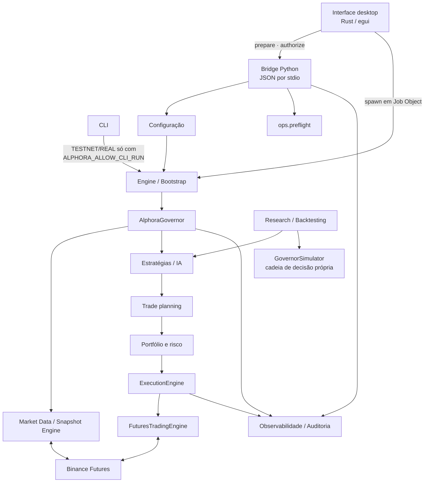
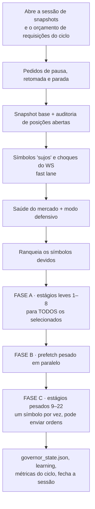
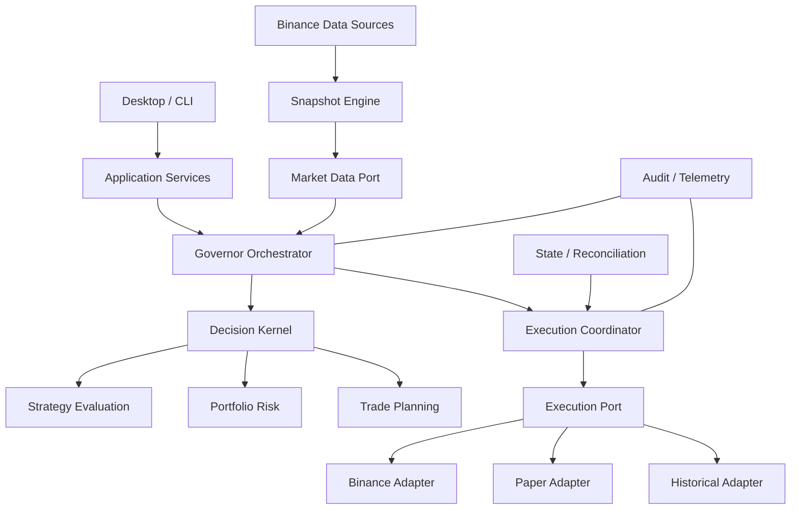
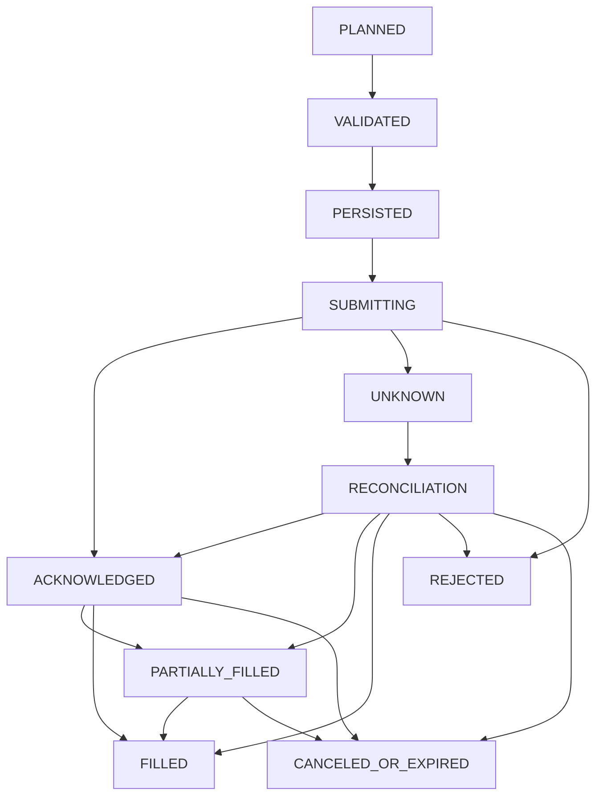
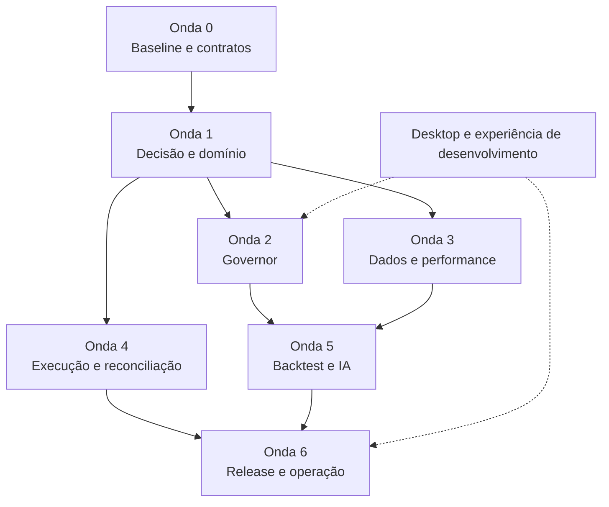

# Alphora — Plano Diretor de Engenharia de Software e Otimização

> **Documento orientador de arquitetura, qualidade, desempenho e evolução técnica**  
> **Destino recomendado:** `docs/ALPHORA_SOFTWARE_ENGINEERING_OPTIMIZATION_PLAN.md`  
> **Status:** proposta de engenharia para adoção e execução incremental  
> **Data da análise:** 12 de novembro de 2026  
> **Repositório:** [`igors93/alphora`](https://github.com/igors93/alphora)  
> **Branch de referência:** `main`  
> **Commit de referência:** `01e2f6e8f8590a19fe5d3b4b2f6786fe17b6d8ed`  
> **Revisão:** 2 — verificada contra o código e medida por AST (ver nota abaixo)

> [!NOTE]
> **Revisão 2 (12/11/2026): o que mudou e por quê**
>
> A versão 1 foi conferida contra o código no mesmo commit. A estrutura do plano (princípios, invariantes, governança,
> golden masters, DoD, ADR, monólito modular, separação de *readiness*) foi **mantida**: está correta. As mudanças foram:
>
> 1. **Correções factuais** em §3.1, §4.1, §4.2, §4.3, §4.5, §15 e §19. Exemplos: o risco de portfólio é avaliado
>    *depois* do plano e do sizing, não antes; o gate econômico roda duas vezes; quem inicia o engine é a interface
>    Rust, não a ponte; IDs de cliente, reconciliação de ordem incerta e timeouts da ponte **já existem**.
> 2. **Evidência estrutural** que faltava (§2, §6): 11 ciclos entre pacotes, 60 funções acima de 150 linhas,
>    contexto de avaliação com 35 campos `Any`, 106 consultas dinâmicas `getattr(self)` nos mixins, componentes
>    duplicados e código morto. Os números vêm de [`tools/architecture_metrics.py`](../tools/architecture_metrics.py).
> 3. **Ordem de execução revisada** (§13, §38, §39, §50): a versão 1 começava pela extração do `TradePlanningService`,
>    que é o trecho mais acoplado e mais arriscado. A nova ordem começa por uma rede de segurança, quebra os ciclos,
>    cria uma raiz de composição e só então extrai estágios, dos pequenos para os financeiros.
> 4. **Backlog ampliado** (§28): OPT-023 a OPT-036.
> 5. Dois documentos novos complementam este:
>    - [Mapa da arquitetura](architecture/README.md): o estado atual em diagramas, com arquivo e linha de cada fato;
>    - [Plano de Migração](MIGRATION_PLAN.md): fases M0–M7 e o roteiro G1–G9 do Governor, com PRs, critérios de saída
>      e rollback. **Para a ordem de execução, vale o Plano de Migração.**

---

## 0. Como utilizar este documento

Este documento é o **guia técnico de evolução** do Alphora. Seu propósito é ajudar a equipe a decidir **o que mudar, por que mudar, em qual ordem mudar, como demonstrar a preservação do comportamento e como verificar ganhos reais**.

Ele cobre:

1. Mapa da engenharia e da arquitetura atualmente implementadas.
2. Fluxos operacionais, dependências e pontos de maior complexidade estrutural.
3. Arquitetura-alvo recomendada e princípios de modularização.
4. Plano de otimização por subsistema: Governor, dados, execução, risco, backtesting, IA, desktop, observabilidade, configuração e resiliência.
5. Estratégia de testes, CI/CD, releases, métricas e benchmarks.
6. Backlog priorizado, ondas de implementação, entregáveis e critérios de aceitação.
7. Regras para tomada de decisão, registro de evidências e manutenção deste roadmap.

### 0.1. Escopo e limites da avaliação

O mapa do estado atual decorre de **inspeção estática do repositório** e de sua documentação na referência indicada. Não foram realizados benchmarks locais, execução da suíte de testes, profiling do processo, simulações da exchange ou execução com capital real para produzir este documento.

Na revisão 2, as métricas estruturais (tamanho, ciclos, funções longas, acoplamento) foram **medidas por análise de AST**
com [`tools/architecture_metrics.py`](../tools/architecture_metrics.py), que qualquer pessoa pode reexecutar. Métricas de
execução (latência, memória, requisições) continuam não medidas.

Portanto, distinguir sempre:

- **Observado:** uma capacidade, estrutura ou mecanismo identificado no código ou em documentação correspondente.
- **Recomendado:** uma alteração de arquitetura/processo a implementar e avaliar.
- **Hipótese:** uma otimização de desempenho cuja utilidade depende de medições.
- **Meta proposta:** objetivo a calibrar após a baseline, não resultado obtido.

**Este plano não aprova trading real, não demonstra rentabilidade e não substitui os critérios de segurança e promoção operacional.** O documento já existente [`REAL_MARKET_READINESS_ROADMAP.md`](REAL_MARKET_READINESS_ROADMAP.md) continua sendo a referência especializada de preparação para mercado real.

### 0.2. Critério geral de sucesso

O Alphora estará melhor engenheirado quando suas decisões puderem ser **compreendidas, reproduzidas, testadas e modificadas de modo localizado**, e quando os ganhos de latência, consumo de recursos e operação forem **medidos sem introduzir alterações financeiras não autorizadas**.

### 0.3. Regra operacional fundamental

> Nenhuma refatoração estrutural ou otimização de performance pode enfraquecer os limites dos modos de execução, alterar silenciosamente o sizing, duplicar ordens, reduzir a confiabilidade do estado financeiro ou converter uma intenção de trading em uma ordem não autorizada.

As regras de *readiness* e aprovação para operação real são independentes da qualidade interna da arquitetura. Um sistema pode ter código bem organizado e ainda assim não estar apto a operar com dinheiro real.

---

# Parte I — Mapa da engenharia atual

## 1. Resumo executivo

O Alphora é um motor de trading algorítmico para Binance Futures USDT-M, com interface desktop nativa, estratégias configuráveis, pontuação probabilística com IA, módulos de risco, mecanismos de dados de mercado, backtesting, auditoria e opções de execução em múltiplos ambientes.

A engenharia já contém subsistemas relevantes e numerosas abstrações operacionais. A maior oportunidade não é uma reconstrução total: é **tornar explícitas as fronteiras do sistema, reduzir a concentração de responsabilidades nos caminhos centrais e compartilhar regras de decisão entre ambientes onde isso for semanticamente correto**.

Cinco objetivos estratégicos:

1. **Simplificação estrutural:** Governor e pipelines menores, com responsabilidades claras.
2. **Eficiência operacional:** menos trabalho redundante, requisições desnecessárias e pressão de memória.
3. **Consistência de comportamento:** contratos e regras reutilizáveis entre live, paper e backtesting.
4. **Confiabilidade demonstrável:** evidências de invariantes de risco, execução e recuperação.
5. **Evolução sustentável:** novas estratégias e módulos de IA sem crescimento desproporcional do acoplamento.

**Direção arquitetural recomendada:** manter um **monólito modular Python**, com **interface nativa Rust**, processos e adaptadores bem delimitados. Não introduzir microsserviços como resposta automática à complexidade interna.

## 2. Dimensão do repositório na baseline

Levantamento da árvore Git em `main`:

| Indicador | Quantidade |
|---|---:|
| Arquivos versionados | 915 |
| Arquivos em `src/` | 432 |
| Arquivos em `tests/` | 437 |
| Arquivos Python (`.py`), incluindo testes | 868 |
| Arquivos Rust (`.rs`) | 22 |
| Arquivos sob `interface/`, incluindo manifests | 25 |

Distribuição por diretórios de código — **número de arquivos**:

| Área | Arquivos |
|---|---:|
| `tests/` | 437 |
| `src/resilience/` | 71 |
| `src/market_data/` | 61 |
| `src/governor/` | 61 |
| `src/futures/` | 47 |
| `src/backtesting/` | 31 |
| `src/trading/` | 30 |
| `src/observability/` | 28 |
| `src/desktop/` | 27 |
| `interface/` | 25 |
| `src/research/` | 12 |
| `src/strategies/` | 11 |

> **Atenção:** arquivo não equivale a classe, caso de teste, cobertura ou nível de maturidade. Esses números são um inventário estrutural, não uma nota de qualidade.

Indicadores estruturais medidos na revisão 2 (linhas sem brancos e comentários):

| Indicador | Valor | Onde ver |
|---|---:|---|
| Linhas de código Python em `src/` | 93.389 | [Mapa §1](architecture/README.md#1-números-da-baseline) |
| Linhas do Governor | 26.975 (29% do total) | [Pacotes §1](architecture/pacotes-e-dependencias.md#1-tamanho-por-pacote) |
| Pares de pacotes com dependência cíclica | 11 | [Pacotes §3](architecture/pacotes-e-dependencias.md#3-os-11-ciclos-entre-pacotes) |
| Funções com mais de 150 linhas | 60 (maior: `load_config`, 724) | [Pacotes §4](architecture/pacotes-e-dependencias.md#4-concentração-de-complexidade) |
| Campos `Any` no `SymbolEvaluationContext` | 35 de 58 | [Governor §6](architecture/governor.md#6-o-contexto-compartilhado-entre-os-estágios) |
| `getattr(self, …)` nos 7 mixins do Governor | 106 | [Governor §9](architecture/governor.md#9-acoplamento-entre-os-mixins) |
| Módulos com `ignore_errors` no mypy | 14 (8 do Governor, 6 do `futures.engine`) | `pyproject.toml` |
| Testes que montam o Governor com `object.__new__` | 24 arquivos | `tests/governor/` |
| Referências ao nome “coalestra” após a internalização | 693 em 41 arquivos | [Pacotes §5](architecture/pacotes-e-dependencias.md#5-código-morto-legado-e-nomes-herdados) |
| Testes por 1.000 linhas: Governor / backtesting / retry_engine | 12 / 7 / 271 | [Mapa §1](architecture/README.md#1-números-da-baseline) |

## 3. Visão de arquitetura atual

Três planos ajudam a explicar a aplicação:

- **Controle:** configuração, interface desktop, comandos, inicialização, processos e supervisão.
- **Decisão e execução:** dados de mercado, estratégias, Governor, risco, planejamento e envio de ordens.
- **Pesquisa e suporte:** backtesting, treinamento de IA, relatórios, observabilidade e auditoria.

### 3.1. Mapa lógico atual



Este é um **mapa conceitual simplificado**. Não representa todas as chamadas, dependências ou caminhos de retorno existentes no código.

**Correções da revisão 2:** a ponte não inicia o engine; ela grava a configuração e roda o preflight, e quem cria o
processo é a interface Rust. O risco de portfólio é avaliado depois do plano e do sizing. O backtest não usa o
planejamento do live: ele tem cadeia própria no `GovernorSimulator`. O mapa detalhado, com os 22 estágios, está em
[`architecture/`](architecture/README.md).

### 3.2. Inventário de subsistemas

| Subsistema | Principal localização | Papel atual |
|---|---|---|
| Bootstrap | `src/engine.py` | Inicialização, modo de execução, criação do Governor e encerramento |
| Configuração | `src/config/` | Carregamento, modelos e validação de configuração |
| Governor | `src/governor/` | Orquestração dos ciclos e coordenação das decisões |
| Estratégias | `src/strategies/` | Avaliação e produção de sinais/intents |
| IA e aprendizagem | `src/research/ai/`, `src/trading/` | Probabilidades, treinamento, modelos e módulos inteligentes |
| Dados de mercado | `src/market_data/` | Preços, candles, snapshots e stores |
| Adaptador da Binance | `src/binance/` | Acesso às APIs da exchange |
| Execução de futuros | `src/futures/` | Operações e ciclo de vida de ordens/posições |
| Backtesting | `src/backtesting/` | Simulação histórica, portfólio, fills e métricas |
| Resiliência | `src/resilience/` | Retry, políticas, budgets e recuperação |
| Observabilidade | `src/observability/`, `src/utils/` | Eventos estruturados, logs, saúde e auditoria |
| Serviços desktop | `src/desktop/` | Bridge, serviços, configuração e controle de processos |
| UI nativa | `interface/src/` | Páginas, eventos, renderização e controles do operador |
| Operações | `src/ops/` | Status, pausa, parada e procedimentos operacionais |

## 4. Fluxos operacionais fundamentais

### 4.1. Inicialização

Caminho principal: `main.py` / `alphora-engine` → `src/engine.py` → `AlphoraGovernor.from_config()` → `governor.start()`.

Sequência relevante:

1. `load_config()` constrói `AppConfig` a partir das fontes de configuração.
2. Inicialização de observabilidade, auditoria e contexto da execução.
3. Validação dos limites de execução para o modo escolhido.
4. Construção de `BinanceFuturesClient` com permissão de mutação derivada do modo.
5. Criação dos componentes do Governor.
6. Bootstrap de dados e conexão com streams quando aplicável.
7. Recuperação ou verificação de estado, conforme configuração.
8. Entrada no loop de operação e encerramento controlado.

Quem dispara essa sequência, na operação normal, é a interface Rust: ela pede `operation.prepare` e
`operation.authorize` à ponte, a ponte grava a configuração e roda `ops.preflight`, e então a interface cria o processo
do engine dentro de um *Job Object* do Windows (se a interface morrer, o sistema operacional encerra o engine). A parada
graciosa é um arquivo `runtime/governor_stop.request`; depois de 15 s, a interface encerra o *Job Object*. Pela CLI,
`TESTNET_LIVE` e `REAL_LIVE` só rodam com `ALPHORA_LAUNCHED_BY_GUI` ou `ALPHORA_ALLOW_CLI_RUN`
([sequência completa](architecture/pesquisa-observabilidade-desktop.md#iniciar-o-alphora-pela-interface)).

Hoje não existe raiz de composição: o construtor do `AlphoraGovernor` cria cerca de 85 componentes, e alguns são criados
de novo em outros pontos ([duplicações](architecture/decisao-e-execucao.md#5-componentes-duplicados)).

**Objetivo de engenharia:** explicitar dependências, pré-condições e estados de inicialização, preservando a existência de um ponto central de bootstrap.

### 4.2. Ciclo do Governor

O ciclo é `run_cycle` (`src/governor/cycle_mixin.py:723`, 266 linhas). Ele é disparado por tempo
(`loop_interval_seconds`) ou antes do prazo, por um choque de preço no WebSocket. Cada símbolo passa por um pipeline de
**22 estágios** (8 leves e 14 pesados), executado por `_run_symbol_evaluation_stages`, que mede cada estágio e para no
primeiro resultado terminal.



Detalhe de cada fase e de cada estágio, com arquivo e linha: [Governor por dentro](architecture/governor.md).

**Característica importante:** leituras e preparação de snapshots podem ocorrer com concorrência controlada, mas mutações financeiras podem invalidar snapshots privados anteriores. A serialização de decisões/efeitos que dependem do estado financeiro deve ser preservada até que um modelo alternativo prove segurança equivalente.

### 4.3. Fluxo de uma decisão financeira

Abstrações relevantes já identificadas:

- `SignalScore`: classificação/prioridade do sinal.
- `TradeIntent`: intenção e dados da ação pretendida.
- `TradeContext`: informações de mercado e portfólio necessárias ao planejamento.
- `TradePlan`: quantidade, preços, custos, proteções e indicadores econômicos.
- `ExecutionCommand`: comando encaminhado para execução.
- Resultado de execução, reconciliação e auditoria.

Ordem real dos estágios pesados (revisão 2), com os tipos de passagem congelados que já existem em
`governor/symbol_evaluation_pipeline.py`:

| Estágios | O que acontece | Tipo produzido |
|---|---|---|
| 9 | Contexto pesado (snapshot pesado) | `HeavyEvaluation` |
| 10 | Estratégia → `SignalScore` → `TradeIntent` (`HotSymbolWorker`) | `IntentCandidate` |
| 11–14 | Reconciliação de estado, warmup, quarentena, modo defensivo, gate de IA | — (podem encerrar) |
| 15 | Quantidade e saída planejadas + **gate econômico** | `PlannedTrade` |
| 16–17 | Camadas inteligentes e `SmartSizingEngine` | — |
| 18 | **Gate econômico final** + `PortfolioRiskEngine.evaluate_trade_intent` | `ValidatedTrade` |
| 19–21 | Guards de learning, `SmartExecutionEngine`, planner de execução | — |
| 22 | Revalidação do snapshot, `PreExecutionGuard`, `ExecutionEngine.execute` | `ExecutableTrade` → `ExecutionCommand` |

Fluxo real, de forma resumida:

`Strategy → Intent → Reconciliation/Guards → TradePlan + Economic Gate → Sizing → Final Economic Gate + Portfolio Risk → Learning Guards → Smart Execution → Revalidation + Pre-execution Guard → ExecutionCommand → Exchange/Paper Adapter → Audit`

Duas diferenças em relação à versão 1: o **risco de portfólio vem depois do plano e do sizing**, e o **gate econômico
roda duas vezes** (estágios 15 e 18). Os tipos de passagem já existem, mas o contexto compartilhado ainda guarda os
mesmos dados em 35 campos `Any`, que é o que impede testar um estágio isoladamente.

**Proposta:** tornar cada estágio uma unidade de comportamento com entradas/saídas tipadas e evidências de decisão.
O executor de estágios já existe e é a costura natural para isso ([Plano de Migração, M3](MIGRATION_PLAN.md#m3--governor-do-mixin-ao-pipeline-de-estágios)).

### 4.4. Backtesting

O backtester contém, entre outros, `HistoricalDataFeed`, `BacktestStrategyRuntime`, `GovernorSimulator`, `PortfolioSimulator` e `ExecutionSimulator`.

Isso permite simular decisões e condições históricas, mas seu pipeline não é literalmente a mesma instância do Governor vivo. Há uma oportunidade de **compartilhar regras de domínio puras** entre os dois ambientes, sem confundir simulação de fills com a realidade da Binance.

Medido na revisão 2: as estratégias são as mesmas do live (`BacktestStrategyRuntime`), mas a cadeia sinal → plano →
gates → sizing é reimplementada em `backtesting/engine/decision_pipeline.py` (1.969 linhas). O backtesting tem a menor
densidade de testes do projeto: 7 por 1.000 linhas.

### 4.5. Desktop

O fluxo fundamental é:

`Rust/egui → JSON via stdio → Bridge Python → Serviços → Resultados/estado → UI`

A interface tem seis áreas de trabalho: **Painel** (estado do engine, prontidão e posições), **Símbolos**, **Estratégia e
IA**, **Pesquisa** (backtest e treinamento), **Monitor** (eventos, journals e runtime) e **Configurações** (credenciais e
núcleo Python). Há menus no topo, paleta de comandos (Ctrl+K) e console acoplável (Ctrl+J).

A ponte (`python -m desktop.bridge`) expõe 39 métodos por linhas JSON no stdin/stdout, correlaciona requisições por ID,
atende em um pool de 4 threads e tem timeouts por método (45 s por padrão). A interface reinicia a ponte até 3 vezes. Os
processos longos (engine, backtest, treino) são criados e supervisionados **pela interface Rust**, em *Job Objects*; a
ponte só prepara comandos e lê resultados. O resultado de treino e de backtest volta como **linhas de texto no stdout**
(`AI_MODEL:`, `BACKTEST_MANIFEST=`), interpretadas pela ponte.

**Objetivo de engenharia:** contratos versionados, estados de operação autoritativos e atualização eficiente, mantendo o framework gráfico atual.

## 5. Modos de execução e limites arquiteturais

Os modos existentes têm semânticas diferentes:

| Modo | Fonte/ambiente | Efeito de ordens |
|---|---|---|
| `DRY_RUN` | Leitura de dados e estado real conforme credenciais | Não envia mutações; não é um simulador offline sem rede |
| `PAPER_LIVE` | Mercado ao vivo com execução simulada | Fills simulados; sem mutações na conta |
| `TESTNET_LIVE` | Binance Testnet | Ordens no ambiente de teste |
| `REAL_LIVE` | Binance real | Ordens reais mediante salvaguardas explícitas |

O código também diferencia módulos `OFF`, `OBSERVE`, `SHADOW`, `ACTIVE` e outras variantes específicas. A ativação de IA possui níveis próprios.

**Invariante arquitetural:** permissões de mutação precisam ser derivadas e verificadas de maneira consistente em todo o caminho, não apenas na UI ou em um único flag de ambiente.

## 6. Concentração de complexidade

Entre os arquivos de maior porte identificados na baseline estão:

| Arquivo | Tamanho aproximado | Por que acompanhar |
|---|---:|---|
| `src/governor/trade_pipeline_mixin.py` | 195 KB | Coordena muitos estágios do fluxo de trades |
| `src/governor/coalestra_provider.py` | 146 KB | Integra autoridade, sessões, atualização e snapshots |
| `src/backtesting/engine/decision_pipeline.py` | 85 KB | Coordenação das decisões históricas |
| `src/futures/engine_position_mixin.py` | 80 KB | Ciclo de vida das posições |
| `src/governor/symbol_eval_mixin.py` | 69 KB | Avaliação de símbolos e estados |
| `src/governor/cycle_mixin.py` | 61 KB | Orquestração do ciclo |
| `src/desktop/bridge/handlers.py` | 61 KB | Distribuição das chamadas desktop |
| `src/governor/execution_engine.py` | 53 KB | Coordenação da execução |
| `src/governor/alphora_governor.py` | 44 KB | Composição e ciclo de vida do sistema |

**Interpretação correta:** tamanho de arquivo não prova defeito. Ele indica onde verificar coesão, dependências implícitas, repetição de regras e custo para testar alterações de maneira isolada.

### 6.1. Evidência estrutural (revisão 2)

Tamanho indica onde olhar; os sinais abaixo mostram **o que** está errado em cada lugar:

| Sinal | Evidência | Efeito |
|---|---|---|
| Ciclos entre pacotes | 11 pares; em todos, um modelo está no pacote errado (ex.: `SymbolTradingConfig` no Governor, importado por `trading`) | Pacotes de baixo não são testáveis nem reutilizáveis sem o Governor |
| Funções longas no caminho de ordem | `_open_position` 482, `_execute_approved_intent` 449, `_revalidate_evaluation_for_execution` 419, `_close_position` 322, `_create_protection_orders_locked` 256 | 1.928 linhas no trecho mais crítico |
| Mixins como uma só classe | `TradePipelineMixin` faz 130 chamadas a métodos de outros mixins e da base; 106 `getattr(self)` | Contratos implícitos; 14 módulos com `ignore_errors` no mypy |
| Contexto quadro-negro | 58 campos, 35 `Any`, escritos e lidos por estágios diferentes | Estágio não testável sozinho |
| Componentes duplicados | `TradeAuditRecorder` em 3 níveis; `StateReconciliationEngine` criado também a cada avaliação; `FuturesRiskGuard` criado em 4 pontos | Estado e configuração podem divergir |
| Cinco representações da posição | Binance, `UserDataShadowCache`, `RuntimeStateStore`, `FuturesTradingEngine`, `SymbolStateTracker` | Reconciliação espalhada |
| Dois sistemas de eventos | `observe_event` e `audit_event` chamados lado a lado; cada `TradeJournal.append` ainda é espelhado no `audit_logger` | Três caminhos para o mesmo fato |
| Código morto | Itens removidos na M2; decisão de `publish_market_snapshot` registrada no ADR-001 | Ruído e falsas pistas eliminados |
| Documentação desatualizada | `docs/governor-orchestration-cycle.md` descreve uma máquina de estados e structlog que não existem | Decisões baseadas em documento errado |

Fonte e detalhes: [Pacotes e dependências](architecture/pacotes-e-dependencias.md),
[Governor](architecture/governor.md) e [Decisão e execução](architecture/decisao-e-execucao.md).

Três áreas prioritárias:

1. **Governor e Trade Pipeline:** concentradores de coordenação, planejamento e políticas.
2. **Coalestra/Snapshot Engine:** alta responsabilidade em cache, consistência, autoridade e revalidação.
3. **Execução real e backtesting:** oportunidade de compartilhar decisões de domínio, mantendo adaptadores distintos.

---

# Parte II — Arquitetura-alvo

## 7. Princípios arquiteturais

Adotar a separação conceitual **Domínio → Aplicação → Infraestrutura → Apresentação**.

| Camada | Responsabilidades | Deve evitar |
|---|---|---|
| Domínio | Modelos, invariantes e políticas financeiras | Acesso direto a HTTP, UI, subprocessos e filesystem |
| Aplicação | Coordenação dos casos de uso, ciclos e workflows | Reimplementar regras de domínio |
| Infraestrutura | Binance, feeds, cache, persistência, processos | Tomar decisões financeiras sem autorização do domínio/aplicação |
| Apresentação | Comandos do usuário e visualização de estado | Duplicar sizing, risco e regras de execução |

Essa divisão pode ser introduzida **dentro da árvore atual de pacotes**, sem exigir grande reorganização de diretórios de imediato.

## 8. Arquitetura lógica proposta



Trata-se de um **desenho-alvo**, não de uma alegação de que todas essas interfaces já estejam implementadas.

## 9. Núcleo de decisão compartilhável (`DecisionKernel`)

### 9.1. Propósito

O `DecisionKernel` deve executar regras determinísticas do domínio e produzir uma decisão explicável, sem criar ordens ou consultar APIs diretamente.

Exemplo **conceitual**, não código pronto para substituir o domínio existente:

```python
@dataclass(frozen=True)
class DecisionInput:
    market: MarketContext
    portfolio: PortfolioContext
    strategy: StrategyContext
    config: DecisionConfig

@dataclass(frozen=True)
class DecisionOutput:
    intent: TradeIntent | None
    trade_plan: TradePlan | None
    risk_decision: RiskDecision
    diagnostics: DecisionDiagnostics
```

### 9.2. Responsabilidades

- Receber dados com origem, timestamp e requisitos de consistência já definidos.
- Interpretar sinais e intenções usando regras do domínio.
- Aplicar políticas de risco e planejamento que possam ser puras.
- Produzir resultado tipado, razões e metadados de decisão.
- Não consultar rede, não acessar segredos e não efetuar mutações na exchange.

### 9.3. Compartilhamento entre ambientes

Uma regra que depende somente de dados de entrada deve ser executável tanto no ambiente histórico quanto no vivo. Diferenças intencionais precisam ser documentadas: fills, latência, relógio, funding, ordem de eventos, slippage e estado da exchange são dependentes do ambiente.

**Não substituir o backtester pelo motor real.** Compartilhar cálculos e políticas, não necessariamente mecanismos de execução.

M6 implementou esse núcleo como a tupla `SmartSizingStage`/`SmartExecutionStage` montada por `governor/stages/decision_kernel.py`. O backtest injeta mercado, relógio e conta simulados e mantém `ExecutionSimulator` para fills e custos. Sinal, regime, saída da estratégia, risco de portfólio e cadência usam os mesmos contratos ou regras do live. O teste diferencial em `tests/backtesting/test_m6_stage_parity.py` compara também o cenário golden `entry_approved`; as diferenças de execução ficam documentadas no teste e no plano de migração.

## 10. Contratos recomendados (ports)

| Interface proposta | Responsabilidade |
|---|---|
| `MarketDataPort` | Oferecer dados de mercado sob políticas explícitas de frescor |
| `AccountSnapshotPort` | Consultar estado reconciliável de conta, posições e ordens |
| `ExecutionPort` | Despachar comandos autorizados e obter resultados |
| `RuntimeStateRepository` | Persistir/restaurar estado transacional ou versionado |
| `DecisionEventSink` | Registrar eventos de decisão, execução e auditoria |
| `Clock` | Fornecer tempo real ou controlado por testes |
| `StrategyPort` | Avaliar estratégias com contratos de entrada/saída |
| `RiskPolicy` | Avaliar limites e devolver decisão tipada |

Preferir interfaces **pequenas, orientadas a uma necessidade efetiva**. Não criar interfaces fictícias para cada classe apenas para atingir um padrão visual.

## 11. Por que manter um monólito modular

Topologia recomendada:

- Processo Python do motor operacional.
- Interface Rust nativa, em processo próprio.
- Bridge para comandos/estado do desktop.
- Entrypoints especializados para pesquisa, treinamento e backtesting.
- Adaptadores internos e contratos de domínio delimitados.

**Não introduzir automaticamente:** Kafka, Kubernetes, microsserviços, RPC distribuído ou bancos complexos. Esses elementos somente devem ser avaliados a partir de necessidade operacional demonstrada e análise de custo/benefício.

## 12. Estratégia de migração arquitetural

Usar o padrão **expandir → adaptar → comparar → migrar → remover**:

1. Criar testes de comportamento do fluxo existente.
2. Definir contrato/serviço novo.
3. Manter adaptador para o caminho antigo.
4. Rodar os mesmos cenários pelos dois caminhos, sem duplicar efeitos financeiros.
5. Comparar saídas tipadas, decisões e efeitos simulados.
6. Migrar chamadas por fatias pequenas.
7. Remover o caminho anterior após aprovação das evidências.

Evitar um *big bang refactor* do Governor ou do ciclo de execução.

**Unidade de migração no Governor (revisão 2): o estágio.** O executor `_run_symbol_evaluation_stages` aceita qualquer
chamável `(contexto) → resultado | None`. Trocar um método do pipeline por um objeto de estágio é trocar uma entrada de
uma tupla, e o rollback é desfazer essa linha. Duas proteções acompanham cada troca: o golden replay (comportamento) e a
catraca de métricas (estrutura). Detalhes no [Plano de Migração §3](MIGRATION_PLAN.md#3-princípios-da-migração).

---

# Parte III — Plano de otimização por subsistema

## 13. Governor e orquestração

**Prioridade de arquitetura: muito alta.**

### Estado atual

> **Atualização (13/11/2026, fim da M3):** o `AlphoraGovernor` não herda mais nenhum mixin. Os 22 estágios são
> objetos em `governor/stages/`, os serviços estão em `governor/services/`, o ciclo em `governor/cycle/` e o avaliador
> em `governor/evaluation/`; a fachada é tipada e passa no mypy estrito. O texto abaixo é o diagnóstico da revisão 2,
> mantido como histórico. Detalhes em [Plano de Migração, M3.1](MIGRATION_PLAN.md#m31-implementação-realizada).

O `AlphoraGovernor` reúne comportamento por meio de mixins, incluindo `CycleMixin`, `SymbolEvalMixin`, `TradePipelineMixin`, `OpportunityMixin`, `AIGateMixin` e outros. O desenho organiza funcionalidades, mas concentra muitos contratos na instância central.

Medido na revisão 2:

- **7 mixins** (`UserDataCacheMixin`, `DefensiveModeMixin`, `CycleMixin`, `OpportunityMixin`, `SymbolEvalMixin`,
  `TradePipelineMixin`, `AIGateMixin`) formam uma só classe: 106 `getattr(self)` e chamadas cruzadas constantes.
- O construtor cria cerca de **85 atributos** e todos os componentes; não há raiz de composição.
- O pipeline por símbolo **já existe** como uma tupla de 22 métodos, executada por `_run_symbol_evaluation_stages`.
- Os resultados terminais passam por dois auxiliares acoplados a `self`: `_make_terminal_result` (37 chamadas) e
  `_mark_blocked` (30 chamadas).
- `AIGateMixin` e `DefensiveModeMixin` não chamam nenhum outro mixin: são os mais baratos de extrair.

### Serviços-alvo

| Serviço | Responsabilidade |
|---|---|
| `CycleCoordinator` | Sequência e prazo do ciclo |
| `SymbolEvaluationService` | Avaliação de símbolo e sua transição de estado |
| `OpportunitySelectionService` | Priorização de candidatos |
| `TradePlanningService` | Construção e validação do plano |
| `PortfolioDecisionService` | Políticas de exposição e portfólio |
| `ExecutionCoordinator` | Envio, confirmação e estado pendente |
| `PositionLifecycleService` | Manutenção, proteção e reconciliação de posições |
| `CycleTelemetryService` | Métricas e evidências por estágio |

### Regras de extração

- Um serviço deve ter entradas, saídas e efeitos definidos.
- Evitar transferência de `self` do Governor para serviços internos.
- Preferir passar contextos tipados em vez de dicionários arbitrários e estado global mutável.
- Tornar dependências explícitas por construtor ou parâmetros.
- Não modificar a ordem de validações financeiras sem justificativa e teste específico.
- Preservar a prioridade de proteção, fechamento e reconciliação.

### Ordem de extração (revisada na revisão 2)

A versão 1 começava pelo `TradePlan`. Isso foi revisto: os estágios de planejamento (15–21) estão no
`TradePipelineMixin`, o mais acoplado, e leem um contexto com campos `Any`. Extraí-los primeiro obrigaria a passar o
contexto inteiro ou o próprio Governor, o que contraria a regra “evitar transferência de `self`” acima. A ordem nova
segue risco e acoplamento crescentes:

1. **Raiz de composição** (G1): o Governor deixa de construir os próprios componentes; fim das instâncias duplicadas.
2. **Contexto tipado** (G2): 0 campos `Any`; os tipos de passagem congelados viram a fonte da verdade.
3. **Protocolo de estágio** (G3): o executor aceita objetos de estágio além de métodos; os auxiliares de resultado
   terminal viram um colaborador.
4. **Estágios folha e serviços sem acoplamento** (G4): warmup, quarentena, orçamento de requisições, `AIGateService`,
   `DefensiveModeService`.
5. **Contexto, decisão, planejamento e risco** (G5): estágios 1, 9–11 e 15–21. O `TradePlanningService` passa a ser a
   fachada dos estágios 15–17.
6. **Execução** (G6): o estágio 22 é reescrito sobre o `ExecutionCoordinator`, depois que o ciclo de vida da ordem for
   explícito (§15).
7. **Ciclo** (G7): `run_cycle` vira um `CycleCoordinator` com as fases A, B e C.
8. **Fim dos mixins** (G8) e **telemetria única por estágio** (G9).

Tabela com os 22 estágios, objeto alvo, dependências e risco: [Plano de Migração, M3](MIGRATION_PLAN.md#m3--governor-do-mixin-ao-pipeline-de-estágios).

**Aceite:** decisões e rastros equivalentes em fixtures determinísticas; interfaces mais claras e testes independentes de partes do fluxo.

## 14. Dados de mercado, candles e Snapshot Engine

**Prioridade de performance: muito alta, condicionada à medição.**

### Estado atual

A infraestrutura inclui WebSocket de mercado, `CandleDataHub`, `MarketDataRouter`, Snapshot Engine interno baseado em conceitos Coalestra, sessões, políticas de autoridade, cache, revalidação e budgets.

### Ações propostas

**14.1. Inventariar leituras:** número de chamadas REST por ciclo, tipo de recurso, símbolo, prioridade, retries, fallback e fonte.

**14.2. Classificar dados por cadência e semântica:**

| Classe | Exemplos | Tratamento recomendado |
|---|---|---|
| Mercado rápido | Bid/ask/preço | Eventos + idade máxima explícita |
| Candles | OHLCV | Atualização vinculada ao fechamento do candle/timeframe |
| Privado | Conta, posições, ordens | Fonte autoritativa, invalidação e reconciliação |
| Metadados | Regras do símbolo | Cache versionado com atualização/invalidação |
| Pós-mutação | Estado após uma ordem | Revalidação prioritária e rastreável |

**14.3. Medir cache:** *hit*, *miss*, idade, custo da leitura, invalidação, refresh forçado, fila de atualização, falhas e aguardos.

**14.4. Medir memória:** retenção por símbolo/timeframe, custo das cópias, número de snapshots simultâneos, crescimento de buffers e stores.

**14.5. Reduzir redundância:** compartilhar leituras compatíveis, evitar materializações repetidas e descartar dados temporários desnecessários quando confirmado pelo profiling.

**14.6. Preservar autoridade:** um ganho de performance não autoriza substituir dados privados recentes por cache mais antigo. O código já diferencia stream, estado reconciliado e REST.

**Aceite:** melhoria mensurada em cenários equivalentes, sem regressão de frescor, consistência ou decisões de entrada/saída.

## 15. Execução, ordens e posições

**Prioridade de invariantes financeiros: P0.**

### Máquina de estados conceitual



Este diagrama é deliberadamente simplificado: a implementação final deve contemplar estados de cancelamento pendente, alterações, fills tardios e particularidades da Binance.

### O que já existe (revisão 2)

Várias frentes da tabela abaixo já têm implementação. O trabalho é **consolidar e tornar explícito**, não criar do zero:

| Frente | Já existe em `futures/engine_position_mixin.py` |
|---|---|
| Identidade | `_new_client_order_id`: ID de cliente por ordem |
| Registro prévio | `_save_state_for_position` grava o estado em torno do envio |
| `UNKNOWN` | `_reconcile_entry_order_unknown` e `_reconcile_close_order_unknown` consultam pelo ID antes de agir |
| Proteções | `_refresh_position_for_protection_operation`, `_assert_protection_triggers_not_breached` |
| Falha | `_pause_engine` pausa o símbolo |

O que falta é **um modelo único**: hoje o ciclo de vida está espalhado por `_open_position` (482 linhas),
`_close_position` (322) e `_create_protection_orders_locked` (256), e o estado da posição tem cinco representações
([mapa](architecture/decisao-e-execucao.md#6-onde-está-a-verdade-sobre-uma-posição)). O Plano de Migração trata isso
em [M4](MIGRATION_PLAN.md#m4--execução-e-fonte-única-de-verdade): transições explícitas primeiro, sem mudar o fluxo;
depois a divisão das funções pelas transições; por fim um `PositionLedger` como fonte única.

### Ações propostas

| Frente | Trabalho |
|---|---|
| Identidade | IDs persistentes e idempotentes por comando/ordem |
| Registro prévio | Persistir a intenção antes de autorizar efeitos externos |
| Envio | Separar preparação de comando e dispatch |
| Confirmação | Diferenciar pedido enviado, aceito, parcial, preenchido e incerto |
| `UNKNOWN` | Resolver desfechos ambíguos antes de criar uma substituição |
| Reconciliação | Comparar journals, ordens, posições, fills e estado local |
| Proteções | Revalidar stop/take após alterações de quantidade/fill |
| Concorrência | Coordenar reservas de exposição entre entradas pendentes |

### Persistência

O Alphora já utiliza journals JSONL e arquivos de estado. Preservar esses mecanismos até que se demonstre uma necessidade concreta de mudança. **SQLite transacional** pode ser avaliado especificamente para um ledger de comandos/ordens se oferecer ganhos verificáveis em durabilidade, consulta e recuperação. JSONL pode continuar sendo um formato adequado para auditoria.

### Testes obrigatórios

- Timeout antes de envio.
- Timeout após aceite sem resposta.
- Reconexão com fill tardio.
- Fill parcial e alteração de proteção.
- Cancelamento concorrente com fill.
- Crash entre persistência e envio.
- Crash entre envio e confirmação.
- Restart com ordem em estado desconhecido.
- Divergência entre journal e estado da exchange.

**Aceite:** invariantes de não duplicação, exposição, proteção e reconciliação demonstrados em testes determinísticos de falha.

## 16. Políticas de risco e portfólio

### Hierarquia-alvo

1. **Conta:** saldo/margem, drawdown e limites globais.
2. **Portfólio:** exposição total, correlação, concentração e limites por grupo.
3. **Operação:** tamanho, stop, risco monetário e custos esperados.
4. **Execução:** preço, filtros de símbolo, estado da conta, slippage e autorização imediata.

Cada política deve produzir uma decisão tipada:

- Resultado (`allow`, `block`, `reduce`, conforme contrato).
- Código estável da razão.
- Valores analisados e limites aplicados.
- Fonte e idade da informação.
- Metadados para auditoria e UI.

O código atual já trata entradas que aumentam exposição diferentemente de ações que reduzem ou protegem risco. **Preservar essa separação.** Uma indisponibilidade de saldo pode impedir novas entradas sem impedir ações seguras de redução de exposição.

**Aceite:** ausência de divergência entre notional planejado, risco autorizado e parâmetros efetivamente despachados.

## 17. Backtesting e research

### Objetivo

Compartilhar regras financeiras puras e acelerar experimentos **sem alterar o significado de execução histórica**.

### Plano

**17.1. Paridade de decisão:** identificar cálculos compartilháveis de indicadores, features, sinais, intenção, sizing, risco e validação econômica.

**17.2. Reprodutibilidade:** manifest com commit, configuração, estratégia, parâmetros, dados, fees, funding, seed, versões de modelos e hashes.

**17.3. Profiling:** medir leitura de arquivos, parsing, computação de indicadores, execução simulada, métricas e escrita dos resultados.

**17.4. Otimizações candidatas:** carregamento incremental, indicadores pré-calculados, caches imutáveis, reutilização segura de dados, paralelismo de experimentos isolados e formatos colunares quando comprovadamente benéficos.

**17.5. Causalidade:** manter separação temporal, não permitir candles futuros, evitar vazamento entre treino e validação e comparar decisões a partir de prefixos históricos equivalentes.

**Aceite:** reexecuções reproduzíveis e testes de paridade para regras idênticas; diferenças de fill/mercado devem continuar explícitas.

## 18. Inteligência artificial e learning

### Pipeline-alvo

`Dataset → Feature Pipeline → Training → Validation → Model Registry → Inference → Activation Policy → Monitoring`

### Manifest de modelo sugerido

- Identificador e versão do modelo.
- Contrato e ordem das features.
- Símbolos, timeframes e janela de dados.
- Parâmetros e algoritmo.
- Hash do artefato.
- Resultados de validação temporal.
- Regras de ativação, limites e rollback.
- Compatibilidade com a versão do motor.

### Melhorias

- Evitar carregamento repetido de modelos.
- Reutilizar inferência do mesmo candle/feature hash quando válido.
- Diferenciar claramente modelo global e refinamento por símbolo.
- Padronizar a saída da inferência e seus diagnósticos.
- Monitorar drift, qualidade de previsão e custos operacionais.
- Preservar ativação gradual entre observação, paper, testnet e real conforme políticas aprovadas.

**Invariante:** a IA gera informação ou intenção; ela não contorna as políticas de risco nem executa ordens diretamente.

## 19. Desktop Rust e bridge Python

### Objetivo

Melhorar contrato, estado e responsividade sem substituir `eframe/egui` por preferência tecnológica.

| Frente | Proposta | Situação na revisão 2 |
|---|---|---|
| Estado | View models tipados e isolados da renderização | Parcial: estado por página em Rust |
| Comunicação | Versão de protocolo do bridge JSON | **Falta** |
| Requests | IDs, correlação, timeout e cancelamento controlado | **Existe**: IDs, timeout por método, reinício da ponte até 3 vezes; falta cancelamento |
| Compatibilidade | Testes de contrato Rust ↔ Python | **Falta** |
| Processos | Estado unificado de inicialização, running, stopping, stopped e falha | **Existe** em Rust, com *Job Objects* e parada forçada após 15 s |
| Atualização | Evitar polling redundante e payloads integrais desnecessários | Parcial: atualização só com a tela visível (3–5 s) |
| Diagnóstico | Logs/eventos com paginação ou atualização incremental | Parcial: leitura incremental do log |
| Operações | Exibir solicitado, pendente, confirmado, negado e desconhecido | Parcial |
| Subprocessos | Resultado estruturado em vez de texto no stdout (`AI_MODEL:`, `BACKTEST_MANIFEST=`) | **Falta** (OPT-034) |

A UI deve receber um **estado de saúde operacional autoritativo**, não inferir sucesso apenas porque um comando foi enviado.

Na M7, o handshake passou a exigir a versão 1 do protocolo; os 39 métodos têm teste de contrato Rust/Python. Treinamento e backtest emitem resultados JSON por linha com `type` e `version`. O contrato atual está em [desktop-bridge-protocol.md](desktop-bridge-protocol.md); a tabela acima registra a situação histórica da revisão 2.

**Aceite:** mensagens de status consistentes após respostas atrasadas, reinício do processo e reconexão do bridge.

## 20. Observabilidade, métricas e auditoria

O projeto já possui observabilidade estruturada, IDs de execução e registros de eventos. Expandir e padronizar onde necessário.

**Antes de expandir, unificar (revisão 2):** hoje há dois sistemas de eventos, `observe_event` (`observability`) e
`audit_event` (`utils/audit_logger.py`), chamados lado a lado com o mesmo conteúdo. Cada `TradeJournal.append` ainda é
espelhado no `audit_logger`. Acrescentar métricas sobre isso multiplica a duplicação. A proposta (OPT-032) é manter
`observe_event` como API única e transformar `audit_logger` e os journals em *sinks* dela. O executor de estágios já
mede cada estágio (`stage_timings`) e é a fonte natural das métricas “avaliação leve”, “avaliação pesada”, “gates” e
“planejamento” da tabela abaixo.

**Situação na M7:** feito. A API única é `utils/events.py` ([ADR-006](architecture/ADR-006-single-event-api.md)); a
trilha de auditoria do run e o serviço de observabilidade são *sinks*, os journals publicam nela, e o executor de
estágios emite um evento por estágio, resumido em `governor_cycle_metrics.stage_telemetry`.

### Métricas por ciclo

| Métrica | Motivo |
|---|---|
| Duração total do ciclo | Latência/throughput |
| Duração da avaliação leve | Eficiência do scanner |
| Duração da avaliação pesada | Custo da decisão |
| Tempo para obter snapshot | Gargalos de fonte/cache |
| REST requests / peso por ciclo | Carga da Binance |
| Idade/frescor dos dados | Consistência temporal |
| Tempo de planejamento | Custo de gerar planos |
| Tempo dos gates | Custo de políticas |
| Envio e confirmação | Comportamento da execução |
| CPU e memória | Consumo do processo |
| Fila de eventos e backlog | Pressão de processamento |
| Latência das telas | Experiência do operador |
| Tempo de reconciliação | Capacidade de recuperação |

Registrar distribuições **p50, p95 e p99** onde houver amostras suficientes. Separar cenários de carga, modo de execução e ambiente de testes.

### Rastreamento recomendado

Um evento de decisão/execução deve conter, conforme aplicável e sem segredos:

`run_id`, `cycle_id`, `symbol`, `strategy_id`, `intent_id`, `trade_plan_id`, `order_client_id`, `decision_stage`, `decision_reason`, `source_age`, `execution_mode`, `timestamp`.

**Aceite:** é possível reconstruir por que uma operação foi aprovada, bloqueada ou executada a partir de registros correlacionados.

## 21. Resiliência e Retry Engine

O projeto já dispõe de um Retry Engine com política, atrasos, condições, budgets e executores síncronos/assíncronos.

### Direção de melhoria

- Padronizar seu uso onde houver mecanismos de repetição redundantes.
- Diferenciar leituras idempotentes de mutações financeiras ambíguas.
- Priorizar proteção, fechamento e reconciliação sob pressão de budget.
- Registrar retries, custo, motivos e tempo de recuperação.
- Incluir casos de rate limit, erro HTTP, perda de stream, desvio de timestamp e indisponibilidade temporária.

**Não repetir automaticamente uma ordem com resultado desconhecido.** Primeiro consultar seu identificador e reconciliar o desfecho da tentativa original.

**Aceite:** comportamento de falha previsível e testável, sem duplicação de exposição.

## 22. Configuração e segurança operacional

### Modelos conceituais

- `TradingConfig`: estratégia, parâmetros e símbolos.
- `ExecutionConfig`: ambiente, modo, autorização e ordens.
- `RiskConfig`: políticas de exposição e proteção.
- `MarketDataConfig`: fontes, frescor, cache e timeframes.
- `IntelligenceConfig`: modelos e níveis de ativação.
- `RuntimeConfig`: processo, paths, cadências e limites.
- `ObservabilityConfig`: eventos, logs e retenção.

Esses grupos podem ser compostos em um `AppConfig` final e imutável para a execução.

Ponto de partida medido na revisão 2: `load_config` (`config/loaders.py:50`) é a **maior função do projeto, com 724
linhas**, e `config` importa o Governor em cinco pontos (ciclo `config ↔ governor`). A divisão em carregadores por grupo
é o caminho natural para os modelos acima (OPT-029), depois que os ciclos forem quebrados (OPT-024).

**Situação na M7:** `load_config` compõe o `AppConfig` a partir de `config/sections/`, um carregador por grupo acima;
nenhuma função de `config/` passa de 150 linhas. Os grupos são `TypedDict`s que preenchem o `AppConfig` imutável único.

### Prioridades

1. Uma configuração efetiva claramente serializável, sanitizada e auditável.
2. Validação de modo, ambiente, conta esperada e permissão de mutação.
3. Versionamento de schemas e migração de configurações locais.
4. Identidade de release associada a parâmetros críticos.
5. Segredos fora de manifests e logs.
6. Rotação de credenciais e execução com permissões mínimas.

**Aceite:** o motor e a UI apresentam a mesma configuração efetiva; mudanças relevantes de risco não herdam aprovação de outro release.

---

# Parte IV — Engenharia de qualidade, testes e releases

## 23. Estado atual do CI

O workflow em `.github/workflows/ci.yml` executa:

- Ruff lint e formatação.
- Mypy para os módulos Python.
- Pytest em Python 3.10, 3.11, 3.12 e 3.13.
- `cargo fmt`, `cargo clippy` e `cargo test` para o desktop Rust no Windows.

Há também uma convenção de contribuição e branches em `CONTRIBUTING.md`.

### 23.1. Inventário de arquivos de teste

| Pasta em `tests/` | Arquivos |
|---|---:|
| `retry_engine/` | 153 |
| `snapshot_engine/` | 48 |
| `governor/` | 43 |
| `market_data/` | 37 |
| `learning/` | 29 |
| `trading/` | 25 |
| `observability/` | 20 |
| `performance/` | 18 |
| `desktop/` | 15 |
| `strategies/` | 13 |
| `config/` | 10 |
| `backtesting/` | 8 |

**Observação:** contar arquivos não mede cenários executados ou cobertura de caminhos críticos.

## 24. Pirâmide de testes-alvo

| Nível | O que deve provar |
|---|---|
| Unidade | Políticas, cálculos, modelos e transformações |
| Contrato | Interfaces e schemas entre pacotes/processos |
| Integração | Composição real de serviços com fakes controlados |
| Diferencial | Decisões equivalentes entre implementações/ambientes |
| Replay | Reprodução determinística de ciclos e decisões |
| Fault injection | Timeout, crash, partial fill, reconnect, rate limit |
| End-to-end | Instalação, bootstrap, operação simulada e shutdown |
| Performance | CPU, memória, latência e rede em cenários fixos |

### 24.1. Testes golden master

Construir um catálogo versionado de entradas e decisões esperadas, por exemplo:

- Sem sinal.
- Sinal de entrada com risco aprovado.
- Entrada bloqueada por limite de portfólio.
- Alteração de preço entre intenção e execução.
- Candle ainda aberto versus candle fechado.
- Dados de mercado desatualizados.
- Saldo indisponível com nova entrada.
- Saldo indisponível com ação de proteção.
- Posição parcialmente preenchida.
- Estado de ordem `UNKNOWN` após timeout.
- Reinício durante ciclo.
- Choque de mercado e fast lane.
- Configuração incompatível com modelo de IA.
- Múltiplos símbolos disputando budget.

Golden masters devem ignorar campos inerentemente não determinísticos ou substituí-los por fontes determinísticas, sem ocultar diferenças financeiras materiais.

### 24.2. Testes de invariantes

Manter asserções explícitas para:

- Permissões de mutação por modo.
- Limites de exposição e capital.
- Não duplicação de ordens após tentativas incertas.
- Rastreabilidade da identidade de cada comando.
- Tratamento de preços e quantidades com precisão adequada.
- Conservação do estado após reconciliação.
- Priorização segura de ações de proteção/redução de risco.
- Causalidade temporal na pesquisa/backtesting.
- Consistência do estado mostrado na UI.

## 25. Evolução do CI/CD

Adicionar gradualmente:

1. Build do wheel Python e instalação em ambiente limpo fora do checkout.
2. Smoke tests dos comandos CLI instalados.
3. Verificações de contrato Python/Rust do bridge.
4. Smoke test de inicialização da UI nas plataformas suportadas.
5. Testes determinísticos do adaptador Binance e falhas.
6. Testes de replay de decisões críticas.
7. Benchmarks versionados, inicialmente informativos e depois com regressão controlada.
8. Scans de segredos e dependências.
9. Manifest e artefatos de release reproduzível.
10. Validação de documentação, exemplos e links internos.
11. Redução gradual de exclusões amplas de análise estática nos módulos críticos.

**Gates de release:** testes funcionais e invariantes financeiros devem bloquear merge/release quando falharem. Benchmarks podem inicialmente sinalizar uma variação até que existam amostras estáveis e limites calibrados.

## 26. Governança de alterações

Uma PR de refatoração/otimização deve apresentar:

- Motivação e qual limite/fluxo muda.
- Comportamento esperado antes/depois.
- Invariantes afetados.
- Testes adicionados ou reexecutados.
- Métricas de benchmark quando houver otimização de performance.
- Plano de rollback quando houver alterações operacionais.
- Documentação e contratos atualizados.
- Evidência de que o modo real não ganhou capacidade nova sem aprovação separada.

O objetivo é **pequenos incrementos verificáveis**, não reescritas grandes com benefícios presumidos.

---

# Parte V — Roadmap executável

## 27. Dependências entre ondas



As ondas representam **dependências e maturidade**, não datas rígidas. Trabalhos de segurança P0 podem avançar em paralelo e bloquear a promoção de releases, independentemente da sequência acima.

**Correspondência com o Plano de Migração (revisão 2):** a Onda 0 corresponde a M0; a Onda 1 a M1 e M2; a Onda 2 a M3;
a Onda 3 a M5; a Onda 4 a M4; a Onda 5 a M6; a Onda 6 a M7. Uma dependência foi acrescentada: a extração do último
estágio do Governor (execução) **depende** da Onda 4, então as Ondas 2 e 4 se intercalam. O grafo detalhado está no
[Plano de Migração §4](MIGRATION_PLAN.md#4-mapa-das-fases).

## 28. Backlog central de otimização

**Priorização:** P0 = pré-requisito/invariante ou baseline necessária; P1 = melhoria central; P2 = otimização complementar.  
**Esforço:** P = pequeno; M = médio; G = grande; deve ser refinado após decomposição das tarefas.

| ID | Pri. | Iniciativa | Esforço | Evidência de conclusão |
|---|---|---|---|---|
| OPT-001 | P0 | Baseline de desempenho e memória | M | Cenários, scripts, resultados e ambiente registrados |
| OPT-002 | P0 | Cenários determinísticos de replay | G | Fixtures e equivalência reprodutível em CI |
| OPT-003 | P0 | Contratos de dados e decisões | M | Modelos tipados e testes de contrato |
| OPT-004 | P0 | Invariantes financeiros no CI | G | Falhas críticas bloqueiam alterações |
| OPT-005 | P0 | Reconciliação e estado de ordens | G | Testes de crash/timeout/partial fill sem duplicações |
| OPT-006 | P1 | Extração de `TradePlanningService` | G | Planejamento testável isoladamente e paridade |
| OPT-007 | P1 | Modularização de `SymbolEvaluation` | G | Entrada/saída tipadas e estado preservado |
| OPT-008 | P1 | Redução do acoplamento entre mixins | G | Responsabilidades documentadas e dependências explícitas |
| OPT-009 | P1 | Instrumentação do Snapshot Engine | M | Hit/miss, idade, latência e invalidação mensurados |
| OPT-010 | P1 | Otimização de REST/cache | M | Menos requisições sob mesmo contrato de frescor |
| OPT-011 | P1 | Controle de memória de candles/snapshots | M | Perfil de memória comparável e regressões monitoradas |
| OPT-012 | P1 | `DecisionKernel` compartilhável | G | Regras puras reutilizáveis e testadas |
| OPT-013 | P1 | Testes diferenciais live/backtest | G | Casos equivalentes com decisões idênticas onde aplicável |
| OPT-014 | P1 | Contrato versionado de bridge desktop | M | Compatibilidade Rust/Python automatizada |
| OPT-015 | P1 | Configuração tipada por domínio | M | Configuração efetiva versionada e testada |
| OPT-016 | P1 | Reforçar análise estática em módulos críticos | G | Redução progressiva de exclusões amplas |
| OPT-017 | P1 | Build e release reproduzíveis | M | Instalação limpa e manifest verificável |
| OPT-018 | P1 | Modelo único de saúde operacional | G | CLI/UI apresentam o mesmo estado autoritativo |
| OPT-019 | P2 | Performance computacional do backtesting | G | Ganho demonstrado por experimentos reproduzíveis |
| OPT-020 | P2 | Pipeline versionado de IA | G | Features/modelos/validação/rollback auditáveis |
| OPT-021 | P2 | Atualização e renderização da interface | M | Menor latência/payload sem regressão visual/funcional |
| OPT-022 | P2 | Organização final de módulos e documentação | M | Diagramas, exemplos e contratos alinhados ao código |
| OPT-023 | P0 | Catraca de métricas estruturais no CI | P | `tools/architecture_metrics.py` + teto versionado; nenhum número piora |
| OPT-024 | P1 | Quebrar os 11 ciclos entre pacotes e aplicar regra de camadas | M | 0 ciclos; arestas proibidas verificadas no CI |
| OPT-025 | P1 | Raiz de composição e instâncias únicas | M | Governor construído só pela raiz; 1 instância de auditoria, reconciliação, risk guard e journal |
| OPT-026 | P1 | Protocolo de estágio e extração estágio a estágio | G | 22 estágios como objetos; golden inalterado em cada PR |
| OPT-027 | P1 | Contexto de avaliação tipado | M | 0 campos `Any` no `SymbolEvaluationContext`; mypy estrito no módulo |
| OPT-028 | P0 | Ledger único de posição e ordem | G | Uma fonte da verdade e quatro projeções; testes de falha sem ordem duplicada |
| OPT-029 | P1 | Dividir `load_config` (724 linhas) | M | Carregadores por grupo; nenhuma função de `config/` acima de 150 linhas |
| OPT-030 | P2 | Renomear “coalestra” para os nomes do Snapshot Engine | M | 0 ocorrências em `src/` fora de aliases de compatibilidade |
| OPT-031 | P1 | Remover código morto | Concluído | `start/run_once` do engine e `futures/portfolio_risk.py` removidos; `publish_market_snapshot` resolvido pelo ADR-001 |
| OPT-032 | P1 | Sistema único de eventos e um dono por journal | M | `observe_event` como API única; `audit_logger` e journals como *sinks* |
| OPT-033 | P2 | Corrigir documentação desatualizada | P | `governor-orchestration-cycle.md` reescrito a partir do código |
| OPT-034 | P1 | Versão do protocolo da ponte e saídas estruturadas dos subprocessos | M | Handshake com versão; linhas JSON no lugar de `AI_MODEL:` e `BACKTEST_MANIFEST=` |
| OPT-035 | P1 | Remover os 14 `ignore_errors` do mypy | G | Os 8 módulos do Governor e os 6 do `futures.engine` verificados |
| OPT-036 | P2 | Contagem única de peso REST | M | Retry Engine, orçamento do ciclo e Snapshot Engine compartilham a contagem |

**Nota da revisão 2 sobre itens existentes:** OPT-006 (`TradePlanningService`) passa a depender de OPT-025, OPT-026 e
OPT-027. OPT-005 e OPT-028 são complementares: OPT-005 cobre o ciclo de vida da ordem, OPT-028 a fonte única do estado.
OPT-012 (`DecisionKernel`) passa a ser o conjunto dos estágios puros extraídos em OPT-026, não um componente desenhado à
parte.

## 29. Onda 0 — Baseline e proteção de comportamento

**Objetivo:** criar evidência para avaliar qualquer refatoração futura.

**Tarefas:**

- Inventariar caminhos críticos de entrada, decisão, execução e encerramento.
- Definir matriz de fixtures e cenários por modo.
- Implantar replay determinístico inicial.
- Medir tempo do ciclo e estágios, CPU, RAM, rede e idade dos dados.
- Registrar commit, dependências, configurações sanitizadas e dataset.
- Identificar indicadores já disponíveis e lacunas de observabilidade.

**Entregáveis:** relatório baseline, scripts reproduzíveis, fixtures, dashboard/tabela inicial de métricas.

**Critério de saída:** o mesmo cenário pode ser reexecutado e comparado antes/depois de uma alteração.

## 30. Onda 1 — Contratos e domínio

**Objetivo:** isolar regras testáveis do acesso à infraestrutura.

**Tarefas:**

- Tipar contexto de mercado, portfólio e estratégia.
- Formalizar contratos de `TradeIntent`, `TradePlan`, decisões de risco e seus diagnósticos.
- Criar interfaces pequenas de dados, execução, tempo e persistência.
- Versionar schemas de eventos críticos.
- Definir fronteiras de erro, timeout e estados desconhecidos.

**Entregáveis:** contratos e testes de contrato, exemplos de composição, ADRs para decisões arquiteturais.

**Critério de saída:** unidades importantes do domínio funcionam com fakes sem conexão à Binance.

## 31. Onda 2 — Simplificação do Governor

**Objetivo:** diminuir a complexidade centrada nos mixins e na instância principal.

**Tarefas:**

1. Extrair serviço de planejamento.
2. Extrair serviço de avaliação por símbolo.
3. Consolidar decisões de risco compartilháveis.
4. Encapsular coordenação de execução.
5. Isolar supervisão de posições.
6. Tornar ciclo e telemetria mais explícitos.

**Entregáveis:** serviços pequenos e adaptadores, testes equivalentes, diagramas atualizados.

**Critério de saída:** alterações em uma etapa não exigem editar várias responsabilidades desconexas do Governor e o replay permanece equivalente.

## 32. Onda 3 — Dados e performance

**Objetivo:** reduzir consumo de recursos comprovadamente redundante.

**Experimentos:**

- Cache hit/miss e idade dos recursos.
- REST privado/público por símbolo e ciclo.
- Prefetch serial versus concorrente com limites.
- Materialização/cópia de snapshots.
- Retenção e alocação de candles.
- Cálculos e serializações repetidos.
- Backlog do processamento de eventos.

**Entregáveis:** perfis antes/depois, otimizações pequenas, notas sobre frescor e consistência.

**Critério de saída:** ganho estatisticamente mensurável sem alterar decisões ou piorar dados críticos.

## 33. Onda 4 — Execução e recuperação

**Objetivo:** modelar, persistir e reconciliar o ciclo de vida da execução.

**Tarefas:**

- Especificar transições de estado de ordens.
- Consolidar IDs e persistência de intenção.
- Centralizar reconciliação de resultados incertos.
- Exercitar preenchimentos parciais/tardios.
- Formalizar reservas de risco pendentes.
- Testar crash entre transições.
- Preservar saídas e proteção em falhas de dados não relacionadas a novas entradas.

**Entregáveis:** máquina de estados, simulador de falhas, suíte de invariantes, runbook de reconciliação.

**Critério de saída:** reconstrução determinística sem duplicar exposição nas falhas ensaiadas.

## 34. Onda 5 — Research, backtesting e IA

**Objetivo:** reuso de regras, eficiência e rastreabilidade científica.

**Tarefas:**

- Compartilhar funções puras de decisão.
- Comparar outputs históricos e operacionais equivalentes.
- Medir gargalos do backtester.
- Adotar caches corretos de indicadores/features quando compensar.
- Unificar manifests de datasets e modelos.
- Formalizar aprovação e monitoramento de modelos.

**Entregáveis:** testes de paridade, benchmarks, contrato versionado de modelo, pesquisa reproduzível.

**Critério de saída:** mesmas regras e mesmas entradas produzem mesmas decisões, excetuando diferenças explicitamente dependentes do ambiente.

## 35. Onda 6 — Engenharia de release e operação

**Objetivo:** sustentar as melhorias com entrega reproduzível e diagnóstico consistente.

**Tarefas:**

- Build e instalação em ambiente limpo.
- CI com contratos Python/Rust e falhas críticas.
- Estado único de saúde operacional.
- Manifests por release e execução.
- Runbooks, rollback, documentação e verificações de segurança.
- Integração do plano com as aprovações do roadmap de readiness.

**Entregáveis:** pipeline de release, evidências de testes, documentação revisada, esquema de promoção/rollback.

**Critério de saída:** qualquer release pode ser reconstruído, auditado e revertido por procedimentos documentados.

---

# Parte VI — Métricas e benchmarking

## 36. Metas iniciais propostas

As seguintes metas são **hipóteses gerenciais**, não ganhos comprovados. Precisam ser ajustadas depois da baseline.

| Indicador | Meta inicial proposta | Restrição |
|---|---|---|
| Latência p95 do ciclo | Redução de 25–35% onde houver gargalo controlável | Sem alterar prioridade de proteção |
| Requisições REST por ciclo comparável | Redução de 20–40% | Sem degradar autoridade/frescor |
| Memória em operação multi-símbolo | Redução de 15–30% onde houver redundância | Sem descartar histórico necessário |
| Decisões financeiras inesperadamente modificadas | Zero | Mudanças intencionais exigem projeto separado |
| Ordens duplicadas por retry ambíguo | Zero nos cenários testados | Evidência por fault injection |
| Contratos críticos catalogados | 100% com testes de contrato | Catalogar antes de medir |
| Replay de golden masters | 100% reproduzíveis | Fixtures versionadas |
| Regressão de invariantes financeiros no CI | Zero para release | Gate bloqueante |
| Estado operacional sem confirmação | Não apresentar como confirmado | UI/CLI coerentes |
| Reprodutibilidade do backtest | Manifest verificável por execução | Inclui dados/config/versões |

Metas estruturais acrescentadas na revisão 2. Ao contrário das metas acima, estas **são medidas hoje** e entram no CI
como catraca (OPT-023):

| Indicador | Baseline | Meta | Restrição |
|---|---:|---:|---|
| Ciclos entre pacotes | 11 | 0 | Sem reexportações permanentes |
| Funções com mais de 150 linhas | 60 | ≤ 15 | Divisão por responsabilidade, não por contagem |
| Campos `Any` no contexto de avaliação | 35 | 0 | — |
| Mixins no `AlphoraGovernor` | 7 | 0 | — |
| Módulos com `ignore_errors` no mypy | 14 | 0 | — |
| Representações do estado de posição | 5 | 1 fonte + projeções | Formato de `runtime/state_*.json` compatível |
| Referências a “coalestra” em `src/` | 693 | 0 fora de aliases | Nomes em disco só mudam por ADR |

Metas por fase: [Plano de Migração §5](MIGRATION_PLAN.md#5-métricas-da-migração).

## 37. Matriz de cenários

Executar carga controlada, sem gerar ordens reais:

| ID | Símbolos | Mercado | Objetivo |
|---|---:|---|---|
| BENCH-01 | 1 | Normal | Latência básica e overhead fixo |
| BENCH-02 | 5 | Normal | Crescimento com concorrência moderada |
| BENCH-03 | 20 | Normal | Cache, memória e volume de snapshots |
| BENCH-04 | 50 | Normal | Escalabilidade e budgets |
| BENCH-05 | 5 | Volátil | Fast lane e wakeups |
| BENCH-06 | 20 | Volátil | Priorização, filas e snapshots |
| BENCH-07 | 5 | Falhas de rede | Retry, circuitos, frescor e recuperação |
| BENCH-08 | 20 | Falhas simuladas | Reconciliação e pressão de budget |
| BENCH-09 | 1 | Partial fill/timeout | Invariantes de execução |
| BENCH-10 | 20 | Reinício | Persistência e recuperação |

Os números acima são **cenários sintéticos de planejamento**, não declarações sobre configuração ou capacidade máxima do software.

### 37.1. Conjunto mínimo de medições

Para cada cenário, registrar:

- Commit e versão.
- Sistema operacional, Python/Rust e hardware.
- Configuração sanitizada e número de símbolos.
- Fonte/volume dos eventos, fixtures e seed.
- Duração total e por estágio (p50/p95/p99).
- Requisições e peso REST.
- Memória RSS/pico, CPU e alocações quando disponíveis.
- Cache hit/miss, idade de dados e revalidações.
- Invariantes de ordem/risco.
- Falhas e recuperação.
- Resultado comparativo com baseline e interpretação.

### 37.2. Regra para aceitar otimização

Uma otimização pode ser aprovada se:

1. Os testes de comportamento/invariantes relevantes passam.
2. O ambiente e o cenário de benchmark são comparáveis.
3. O ganho supera ruído de medição.
4. O custo de manutenção e risco adicional são aceitáveis.
5. A mudança pode ser revertida com segurança.

**Nunca trocar consistência financeira por um benchmark melhor.**

---

# Parte VII — Execução imediata

## 38. As primeiras dez entregas

Revisadas na revisão 2. A entrega 1 da versão 1 (“mapa formal de dependências”) já foi feita: é o
[mapa da arquitetura](architecture/README.md).

1. **Catraca estrutural no CI** (OPT-023): nenhuma métrica de arquitetura piora a partir daqui.
2. **Golden replay do Governor** (OPT-002): 8 cenários com `FakeFuturesClient` e tempo fixo.
3. **Baseline de execução** (OPT-001): rede, cache, memória, CPU e duração por estágio, já medida pelo executor.
4. **Zero ciclos entre pacotes** (OPT-024): pacotes `domain/` e `execution/`; regra de camadas no CI.
5. **Raiz de composição e instâncias únicas** (OPT-025): fim das duplicações de auditoria, reconciliação, risk guard e journal.
6. **Remoção do código morto** (OPT-031).
7. **Protocolo de estágio e primeiro estágio extraído** (OPT-026): `WarmupStage`, a refatoração de referência.
8. **Contexto de avaliação tipado** (OPT-027).
9. **Modelo explícito do ciclo de vida da ordem** (OPT-005): transições registradas sem mudar o fluxo.
10. **Instrumentação do Snapshot Engine** (OPT-009): base para as otimizações de dados.

A sequência PR a PR está no [Plano de Migração §7](MIGRATION_PLAN.md#7-os-primeiros-12-prs).

## 39. Plano da primeira iteração

Antes de qualquer refatoração grande, selecionar um cenário operacional representativo e realizar:

- [ ] Fixar commit de referência e manifest de dependências.
- [ ] Definir ao menos um cenário de operação simulada sem mutações reais.
- [ ] Capturar o caminho completo de `TradeIntent` até resultado de decisão.
- [ ] Listar todas as fontes de tempo, aleatoriedade e estado externo nesse caminho.
- [ ] Criar fixtures para uma entrada aprovada, uma entrada bloqueada e uma ação de proteção.
- [ ] Registrar outputs esperados e razões de decisão.
- [ ] Medir o ciclo atual para a mesma carga.
- [ ] Especificar o protocolo de estágio (`EvaluationStage`) e o colaborador de resultados terminais.
- [ ] Criar teste de paridade (golden) antes da extração.
- [ ] Extrair o primeiro estágio folha (`WarmupStage`), uma extração por PR.
- [ ] Executar suíte e benchmark, registrar resultado.
- [ ] Produzir ADR sobre a fronteira arquitetural estabelecida.

**Primeiro resultado desejado:** uma refatoração real, pequena, mensurada e comprovadamente preservadora de comportamento. Ela servirá de referência metodológica para as próximas.

**Revisão 2:** a primeira extração deixa de ser o `TradePlanningService` e passa a ser um estágio folha (warmup). O
método é o mesmo; o risco é menor, e o `TradePlanningService` chega depois, quando o contexto já for tipado
(ver §13).

## 40. Modelo de issue para o roadmap

```markdown
## OPT-XXX — Título

### Objetivo
O que será melhorado e por quê.

### Estado atual
Arquivos/componentes, fluxos e evidência observada.

### Mudança proposta
Contratos, responsabilidades e limites da alteração.

### Invariantes a preservar
- [ ] Permissão de execução por modo
- [ ] Integridade do risco/portfólio
- [ ] Não duplicação de ordens
- [ ] Correção de proteção/saída
- [ ] Causalidade e consistência de dados

### Critérios de aceitação
- [ ] Testes de comportamento
- [ ] Testes de contrato/integridade
- [ ] Benchmark ou justificativa de não aplicabilidade
- [ ] Documentação e ADR, se houver decisão arquitetural
- [ ] Rollback definido quando aplicável

### Dependências
OPT-XXX, decisões e pré-requisitos.

### Evidências
Commit, relatórios, logs sanitizados, medições e PRs.
```

## 41. Modelo de ADR (Architecture Decision Record)

```markdown
# ADR-XXX — Título

- Estado: proposto | aceito | substituído | rejeitado
- Data:
- Contexto:
- Problema a resolver:
- Alternativas consideradas:
- Decisão:
- Consequências positivas:
- Consequências negativas / trade-offs:
- Invariantes afetados:
- Plano de migração:
- Como validar:
- Links para issues/PRs/evidências:
```

## 42. Definition of Done (DoD)

Uma tarefa `OPT-*` só é concluída quando:

- [ ] Código revisado e alterações localizadas.
- [ ] Testes funcionais e de contrato atualizados.
- [ ] Nenhum invariante relevante foi enfraquecido.
- [ ] Comportamento anterior comparado em fixtures de referência.
- [ ] Métricas antes/depois anexadas quando a proposta for de desempenho.
- [ ] Exceções e limitações documentadas.
- [ ] Configuração e formatos persistidos continuam compatíveis ou possuem migração.
- [ ] Observabilidade e diagnósticos necessários foram mantidos.
- [ ] CI passa no conjunto exigido para a alteração.
- [ ] Plano de rollback ou reversibilidade está claro.
- [ ] Mudanças relevantes registradas no documento/ADR correspondente.

## 43. Regras permanentes de engenharia

1. **Preservação comportamental primeiro:** separar refatoração de mudança de estratégia ou risco.
2. **Uma fonte de verdade por regra:** não duplicar sizing e validações entre UI/backtest/live.
3. **Estado financeiro explícito:** toda intenção, ordem pendente e desfecho ambíguo é rastreável.
4. **Paralelismo controlado:** leituras e cálculos podem ser concorrentes; mutações exigem coordenação explícita.
5. **Profiling antes de performance:** melhorar o que for medido, não apenas o que parecer lento.
6. **Tipagem nas fronteiras:** interfaces com contratos verificáveis.
7. **Migração incremental:** compatibilidade com persistência, configuração e eventos.
8. **Invariantes além de outputs:** exposição, proteção, risco, recuperação e segurança por modo.
9. **Releases reproduzíveis:** rastrear código, dependências, dados e config.
10. **Qualidade de software ≠ lucratividade:** engenharia facilita a pesquisa, mas não prova vantagem estatística.

## 44. O que não fazer inicialmente

Evitar sem justificativa baseada em medições ou requisitos:

- Reescrever todo o projeto em Rust.
- Migrar para microsserviços.
- Substituir o Snapshot Engine sem benchmarking.
- Reescrever todos os mixins do Governor simultaneamente.
- Introduzir banco de dados complexo para todos os estados.
- Paralelizar indiscriminadamente a criação de ordens.
- Modificar estratégias enquanto refatora o pipeline.
- Trocar `egui` por preferência pessoal.
- Criar contratos genéricos sem consumidor ou necessidade.
- Avaliar uma otimização apenas por contagem de linhas removidas.
- Mover arquivos, renomear e mudar lógica no mesmo PR (revisão 2).
- Extrair o caminho financeiro antes de ter golden replay, contexto tipado e raiz de composição (revisão 2).

---

# Parte VIII — Avaliação contínua e governança do plano

## 45. Critérios de um Alphora tecnicamente otimizado

| Dimensão | Condição desejada |
|---|---|
| Arquitetura | Governor coordena serviços de responsabilidade clara |
| Domínio | Contratos tipados e decisões reproduzíveis |
| Dados | Snapshots medidos, consistentes e com autoridade explícita |
| Performance | Ganhos demonstrados por benchmarks comparáveis |
| Execução | Máquina de estados, IDs e reconciliação verificáveis |
| Risco | Políticas alinhadas ao estado confirmado e à execução |
| Backtesting | Regras compartilhadas, modelos de fill próprios e experimentos reproduzíveis |
| IA | Features/modelos versionados, ativação controlada e monitoramento |
| Desktop | Contrato estável, responsividade e estado autoritativo |
| Testes | Unidade, contrato, replay, falhas e performance |
| CI/CD | Build, instalação e release reproduzíveis |
| Operação | Saúde, auditoria, runbooks e recuperação demonstráveis |

## 46. Relação com o roadmap de mercado real

O [`REAL_MARKET_READINESS_ROADMAP.md`](REAL_MARKET_READINESS_ROADMAP.md) contém itens específicos sobre execução, risco, resiliência, pesquisa, operação e promoção para mercado real. A baseline desse documento inclui registros históricos de revisão, portanto pendências devem ser **reconciliadas com o código atual antes de criar novas issues**.

Os dois programas são complementares:

| Programa | Pergunta principal | Resultado |
|---|---|---|
| Readiness | Esta configuração/release pode operar neste ambiente sob os critérios exigidos? | Aprovação ou bloqueio operacional |
| Otimização de engenharia | O software é compreensível, mensurável, confiável e sustentável? | Qualidade arquitetural e eficiência verificável |

Uma melhoria arquitetural não substitui um gate de readiness, e uma aprovação operacional não elimina a necessidade de manutenção técnica.

## 47. Riscos da execução deste plano

| Risco | Consequência | Mitigação |
|---|---|---|
| Refatoração excessiva | Regressões difíceis de localizar | Mudanças pequenas com golden masters |
| Abstração prematura | Mais código sem benefício | Criar ports somente nas fronteiras necessárias |
| Otimização de cache incorreta | Decisão baseada em estado antigo | Contratos de autoridade/frescor e fault injection |
| Concorrência indevida | Exposição e ordens inconsistentes | Serialização/reservas e testes de corrida |
| Paridade live/backtest mal definida | Simulação que mascara diferenças reais | Compartilhar só regras puras e documentar diferenças |
| Benchmark irreproduzível | Ganhos falsos | Fixtures, hardware, seeds, config e manifest |
| Mudança de config sem migração | Inicialização inconsistente | Schemas versionados e testes de compatibilidade |
| Foco excessivo na UI | Estado visual diferente da exchange | Saúde e execução com fonte autoritativa |
| Otimização confundida com readiness | Promoção prematura para real | Gates de readiness independentes |

## 48. Registro de decisões e progresso

Para preservar rastreabilidade, manter uma tabela de acompanhamento dentro deste arquivo ou em um documento específico de execução:

| ID | Estado inicial | Estado atual | Evidência/PR | Próximo passo |
|---|---|---|---|---|
| OPT-001 | Proposto | Não iniciado | — | Definir cenários e instrumentação |
| OPT-002 | Proposto | Não iniciado | — | Catalogar golden masters |
| OPT-003 | Proposto | Não iniciado | — | Especificar contratos de domínio |
| OPT-004 | Proposto | Não iniciado | — | Catalogar invariantes financeiros |
| OPT-005 | Proposto | Não iniciado | — | Desenhar máquina de estados e cenários de falha |

Estados permitidos sugeridos: **Não iniciado → Em descoberta → Em implementação → Em validação → Concluído**; usar **Bloqueado** quando houver dependência impeditiva e **Cancelado/Substituído** com justificativa explícita.

O acompanhamento por fase e por passo do Governor fica no [Plano de Migração §8](MIGRATION_PLAN.md#8-acompanhamento).

### Cadência de revisão

- Revisar o backlog quando uma onda alcançar seus critérios de saída.
- Atualizar baseline após mudanças arquiteturais relevantes.
- Registrar ADR para mudanças estruturais de impacto.
- Revisar prioridades conforme as medições, riscos e dependências reais.
- Manter o documento como um guia vivo, sem apagar o histórico de decisões.

---

# Parte IX — Referências internas e conclusão

## 49. Arquivos de referência

### Núcleo e operações

- [`src/engine.py`](../src/engine.py)
- [`src/governor/alphora_governor.py`](../src/governor/alphora_governor.py)
- [`src/governor/cycle/`](../src/governor/cycle) (ciclo, sessão de snapshots, prefetch, telemetria)
- [`src/governor/evaluation/`](../src/governor/evaluation) (contexto, executor e avaliador de símbolo)
- [`src/governor/stages/`](../src/governor/stages) (os 22 estágios)
- [`src/governor/services/`](../src/governor/services) (serviços que substituíram os mixins)
- [`src/governor/execution_engine.py`](../src/governor/execution_engine.py)
- [`src/governor/portfolio_risk_engine.py`](../src/governor/portfolio_risk_engine.py)
- [`src/execution/engine.py`](../src/execution/engine.py)
- [`src/trading/intent.py`](../src/trading/intent.py)
- [`src/trading/plan.py`](../src/trading/plan.py)

### Dados, pesquisa e IA

- [`src/market_data/snapshot_provider/provider.py`](../src/market_data/snapshot_provider/provider.py)
- [`src/governor/market_data_router.py`](../src/governor/market_data_router.py)
- [`src/market_data/candle_hub.py`](../src/market_data/candle_hub.py)
- [`src/market_data/snapshot_engine/`](../src/market_data/snapshot_engine/)
- [`src/resilience/retry_engine/`](../src/resilience/retry_engine/)
- [`src/backtesting/engine/decision_pipeline.py`](../src/backtesting/engine/decision_pipeline.py)
- [`src/research/ai/`](../src/research/ai/)

### Desktop, engenharia e documentação

- [`interface/src/app.rs`](../interface/src/app.rs)
- [`interface/src/bridge.rs`](../interface/src/bridge.rs)
- [`src/desktop/bridge/handlers.py`](../src/desktop/bridge/handlers.py)
- [`src/desktop/services/operation_service.py`](../src/desktop/services/operation_service.py)
- [`.github/workflows/ci.yml`](../.github/workflows/ci.yml)
- [`pyproject.toml`](../pyproject.toml)
- [`CONTRIBUTING.md`](../CONTRIBUTING.md)
- [`SECURITY.md`](../SECURITY.md)
- [`docs/backtesting-engine.md`](backtesting-engine.md)
- [`docs/snapshot-engine.md`](snapshot-engine.md)
- [`docs/retry-engine.md`](retry-engine.md)
- [`docs/REAL_MARKET_READINESS_ROADMAP.md`](REAL_MARKET_READINESS_ROADMAP.md)

### Mapa da arquitetura e migração (revisão 2)

- [`docs/architecture/README.md`](architecture/README.md): índice, baseline e diagramas de contexto
- [`docs/architecture/pacotes-e-dependencias.md`](architecture/pacotes-e-dependencias.md): ciclos, maiores funções, código morto
- [`docs/architecture/governor.md`](architecture/governor.md): composição, ciclo, 22 estágios, contexto, acoplamento
- [`docs/architecture/decisao-e-execucao.md`](architecture/decisao-e-execucao.md): cadeia de decisão, risco, duplicações
- [`docs/architecture/dados-e-resiliencia.md`](architecture/dados-e-resiliencia.md): vias de dados, Snapshot Engine, endpoints
- [`docs/architecture/pesquisa-observabilidade-desktop.md`](architecture/pesquisa-observabilidade-desktop.md): backtest, IA, eventos, interface
- [`docs/MIGRATION_PLAN.md`](MIGRATION_PLAN.md): fases M0–M7 e roteiro G1–G9 do Governor
- [`tools/architecture_metrics.py`](../tools/architecture_metrics.py): medição das métricas estruturais

## 50. Recomendação final

O Alphora já possui uma base de engenharia substancial: Governor, estratégias, execução, risco, snapshots, retry, backtesting, IA, auditoria, interface nativa e CI. O próximo passo não deveria ser reconstruir tudo, mas **reduzir a complexidade acumulada por meio de contratos, medições, testes diferenciais e extrações incrementais**.

As prioridades iniciais recomendadas são:

1. **Capturar uma baseline confiável.**
2. **Tornar contratos de decisão e invariantes explícitos.**
3. **Simplificar gradualmente o Governor e o Trade Pipeline.**
4. **Otimizar o processamento de dados somente com métricas.**
5. **Consolidar execução, reconciliação e recuperação.**
6. **Compartilhar regras de domínio entre ambiente operacional, research e backtesting.**
7. **Profissionalizar evidências de release, health e observabilidade.**

O resultado desejado não é um projeto com menos linhas por si só, mas um sistema em que seja mais fácil **adicionar uma estratégia, trocar um modelo, ajustar uma política, explicar uma decisão, reproduzir um trade e recuperar uma execução**, com impactos localizados e verificáveis.

O diagnóstico da revisão 2 acrescenta uma prioridade **antes** do item 3: **limpar a estrutura que impede extrair**.
São 11 ciclos entre pacotes, nenhuma raiz de composição, componentes duplicados e um contexto sem tipos. Resolver isso é
barato e mecânico, e é o que torna as extrações do Governor pequenas e seguras.

> **Próxima ação recomendada (revisão 2):** abrir `OPT-023` (catraca estrutural) e `OPT-002` (golden replay), com
> `OPT-001` (baseline de execução) em paralelo; depois `OPT-024` (zero ciclos) e `OPT-025` (raiz de composição). A
> primeira extração do Governor é um estágio folha (`WarmupStage`), não o `TradePlanningService`. Sequência completa:
> [Plano de Migração](MIGRATION_PLAN.md).

---

*Documento preparado a partir da estrutura e dos arquivos do repositório na referência informada. Nenhuma alteração de código, execução de testes, benchmark, simulação financeira ou autorização para trading real é implicada por este plano.*

*Revisão 2: conferida contra o código no mesmo commit; métricas estruturais medidas por AST com `tools/architecture_metrics.py`. Continua sem benchmark de execução, simulação financeira ou autorização para trading real.*
