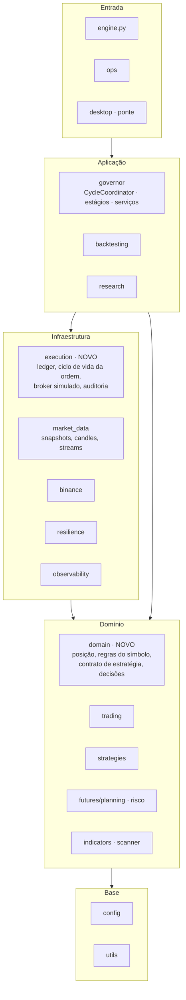
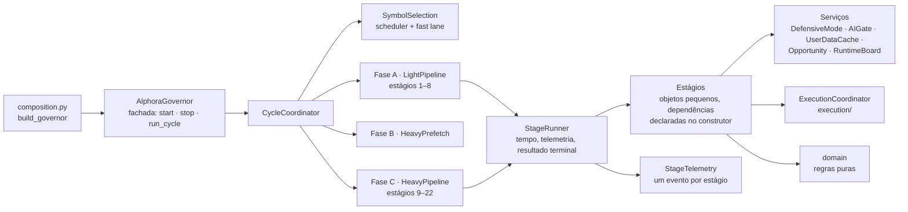
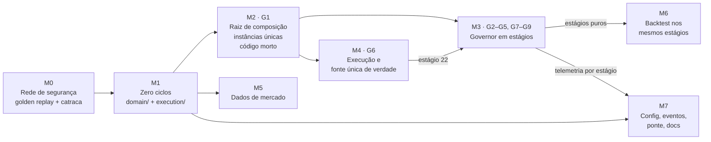
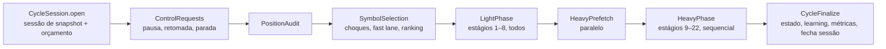
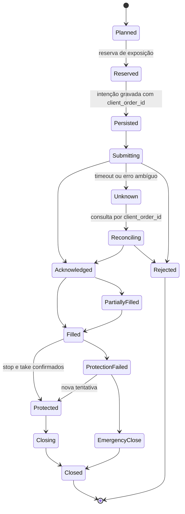

# Alphora — Plano de Migração para uma Engenharia Otimizada

> **O que é:** o plano executável que leva o código atual à arquitetura-alvo, fase por fase e PR por PR.  
> **Base de evidências:** [Mapa da arquitetura](architecture/README.md), medido no commit `01e2f6e` com
> [`tools/architecture_metrics.py`](../tools/architecture_metrics.py).  
> **Relação com o Plano Diretor:** o [Plano Diretor](ALPHORA_SOFTWARE_ENGINEERING_OPTIMIZATION_PLAN.md) diz **o quê e
> por quê** (princípios, invariantes, governança, backlog `OPT-*`). Este documento diz **como, em que ordem e com qual
> prova**. Quando os dois divergirem sobre ordem de execução, vale este.  
> **Status:** migração estrutural M0–M7 concluída na `main`. O estágio 22 despacha negociações aprovadas pelo
> `ExecutionCoordinator`; o ciclo de vida e a recuperação das ordens são explícitos. O provider de snapshots vive em
> `market_data/snapshot_provider/`, sem o nome herdado no código, e todo o tráfego REST tem uma contagem única.
> Na M7, a configuração, as camadas, os eventos (ADR-006), os journals, a telemetria por estágio (G9), a
> ponte desktop versionada e a documentação do ciclo estão concluídos. As otimizações medidas
> OPT-010/OPT-011 e a decisão de usar `ENFORCE` por padrão aguardam medições em TESTNET/REAL (§8).

---

## Sumário

- [0. Como ler](#0-como-ler)
- [1. Diagnóstico em uma página](#1-diagnóstico-em-uma-página)
- [2. Arquitetura-alvo](#2-arquitetura-alvo)
- [3. Princípios da migração](#3-princípios-da-migração)
- [4. Mapa das fases](#4-mapa-das-fases)
- [M0 — Rede de segurança](#m0--rede-de-segurança)
- [M1 — Fronteiras: zero ciclos entre pacotes](#m1--fronteiras-zero-ciclos-entre-pacotes)
- [M2 — Raiz de composição e instâncias únicas](#m2--raiz-de-composição-e-instâncias-únicas)
- [M3 — Governor: do mixin ao pipeline de estágios](#m3--governor-do-mixin-ao-pipeline-de-estágios)
- [M4 — Execução e fonte única de verdade](#m4--execução-e-fonte-única-de-verdade)
- [M5 — Dados de mercado](#m5--dados-de-mercado)
- [M6 — Backtest sobre os mesmos estágios](#m6--backtest-sobre-os-mesmos-estágios)
- [M7 — Plataforma: configuração, eventos, ponte e documentação](#m7--plataforma-configuração-eventos-ponte-e-documentação)
- [5. Métricas da migração](#5-métricas-da-migração)
- [6. Riscos e rollback](#6-riscos-e-rollback)
- [7. Os primeiros 12 PRs](#7-os-primeiros-12-prs)
- [8. Acompanhamento](#8-acompanhamento)
- [9. Correspondência com o backlog do Plano Diretor](#9-correspondência-com-o-backlog-do-plano-diretor)

---

## 0. Como ler

- Cada fase (`M0`…`M7`) tem **objetivo, entradas, passos, critério de saída e rollback**.
- O Governor tem um roteiro próprio (`G1`…`G9`) dentro das fases M2, M3 e M4.
- Toda afirmação sobre o código atual aponta para a página do mapa que a demonstra.
- “Linhas” significa linhas de código sem brancos e comentários, como mede a ferramenta.
- Nenhuma fase muda estratégia, risco, sizing ou parâmetros financeiros. Mudança de comportamento é **outro PR**,
  com outro rótulo e outra revisão (ver [princípio 3](#3-princípios-da-migração)).

---

## 1. Diagnóstico em uma página

Os dez problemas estruturais que este plano resolve, em ordem de dependência (resolver os de cima destrava os de baixo):

| # | Problema | Evidência | Consequência | Fase |
|---:|---|---|---|---|
| 1 | Não existe rede de comparação de comportamento | Nenhum teste de replay; 24 arquivos de teste montam o Governor com `object.__new__` e trocam atributos | Qualquer refatoração depende de revisão manual | M0 |
| 2 | **11 ciclos** entre pacotes | [Pacotes §3](architecture/pacotes-e-dependencias.md#3-os-11-ciclos-entre-pacotes) | Nenhum pacote de baixo é testável ou reutilizável sem o Governor | M1 |
| 3 | O Governor constrói tudo e não há raiz de composição | [Governor §1](architecture/governor.md#1-composição) | Componentes criados 2–4 vezes com estado separado | M2 |
| 4 | Instâncias duplicadas de `TradeAuditRecorder`, `StateReconciliationEngine`, `FuturesRiskGuard` e do journal de eventos | [Decisão §5](architecture/decisao-e-execucao.md#5-componentes-duplicados) | Contadores diários e configurações podem viver em objetos diferentes | M2 |
| 5 | `SymbolEvaluationContext` é um quadro-negro: 58 campos, **35 `Any`** | [Governor §6](architecture/governor.md#6-o-contexto-compartilhado-entre-os-estágios) | Estágio não testável sozinho; mypy cego no caminho financeiro | M3 (G2) |
| 6 | 7 mixins formando uma só classe: 106 `getattr(self)` e 130 chamadas cruzadas só no `TradePipelineMixin` | [Governor §9](architecture/governor.md#9-acoplamento-entre-os-mixins) | 14 módulos com `ignore_errors` no mypy | M3 |
| 7 | Ciclo de vida da ordem espalhado por funções de 250–480 linhas | `_open_position` 482, `_execute_approved_intent` 449, `_revalidate_evaluation_for_execution` 419 | Caminho mais crítico é o menos legível | M4 |
| 8 | Cinco representações do estado de posição | [Decisão §6](architecture/decisao-e-execucao.md#6-onde-está-a-verdade-sobre-uma-posição) | Reconciliação por regras distribuídas | M4 |
| 9 | O backtest reimplementa a decisão (`GovernorSimulator`, 1.969 linhas) | [Pesquisa §1](architecture/pesquisa-observabilidade-desktop.md#1-backtest) | Regra muda no live e não muda no backtest | M6 |
| 10 | Dívida de plataforma: `load_config` com 724 linhas, dois sistemas de eventos, 693 referências a “coalestra”, contratos de subprocesso por texto no stdout, código morto | [Pacotes §5](architecture/pacotes-e-dependencias.md#5-código-morto-legado-e-nomes-herdados) | Custo de mudança alto e nomes enganosos | M2, M5, M7 |

**O que já é bom e vai ser aproveitado:** o executor de estágios (`_run_symbol_evaluation_stages`) já existe, mede cada
estágio e para no primeiro resultado terminal. Os tipos de passagem congelados (`LightEvaluation`, `HeavyEvaluation`,
`IntentCandidate`, `PlannedTrade`, `ValidatedTrade`, `ExecutableTrade`) também já existem. A migração do Governor
**não inventa um pipeline**: ela troca, uma entrada por vez, os métodos do pipeline atual por objetos de estágio.

---

## 2. Arquitetura-alvo

### 2.1. Camadas e regra de dependência



**Regra:** um pacote só importa pacotes da própria camada ou de camadas abaixo. O domínio não conhece Binance, arquivos,
threads nem relógio de parede. A infraestrutura implementa os *ports* que o domínio e a aplicação declaram.

### 2.2. Árvore de pacotes alvo

A árvore muda **pouco**: dois pacotes novos e o Governor reorganizado por dentro. O resto fica onde está.

```text
src/
  domain/                    NOVO   modelos e regras puras, sem I/O
    models.py                       FuturesPosition, PositionDirection, TradeAction,
                                    TradeDecision, MarketSnapshot             (de futures/models, M1 ✔)
    symbol_rules.py                 SymbolRules e arredondamentos             (de futures/exchange_rules, M1 ✔)
    trade_result.py                 TradeResult                               (de futures/performance, M1 ✔)
    decisions.py                    GateDecision: contrato comum de bloqueio  (G5)
    orders.py                       OrderState e transições                   (M4)
  config/                           + symbol_context, smart_settings, ws_endpoints,
                                    regime_policy_modes                       (de governor/ e futures/, M1 ✔)
  binance/
    retry_policies.py               políticas e predicados de retry da Binance (de resilience/, M1 ✔)
  strategies/
    loader.py                       carregador de estratégias                 (de futures/strategy_loader, M1 ✔)
  execution/                 NOVO   efeitos e estado financeiro
    state_reconciliation.py         StateReconciliationEngine                 (de governor/, M1 ✔)
    trade_audit.py                  TradeAuditRecorder                        (de governor/, M1 ✔)
    ledger.py                       PositionLedger: fonte única               (M4)
    lifecycle.py                    OrderLifecycle                            (M4)
    simulated_broker.py             SimulatedBroker                           (hoje em futures/, vem em M4)
  governor/
    composition.py           NOVO   raiz de composição                        (M2)
    evaluation/                     contexto tipado + executor de estágios    (G2, G3)
    stages/                         um módulo por grupo de estágios           (G4–G6)
    services/                       defensivo, gate de IA, user data, oportunidade (G8)
    cycle/                          CycleCoordinator e as fases A/B/C         (G7)
    alphora_governor.py             fachada fina: start, stop, run_cycle
  market_data/
    snapshot_provider/              de governor/coalestra_provider.py, renomeado (M5)
```

Os módulos antigos ficam como **reexportação de compatibilidade** até o fim da fase. Cada reexportação tem um
comentário com a fase que a remove, e a catraca de métricas conta quantas restam.

### 2.3. O Governor ao final



O `AlphoraGovernor` deixa de herdar mixins. Ele recebe tudo pronto da raiz de composição e só controla o ciclo de vida.

---

## 3. Princípios da migração

1. **Estrangulamento por estágio.** O executor aceita qualquer chamável `(contexto) → resultado | None`. Trocar um método
   por um objeto de estágio é trocar **uma entrada de uma tupla**. Reverter é desfazer essa linha.
2. **Expandir → comparar → migrar → remover.** O código novo nasce ao lado do antigo, o replay prova equivalência, as
   chamadas migram e só então o antigo é apagado, em PR separado.
3. **Refatoração não muda comportamento.** Se o golden replay muda, o PR não é refatoração. Mudanças intencionais de
   comportamento vão em PR próprio, com o rótulo `behavior-change`, e atualizam o golden ali mesmo, com a diferença
   explicada.
4. **Catraca, não meta.** As métricas estruturais só podem melhorar. Um PR que piora um número falha no CI; um PR que
   melhora abaixa o teto.
5. **Um movimento por PR.** Mover arquivo, renomear e mudar lógica nunca acontecem no mesmo PR.
6. **Dono único.** Cada arquivo de estado ou journal tem um único objeto responsável por escrever nele, criado pela raiz
   de composição.
7. **Serialização de efeitos preservada.** A Fase C continua sequencial: uma ordem invalida os snapshots privados dos
   símbolos seguintes ([Governor §4](architecture/governor.md#4-anatomia-de-um-ciclo-run_cycle)).
8. **Coordenação com mudanças paralelas.** O código está sendo reorganizado em paralelo. Cada PR é pequeno, faz rebase
   cedo e, quando encontra um caminho que mudou, **só ajusta o caminho**, sem desfazer a reorganização.

---

## 4. Mapa das fases



| Fase | Objetivo | Critério de saída | Risco |
|---|---|---|---|
| M0 | Poder provar equivalência | 8 cenários golden + catraca no CI | Baixo |
| M1 | Fronteiras limpas | 0 ciclos, regra de camadas no CI | Baixo, mecânico |
| M2 | Construção explícita | Uma instância por componente; Governor construído só pela raiz | Médio |
| M3 | Governor sem mixins | 22 estágios como objetos, contexto sem `Any`, 0 mixins | Médio a alto |
| M4 | Execução auditável | Ciclo de vida explícito, ledger único, testes de falha | Alto, caminho financeiro |
| M5 | Dados sem dívida | Sem “coalestra” no código, provider dividido, orçamento único | Baixo a médio |
| M6 | Paridade live/backtest | Backtest roda os estágios puros; testes diferenciais | Médio |
| M7 | Plataforma simples | `load_config` dividido, um sistema de eventos, ponte versionada | Baixo a médio |

M5 e M7 podem andar em paralelo com M3 e M4 porque tocam outras áreas.

---

## M0 — Rede de segurança

**Objetivo:** ter duas provas automáticas antes de mexer em qualquer estrutura: o comportamento não mudou (golden
replay) e a estrutura não piorou (catraca).

### M0.1. Golden replay do Governor

```mermaid
flowchart LR
    subgraph IN["Entrada do cenário · tests/golden/SCENARIO/"]
        CFG["config.json<br/>modo, símbolos, perfis"]
        SNAP["snapshots.json<br/>leve e pesado por ciclo"]
        CAN["candles.csv"]
        ACC["account.json<br/>conta, posições, ordens"]
    end
    subgraph H["Harness"]
        GOV["AlphoraGovernor real"]
        FAKE["FakeFuturesClient<br/>tests/fakes.py"]
        PROV["Provider de snapshots<br/>que serve o arquivo"]
        CLK["run_cycle(now=t)<br/>tempo fixo por ciclo"]
    end
    subgraph OUT["Saída comparada"]
        TR["Trilha por símbolo:<br/>estágios percorridos, estágio terminal,<br/>classificação, razão"]
        PL["Plano: quantidade, saída,<br/>sizing, comando de execução"]
        MU["Mutações no cliente:<br/>new_order, new_algo_order, cancel"]
        EV["Eventos do journal<br/>tipo + payload normalizado"]
    end
    IN --> H --> OUT
    OUT --> CMP{"igual ao<br/>expected.json?"}
```



**O que é gravado.** O executor já registra `stage_timings` (nome do estágio, status e se foi terminal). O golden grava
essa trilha **sem as durações**, o `SymbolEvaluationResult`, os parâmetros enviados ao `FakeFuturesClient` e os eventos
do journal de decisão.

**Normalização.** Há 87 chamadas diretas a relógio e UUID em `governor`, `futures` e `trading` (47 `time.time()`,
26 `uuid4()`). Na M0 elas **não** são refatoradas. O harness:

- passa `now` fixo para `run_cycle` (o parâmetro já existe);
- troca identificadores (`cycle_id`, `symbol_eval_id`, `trade_id`, `client_order_id`) por marcadores estáveis na
  ordem em que aparecem (`<id:1>`, `<id:2>`…);
- remove durações e carimbos de tempo de parede;
- mantém **exatos** os `Decimal` de preço, quantidade e notional. Diferença financeira nunca é normalizada.

Um `Clock` e um gerador de IDs injetáveis entram depois, estágio por estágio, na M3.

**Primeira leva de cenários (8):**

| Cenário | Modo | Prova |
|---|---|---|
| `no_signal` | DRY_RUN | Ciclo completo termina em “só leve” sem plano |
| `entry_approved` | TESTNET_LIVE (fake) | Os 22 estágios rodam; ordem de entrada + stop + take enviados com quantidades exatas |
| `economic_gate_block` | TESTNET_LIVE | Termina no estágio 15 com a razão do gate |
| `portfolio_risk_block` | TESTNET_LIVE | Termina no estágio 18; nenhuma mutação |
| `defensive_mode_block` | TESTNET_LIVE | Termina no estágio 6 ou 14 |
| `warmup` | DRY_RUN | Termina no estágio 3 |
| `close_with_protection` | TESTNET_LIVE | Fechamento cancela proteções e envia saída `reduceOnly` |
| `unknown_entry_result` | TESTNET_LIVE | Envio incerto → consulta por `client_order_id` → reconciliação, sem segunda ordem |

Os outros seis cenários da [lista do Plano Diretor §24.1](ALPHORA_SOFTWARE_ENGINEERING_OPTIMIZATION_PLAN.md#241-testes-golden-master)
entram na segunda leva (fast lane, quarentena, orçamento, gate de IA, learning em paper, múltiplos símbolos).

**Atualização.** `pytest tests/golden --update-golden` regrava os `expected.json`. Só é permitido em PR com o rótulo
`behavior-change`, e a revisão lê o diff do JSON.

### M0.2. Catraca de métricas estruturais

[`tools/architecture_metrics.py`](../tools/architecture_metrics.py) já mede os indicadores (ver [§5](#5-métricas-da-migração)).
A catraca é um teste que compara a medição com um arquivo de teto versionado:

```text
tests/architecture/
  baseline.json                  tetos atuais: ciclos 11, funções > 150 linhas 60, campos Any 35, ...
  test_architecture_ratchet.py   falha se algum número subir; avisa para abaixar o teto quando cair
```

Também entram na catraca o número de módulos com `ignore_errors` no mypy (hoje 14, em `pyproject.toml`) e o número de
arquivos de teste que usam `object.__new__(AlphoraGovernor)` (hoje 24).

**Critério de saída de M0:** os 8 cenários e a catraca rodam no job de testes do CI; o golden é estável em 20 execuções
seguidas nas versões 3.10 a 3.13 do Python.

**Rollback:** não se aplica. M0 só adiciona testes.

---

## M1 — Fronteiras: zero ciclos entre pacotes

**Objetivo:** cada ciclo existe porque um modelo está no pacote errado. Mover o modelo quebra o ciclo. É trabalho
mecânico, de baixo risco, e destrava todo o resto.

> **Estado (12/11/2026): concluído.** Os 11 ciclos foram quebrados, a regra de camadas está no CI e as
> reexportações de compatibilidade foram removidas.

### M1.1. Movimentos realizados

| Commit | Ciclos quebrados | Movimento | Ciclos |
|---|---|---|---:|
| `2145fcc` | `config ↔ governor`, `config ↔ futures`, `governor ↔ trading` | `SmartExecutionSettings`, `SmartSizingSettings` e `SmartSizingMinNotionalPolicy` → `config/smart_settings.py` (os *engines* continuam no Governor); `governor/symbol_context.py` e `governor/ws_endpoints.py` → `config/`; modos da política de regime e `normalize_regime_policy_mode` → `config/regime_policy_modes.py` | 11 → 8 |
| `63950d5` | `futures ↔ trading`, `futures ↔ strategies`, `market_data ↔ strategies`, `futures ↔ resilience`, `binance ↔ resilience` | `futures/models.py` → `domain/models.py`; `SymbolRules` e arredondamentos → `domain/symbol_rules.py`; `TradeResult` → `domain/trade_result.py`; políticas e predicados de retry da Binance → `binance/retry_policies.py` e `TRANSIENT_STATUS_CODES` → cliente Binance; carregador de estratégias → `strategies/loader.py`; `futures/base.py` (reexportação sem uso) removido; `market_data/requirements.py` lê os metadados da estratégia por um `Protocol` | 8 → 3 |
| `186327a` | `futures ↔ governor`, `futures ↔ research` | `StateReconciliationEngine` e `TradeAuditRecorder` → pacote novo `execution/`; `SimulatedBroker` → `futures/simulated_broker.py` | 3 → 1 |
| `f109b8c` | `observability ↔ utils` | Os dois *sinks* de snapshot saem de `observability/integrations` e vão para `governor/`, ao lado do provider | 1 → **0** |

Em cada commit, **todos os importadores** em `src/` e `tests/` passaram para o caminho novo. Cada passo foi validado com
ruff, mypy, a suíte completa (4.391 testes) e os 8 cenários golden inalterados. Nenhuma lógica mudou: só o lugar das
definições.

**Desvios em relação ao plano original, e por quê:**

| Plano original | Feito | Motivo |
|---|---|---|
| `resolve_public_market_ws_base_url` → `binance/` | → `config/ws_endpoints.py` | É uma função pura da configuração; colocá-la em `binance/` faria `config` (camada base) importar a infraestrutura |
| `FuturesStrategy` e `StrategyMetadata` → `domain/strategy.py` | O contrato fica em `strategies/`; o carregador vai para `strategies/loader.py`; `market_data` usa um `Protocol` | O contrato depende dos requisitos de dados de `market_data`; levá-lo para `domain` criaria o ciclo `domain ↔ market_data`. A volta `futures → strategies` era só do carregador e de uma reexportação sem uso |
| `TRANSIENT_STATUS_CODES` → `resilience/` | → `binance/futures_client.py` | São códigos HTTP da Binance; ficam junto das exceções do cliente |
| Injetar a política de resync no cliente por `make_client` | Políticas da Binance → `binance/retry_policies.py` | Injeção exigiria mudar todo ponto que cria o cliente e, se esquecida, desligaria o retry de `-1021`. Mover não muda comportamento e tira de `resilience` todo import da Binance |
| `SimulatedBroker` → `execution/` | → `futures/simulated_broker.py` | Ele importa oito módulos de `futures`; em `execution/` criaria o ciclo `futures ↔ execution`. Vai para `execution/` em M4, junto com o `FuturesTradingEngine` |

### M1.2. Regra de camadas no CI (`44946d7`)

`tools/architecture_metrics.py` atribui cada pacote a uma camada (`LAYERS`, conforme §2.1) e lista os imports que apontam
para uma camada acima. `tests/architecture/test_layer_rules.py` falha se surgir um ciclo, um pacote sem camada ou um
import para cima que não esteja em `tests/architecture/layer_exceptions.json`. Essa lista **só diminui**: quando uma
exceção some, o teste avisa para retirá-la.

| Exceção na conclusão de M1 | Imports | Some em |
|---|---:|---|
| `domain → market_data` | 1 (só tipo: `Candle` em `MarketSnapshot`) | M3, levando `Candle` para `domain` |
| `futures → binance` | 8 | M4, com o `FuturesTradingEngine` em `execution/` |
| `futures → execution` | 3 | M4 |
| `futures → resilience` | 4 | M4 |
| `strategies → market_data` | 5 | M6, com os contratos de dados em `domain` |
| `strategies → research` | 2 | M6, com o contrato do modelo de IA fora de `research` |
| `trading_cadence → market_data` | 1 | M7 |
| `utils → observability` | 10 | M7, com o sistema único de eventos |

As entradas de M6 foram removidas da lista efetiva em `tests/architecture/layer_exceptions.json`; a tabela acima preserva a medição histórica de M1.

### M1.3. Fechamento de M1

As reexportações de compatibilidade foram removidas. Cada módulo repassava nomes para o caminho novo:

| Reexportação | Caminho novo |
|---|---|
| `governor/symbol_context.py` | `config.symbol_context` |
| `governor/ws_endpoints.py` | `config.ws_endpoints` |
| `futures/models.py` | `domain.models` |
| `futures/performance/trade_result.py` | `domain.trade_result` |
| nomes `SymbolRules`, `format_decimal`, `round_*` em `futures/exchange_rules.py` | `domain.symbol_rules` |
| `research/simulated_broker.py` | `futures.simulated_broker` |
| `governor/state_reconciliation.py` | `execution.state_reconciliation` |
| `governor/trade_audit.py` | `execution.trade_audit` |

Os dois consumidores restantes em `tests/golden/harness.py` foram migrados para `domain.models` e
`config.symbol_context`. Os sete módulos que eram apenas aliases foram apagados e `futures/exchange_rules.py`
passou a exportar somente `extract_symbol_rules`.

**Critério de saída:** `architecture_metrics.py` reporta 0 ciclos ✔; golden inalterado ✔; regra de camadas no CI ✔;
reexportações de M1 removidas ✔.

**Rollback:** reverter o PR. Movimentos não alteram lógica.

---

## M2 — Raiz de composição e instâncias únicas

Corresponde ao passo **G1** do Governor.

**Objetivo:** um único lugar decide o que é criado e quem compartilha o quê. Isso elimina as duplicações e permite que
testes e backtest montem o sistema com peças trocadas, sem `object.__new__`.

> **Estado (12/11/2026): concluído.** A raiz de composição foi extraída, os componentes operacionais duplicados foram
> unificados, a fábrica de testes foi criada e o código morto listado abaixo foi removido.

### M2.1. Passos

1. **Extrair a construção.** Criar `governor/composition.py` com `GovernorComponents` (dataclass congelada com os ~85
   componentes agrupados: dados, decisão, risco, execução, estado) e `build_governor_components(config, client)`. O
   `AlphoraGovernor.__init__` passa a chamar essa função e copiar os atributos. **Nenhuma mudança de comportamento:**
   golden inalterado.
2. **Uma instância por componente.** A raiz cria uma vez e injeta:

   | Componente | Hoje | Depois |
   |---|---|---|
   | `TradeAuditRecorder` | 3 instâncias: Governor, `ExecutionEngine`, cada `FuturesTradingEngine` | 1, injetada |
   | `StateReconciliationEngine` | Governor, cada `FuturesTradingEngine` e **uma nova a cada avaliação** (`symbol_eval_mixin.py:1710`) | 1, injetada |
   | `FuturesRiskGuard` | Criado no engine, sobrescrito pelo `ExecutionEngine`, criado de novo em `execution_engine.py:860, 1212` e em `symbol_eval_mixin.py:1460` | 1 por símbolo, dono `ExecutionEngine` |
   | Journal `data/governor_events.jsonl` | Dois `TradeJournal` (Governor e `ExecutionEngine`) | 1 dono, injetado |
   | `paper_journal` | Criado com caminho fixo e depois trocado | Criado uma vez com o caminho certo |

   O `FuturesRiskGuard` é o ponto delicado: os contadores diários precisam continuar com a mesma semântica. Antes de
   unificar, um teste prova quais instâncias o caminho de abertura realmente consulta hoje.
3. **Testes deixam de usar `object.__new__`.** Um `build_governor_for_tests(**overrides)` em `tests/` monta o Governor
   pela raiz com peças trocadas. Os 24 arquivos migram aos poucos; a catraca impede que surjam novos.
4. **Código morto sai**, um item por PR, cada um com evidência de zero chamadores:
   - `FuturesTradingEngine.start()` e `run_once()` (`futures/engine.py:84-95`);
   - `futures/portfolio_risk.py` (placeholder) e o teste que só cobre ele;
   - `publish_market_snapshot` (`governor/coalestra_provider.py:1076`). Antes, um ADR decide entre remover ou ligar o
     preço do WebSocket ao Snapshot Engine. Ligar é mudança de comportamento e vai para M5.

**Critério de saída:** golden inalterado; o construtor do Governor não chama nenhum construtor de componente
diretamente; catraca: 1 instância de cada componente da tabela.

### M2.2. Implementação realizada

- `governor/composition.py` contém `GovernorComponents`, congelado e agrupado em dados, decisão, risco, execução e
  estado, além de `build_governor_components`. O construtor instala o grafo retornado e não cria componentes.
- `TradeAuditRecorder`, `StateReconciliationEngine` e o journal `governor_events.jsonl` têm uma instância compartilhada
  entre Governor, `ExecutionEngine` e engines por símbolo.
- `ExecutionEngine` possui um cache de `FuturesRiskGuard`: exatamente uma instância por símbolo é usada tanto na
  avaliação quanto na abertura. O teste de caracterização prova que ela lê o journal de paper correto e mantém o
  contador diário.
- O `paper_journal` nasce uma única vez, já com o caminho específico do símbolo e ambiente.
- `tests/governor/factory.py` fornece `build_governor_for_tests`; a primeira migração reduziu a catraca de arquivos com
  `object.__new__(AlphoraGovernor)` de 24 para 23. As migrações restantes continuam incrementais nas fases seguintes.
- Foram removidos `FuturesTradingEngine.start/run_once`, o placeholder `futures/portfolio_risk.py` e seus testes.
- `publish_market_snapshot` e seu conversor exclusivo foram removidos conforme
  [ADR-001](architecture/ADR-001-market-stream-snapshot-boundary.md); ligar o WebSocket ao Snapshot Engine continua
  reservado para M5 por ser mudança de comportamento.

**Validação:** golden inalterado; composição e identidade cobertas por testes; catracas reduzidas para 23 bypasses e
687 referências ao nome legado; 0 ciclos mantidos.

**Rollback:** passo 1 é reversível por um PR; os passos 2 e 4 são um PR por item.

---

## M3 — Governor: do mixin ao pipeline de estágios

O Governor tem 26.975 linhas (29% do código). Esta fase leva o Governor de **7 mixins com contratos implícitos** a
**estágios e serviços com dependências declaradas**, sem parar o sistema em nenhum momento.

> **Estado (13/11/2026): concluído.** O `AlphoraGovernor` não herda nenhum mixin: os 22 estágios são objetos em
> `governor/stages/`, o comportamento dos 7 mixins está em serviços (`governor/services/`), no ciclo
> (`governor/cycle/`) e no avaliador (`governor/evaluation/`), e a fachada e a raiz de composição passam no mypy
> estrito. O estágio 22 virou objeto em M3 sobre o `ExecutionEngine` atual; M4 troca o despacho dele pelo
> `ExecutionCoordinator`. G9 depende do sistema único de eventos e foi para M7. Detalhes em
> [M3.1](#m31-implementação-realizada).

### Roteiro G1–G9

| Passo | O que muda | Fase | Depende de |
|---|---|---|---|
| G1 | Raiz de composição | M2 | M1 |
| G2 | Contexto de avaliação tipado | M3 | M1 (`domain/`) |
| G3 | Protocolo de estágio, executor e saídas compartilhadas | M3 | G1 |
| G4 | Serviços sem acoplamento e estágios folha (2–8, 12–14) | M3 | G3 |
| G5 | Estágios de contexto, decisão, planejamento e risco (1, 9–11, 15–21) | M3 | G4 |
| G6 | Estágio 22 como objeto (M3); despacho sobre o `ExecutionCoordinator` (M4) | M3 → M4 | G5; M4.3 |
| G7 | `CycleCoordinator`: `run_cycle` em fases | M3 | G5 |
| G8 | Serviços restantes e fim dos mixins | M3 | G6, G7 |
| G9 | Telemetria única por estágio | M7 | G3, sistema único de eventos |

### G2 — Contexto tipado

Hoje o contexto tem os tipos congelados **e** os mesmos dados soltos em campos `Any` (`light`, `heavy`, `score`,
`planned_exit`…). O caminho é tornar os tipos congelados a fonte da verdade:

1. Trocar cada `Any` pelo tipo real (35 campos). Os tipos existem: `LightMarketSnapshot`, `HeavyMarketSnapshot`,
   `SignalScore`, `EconomicGateDecision`, `SmartSizingDecision`, `PortfolioRiskDecision`… Só passa a ser verificado
   depois de M1, quando importar esses tipos não cria ciclo.
2. Agrupar por fase em sub-objetos: `light_phase`, `heavy_phase`, `plan_phase`, `execution_phase`, cada um preenchido
   por um grupo de estágios. Os campos antigos viram **propriedades somente leitura** que leem do sub-objeto.
3. Rodar o mypy com `--strict` em `governor.symbol_evaluation_pipeline` (o módulo não está na lista de
   `ignore_errors`, mas hoje o `Any` esconde os erros).
4. Remover as propriedades de compatibilidade quando nenhum estágio as usar.

**Saída:** 0 campos `Any`; cada campo tem um único estágio escritor, documentado no próprio campo.

### G3 — Protocolo de estágio

```python
class EvaluationStage(Protocol):
    name: str  # o mesmo nome de métrica de hoje (_STAGE_METRIC_NAMES)

    def __call__(self, evaluation: SymbolEvaluationContext) -> SymbolEvaluationResult | None: ...
```

Três mudanças pequenas tornam métodos e objetos intercambiáveis:

1. **Executor.** `_run_symbol_evaluation_stages` passa a usar `getattr(stage, "name", None) or
   _stage_metric_name(stage.__name__)`. Os nomes de métrica não mudam, então a telemetria e o golden também não.
2. **Saídas compartilhadas.** `_make_terminal_result` (37 chamadas) e `_mark_blocked` (30 chamadas) dependem de
   `self`. Eles viram um colaborador, `StageOutcomes`, que recebe o journal de decisões e o quadro de estado dos símbolos
   (`snapshots`, que vira `SymbolRuntimeBoard`). Os métodos antigos delegam para ele.
3. **Dependências declaradas.** Cada estágio recebe no construtor só os *ports* de que precisa (Protocols pequenos), nunca
   o Governor. A raiz de composição (G1) monta as tuplas de estágios.

**Saída:** o executor roda uma tupla mista (métodos e objetos) com golden inalterado; existe um teste de unidade de
estágio que monta só o contexto e os *fakes* dos *ports*.

### G4 e G5 — Ordem de extração dos 22 estágios

A ordem segue **risco crescente e acoplamento crescente**. O método é validado nos estágios pequenos antes de chegar ao
caminho financeiro.

| Ordem | # | Estágio atual | Linhas | Objeto alvo | Depende de | Risco |
|---:|---:|---|---:|---|---|---|
| 1 | 3 | `_handle_warmup` | 12 | `WarmupStage` | `StageOutcomes` | Baixo |
| 2 | 4, 12 | `_run_symbol_warmup_pre/post_heavy` | 14 + 13 | `SymbolWarmupStage(fase)` | rastreador de warmup | Baixo |
| 3 | 5, 13 | `_run_symbol_quarantine_pre/post_heavy` | 17 + 19 | `QuarantineStage(fase)` | quarentena | Baixo |
| 4 | 8 | `_run_request_budget_guard` | 22 | `RequestBudgetStage` | `RequestBudget` | Baixo |
| 5 | 7 | `_handle_light_only` | 36 | `LightOnlyStage` | journal de score | Baixo |
| 6 | 2 | `_handle_manual_or_protection_status` | 35 | `ManualControlStage` | pedidos de controle | Baixo |
| 7 | — | `AIGateMixin` → `AIGateService` | 6 métodos | serviço | nenhum outro mixin | Baixo |
| 8 | — | `DefensiveModeMixin` → `DefensiveModeService` | 11 métodos | serviço | nenhum outro mixin | Baixo |
| 9 | 6, 14 | `_run_pre/post_heavy_guards` | 55 + 79 | `DefensiveAndAIGuardStage(fase)` | os dois serviços acima | Médio |
| 10 | 1 | `_build_light_evaluation_context` | 169 | `LightContextStage` | router, scheduler, rastreador de estado | Médio |
| 11 | 9 | `_build_heavy_evaluation_context` | 201 | `HeavyContextStage` | sessão de snapshots | Médio |
| 12 | 10 | `_run_hot_symbol_decision` | 120 | `HotSymbolDecisionStage` | `StrategyCoordinator`, `HotSymbolWorker` | Médio |
| 13 | 11 | `_run_state_reconciliation_guard` | 68 | `StateReconciliationStage` | instância única de M2 | Médio |
| 14 | 15 | `_build_and_validate_trade_plan` | 132 | `TradePlanStage` | `EconomicTradeGate`, planejamento | Alto |
| 15 | 16 | `_apply_intelligent_layers` | 134 | `IntelligentLayersStage` | camadas inteligentes | Alto |
| 16 | 17 | `_run_smart_sizing` | 105 | `SmartSizingStage` | `SmartSizingEngine` | Alto |
| 17 | 18 | `_run_final_execution_guards` | 184 | `FinalRiskGuardsStage` | `PortfolioRiskEngine`, gate final | Alto |
| 18 | 19 | `_run_learning_execution_guards` | 289 | `LearningExecutionStage` (dividido em paper e testnet) | learning | Alto |
| 19 | 20 | `_run_smart_execution` | 93 | `SmartExecutionStage` | `SmartExecutionEngine` | Alto |
| 20 | 21 | `_run_execution_planner` | 78 | `ExecutionPlannerStage` | planner | Alto |
| 21 | 22 | `_execute_approved_intent` + `_revalidate_evaluation_for_execution` | 449 + 419 | `ExecutionRevalidationStage` + `DispatchStage` | `ExecutionCoordinator` (M4) | **Muito alto** |

**Por que o planejamento não vem primeiro** (diferente da versão 1 do Plano Diretor): os estágios 15–21 estão no
`TradePipelineMixin`, que faz 89 chamadas a outros mixins e 41 à classe base. Extrair um `TradePlanningService` antes
de G2 e G3 obrigaria a passar o contexto `Any` inteiro ou o próprio Governor, o que viola a regra do próprio Plano
Diretor de não passar `self`. O `TradePlanningService` continua existindo como **fachada dos estágios 15–17** quando
eles estiverem extraídos.

**Contrato comum de bloqueio (G5).** Os gates devolvem tipos diferentes (`EconomicGateDecision`,
`PortfolioRiskDecision`, `PreExecutionGuardDecision`, `RiskGuardDecision`, `DefensiveModeEvaluation`). Cada um ganha um
adaptador para `domain/decisions.GateDecision` (`allow | block | reduce`, código estável, valores, limites, idade da
fonte). Os estágios traduzem `GateDecision` para resultado terminal num único lugar.

**Teste de cada extração.** Cada PR de estágio traz: (a) golden inalterado; (b) testes de unidade do estágio com *fakes*;
(c) os testes antigos do mixin para aquele estágio migrados para o objeto; (d) o método antigo apagado no PR seguinte.

### G7 — `CycleCoordinator`

`run_cycle` (266 linhas) vira uma sequência explícita, cada parte testável:



O coordenador recebe um `Clock`. O `now` deixa de ser lido em vários lugares do ciclo.

### G8 — Fim dos mixins

Depois de G6 e G7, o que resta nos mixins vira serviço:

| Mixin | Métodos | `getattr(self)` | Destino |
|---|---:|---:|---|
| `UserDataCacheMixin` | 31 | 29 | `UserDataCacheService` (os módulos `user_data_cache_*` já são separados; o mixin é só cola) |
| `OpportunityMixin` | 19 | 10 | `OpportunityService` + `RequestBudgetStage` |
| `CycleMixin` | 44 | 21 | `CycleCoordinator` (G7) |
| `SymbolEvalMixin` | 50 | 17 | estágios + `StageRunner` |
| `TradePipelineMixin` | 62 | 24 | estágios 15–22 |

**Saída de M3:** `AlphoraGovernor` sem herança de mixins; os 8 módulos do Governor (7 mixins e `alphora_governor`)
fora do `ignore_errors` do mypy (ou apagados); 0 `getattr(self, …)` dinâmicos; a maior função do Governor com menos de 150 linhas.

### M3.1. Implementação realizada

| Commit | Passo | Conteúdo |
|---|---|---|
| `07526eb` | G3 | `governor/evaluation/`: `EvaluationStage`, `StageRunner`, `StageOutcomes` e `SymbolRuntimeBoard`. O executor aceita métodos e objetos; `_make_terminal_result`, `_mark_blocked` e `_mark_no_action` delegam |
| `b8a5af7` | G2 | Os 35 campos `Any` do contexto viram tipos reais, agrupados por fase, cada um com o estágio escritor documentado; `reset_plan_for_replan` substitui os 26 resets inline do replan; mypy com opções estritas no contexto, em `governor.evaluation`, `governor.stages` e `governor.services` |
| `582d378` | G4 | `AIGateMixin` → `AIGateService` e `DefensiveModeMixin` → `DefensiveModeService` em `governor/services/`; testes dos mixins migrados para os serviços |
| `3605006` | G4 | Estágios 2–8 e 12–14 como objetos: `ManualControlStage`, `WarmupStage`, `SymbolWarmupStage(fase)`, `QuarantineStage(fase)`, `DefensiveAndAIGuardStage(fase)`, `LightOnlyStage`, `RequestBudgetStage` |
| `f75d457` | G5 | Estágios 10 e 11: `HotSymbolDecisionStage` e `StateReconciliationStage` (reaproveitado pela revalidação do estágio 22) |
| `1e323ab` | G5 | Estágios 1 e 9: `LightContextStage` e `HeavyContextStage`, com *ports* agrupados em dataclasses tipadas |
| `349092d` | G5 | Estágios 17, 20 e 21: `SmartSizingStage`, `SmartExecutionStage` e `ExecutionPlannerStage`; uma tupla única `_plan_stages` (15–21) serve o pipeline e o replan pré-envio |
| `9de3948` | G5 | Estágios 15 e 16: `TradePlanStage` e `IntelligentLayersStage`, orquestrando os ajudantes de planejamento por *ports* |
| `53e6c7f` | G5 | Estágios 18 e 19: `FinalRiskGuardsStage` e `LearningExecutionStage` |
| `767867d` | G5 | `domain/decisions.GateDecision`, adaptadores em `governor/evaluation/gates.py` e `StageOutcomes.gate_blocked`; adotado pelos estágios 6 e 14 |
| `7bcc844` | G7 | `run_cycle` (273 linhas) → `CycleCoordinator` em `governor/cycle/`, com `Clock` e `CyclePorts`; fases nomeadas e fechamento em `finally` |
| `9e910a9`, `56f97b8` | G8 | `OpportunityMixin` → `OpportunityService` e `RequestBudgetService` |
| `77a4877` | G8 | 14 testes que ainda chamavam o `OpportunityMixin` migrados para os serviços (a `main` estava vermelha) |
| `956fb44` | G8 | `UserDataCacheMixin` → `services/user_data_cache.py` (`UserDataCacheService`); os 12 arquivos `test_governor_user_data_*` constroem o serviço |
| `6c2ce7f` | G8 | `CycleMixin` → `cycle/wakeup.py` (`MarketWakeup`), `cycle/snapshots.py` (`CycleSnapshots`), `cycle/prefetch.py` (`HeavyPrefetcher`), `cycle/telemetry.py` (`CycleTelemetry`), `services/fast_lane.py`, `services/learning.py`, `services/trade_events.py` |
| `cc0943c` | G8 | `SymbolEvalMixin` → `evaluation/evaluator.py` (`SymbolEvaluator`), `evaluation/transitions.py`, `services/trend_context.py`, `services/symbol_health.py`; a raiz de composição cria a quarentena sem passar pelo Governor |
| `2eb366d` | G6, G8 | `TradePipelineMixin` → estágio 22 em `stages/execution.py` (`ExecutionRevalidation`, `PreDispatchPriceCheck`, `ExecutionStage` com `ExecutionPorts`) e os serviços `economic_gate`, `trade_planning`, `intelligent_flow` e `adaptive_management`; o Governor deixa de herdar mixins |
| `26d1448` | G8 | Governor tipado (contrato de atributos) e fora do `ignore_errors`; fachada e raiz de composição no mypy estrito; 0 `getattr(self)`; `build_governor_components` dividido por grupo e `HeavyContextStage` por passo (maiores funções ≤ 150 linhas); catraca mede o Governor, não só os mixins |
| `b02e6ed` | prova | Seis cenários golden novos, gravados com o código anterior à refatoração (`56f97b8`) e reproduzidos pelo código novo: `dynamic_plan_entry`, `learning_shadow_entry`, `paper_entry`, `dry_run_entry`, `short_entry`, `adaptive_open_position` |
| `1e9784f` | robustez | `EventSink` descartava um journal vazio que define `__len__` (eventos do pipeline perdidos sem erro); a falha ao montar o heavy degradado da saída no estágio 22 passa a ser registrada |

**Como os estágios e serviços recebem as dependências.** O Governor monta serviços e tuplas de estágios **sob
demanda**, a partir dos atributos que a raiz de composição instalou (o contrato tipado no topo da classe). Montar
uma vez na raiz quebraria o harness golden e os testes que trocam o journal, o coordenador ou o executor depois da
construção; essa troca vai para a raiz quando os testes usarem só `build_governor_for_tests`. O estado que precisa
durar entre instâncias sob demanda mora em objetos pequenos criados pela raiz: `MarketWakeup`,
`CycleMetricsState`, `LearningReportState`, o dicionário de auditorias do cache privado e o de cooldown do fast lane.

**Mapa do que saiu de cada mixin:**

| Mixin | Destino |
|---|---|
| `AIGateMixin`, `DefensiveModeMixin` | `services/ai_gate.py`, `services/defensive_mode.py` |
| `OpportunityMixin` | `services/opportunity.py`, `services/request_budget.py` |
| `UserDataCacheMixin` | `services/user_data_cache.py` |
| `CycleMixin` | `cycle/wakeup.py`, `cycle/snapshots.py`, `cycle/prefetch.py`, `cycle/telemetry.py`, `services/fast_lane.py`, `services/learning.py`, `services/trade_events.py`; `run_cycle`, as portas do ciclo e os pedidos de controle ficam na fachada |
| `SymbolEvalMixin` | `evaluation/evaluator.py`, `evaluation/transitions.py`, `services/trend_context.py`, `services/symbol_health.py`; a montagem das tuplas de estágios fica na fachada |
| `TradePipelineMixin` | `stages/execution.py` (estágio 22), `services/economic_gate.py`, `services/trade_planning.py`, `services/intelligent_flow.py`, `services/adaptive_management.py`, `services/trade_events.py`, `services/learning.py` |

**Decisões e desvios:**

| Plano | Feito | Motivo |
|---|---|---|
| `snapshots` vira `SymbolRuntimeBoard` | O quadro **envolve** o dicionário `snapshots` do Governor | O dicionário é lido pelo state writer e pela interface; envolver evita copiar estado |
| Campos do contexto em sub-objetos por fase | Campos agrupados e comentados por fase, sem sub-objetos | Os estágios 15–22 ainda escrevem os campos diretamente; os sub-objetos entram quando eles forem objetos |
| “Um único estágio escritor” por campo | Escritor principal documentado; as atualizações da revalidação (estágio 22) aparecem ao lado do campo | A revalidação refaz o plano por desenho; o teste `test_every_context_field_documents_its_writer_stage` impede campo sem dono |
| Catraca conta mixins de uma lista fixa | `tools/architecture_metrics.py` lê as bases de `AlphoraGovernor` | Com a lista fixa, apagar um mixin quebrava a medição |
| `LearningExecutionStage` dividido em paper e testnet | Um estágio, com paper, testnet e revalidação em métodos separados | Dois estágios mudariam a trilha de estágios e o golden; a divisão vai num PR `behavior-change` |
| Estágios 15, 16, 18 e 19 sem acesso ao Governor | Recebem os ajudantes do `TradePipelineMixin` como *ports* nomeados | Os ajudantes viram serviços em G8 sem mexer nos estágios |
| `GateDecision` em todos os gates | Contrato e adaptadores para os sete gates; tradução única adotada nos estágios 6 e 14 | Nos demais, o bloqueio intercala transições de estado e eventos; adotar ali é o próximo passo, um estágio por PR |
| G6 (estágio 22) sobre o `ExecutionCoordinator`, em M4 | Estágio 22 virou objeto em M3, sobre o `ExecutionEngine` atual, com dependências em `ExecutionPorts` | Era o único bloqueio do fim dos mixins. M4 troca só o despacho (`ExecutionStage._dispatch`) pelo `ExecutionCoordinator`, sem mexer no Governor |
| Estágio 22 dividido em `ExecutionRevalidationStage` + `DispatchStage` | Um estágio (`pre_execution_execution`) composto por `ExecutionRevalidation`, `PreDispatchPriceCheck` e os passos do despacho | Dois estágios mudariam a trilha de estágios e o golden |
| G9 em M3/M7 | Movido para M7 | O evento único por estágio depende do sistema único de eventos (M7); emitir eventos novos agora mudaria o golden |
| Catraca de `getattr(self)` conta só os mixins | Conta também o `AlphoraGovernor` | Sem mixins a medição antiga dava 0 por construção; o Governor tinha 27 |
| “Maior função do Governor” | Medida na fachada, na raiz de composição e nos pacotes `cycle`, `evaluation`, `services` e `stages` | É o código que saiu dos mixins; `pre_execution_guard.evaluate` (348) e o stale guard do cache (312) são regras de domínio do pacote `governor/` fora deste escopo |

**Saída de M3, medida:** `AlphoraGovernor` sem herança de mixins; os 8 módulos do Governor apagados (7 mixins) ou
fora do `ignore_errors` (`alphora_governor`, agora no mypy estrito junto com `composition`); **0** `getattr(self)` no
Governor; maior função do escopo do Governor com **149** linhas (`LightContextStage.__call__`).

**Catraca ao fim de M3:** campos `Any` 35 → **0**; mixins 7 → **0**; `getattr(self)` 106 → **0**; módulos com
`ignore_errors` 14 → **6** (só `futures.engine*`, alvo de M4); arquivos de teste com `object.__new__(AlphoraGovernor)`
24 → **0**; funções com mais de 150 linhas 60 → **49**; referências ao nome legado 693 → **643**; cenários golden
8 → **14**. Golden inalterado em todos os commits; suíte completa com 4.491 testes verdes.

**Pendências transferidas:**

- **M4:** o despacho do estágio 22 sobre o `ExecutionCoordinator` e o `OrderLifecycle`; os testes de falha do envio.
- **M7:** G9, a telemetria única por estágio pelo sistema único de eventos.
- **Montagem na raiz:** as tuplas de estágios e os serviços passam a ser montados pela raiz de composição quando os
  testes deixarem de trocar colaboradores depois da construção (hoje o Governor monta tudo sob demanda).
- **Metas de §5 não atingidas em M3:** funções com mais de 150 linhas ficaram em 49 (meta ≤ 40). As que restam
  estão fora do Governor (`load_config`, engine de futures, backtesting, guardas de domínio) e saem em M4, M6 e M7.

### G9 — Telemetria por estágio

O executor emite **um** evento por estágio (`stage`, `duration_ms`, `status`, `terminal`, `classification`, `reason`)
pelo sistema único de eventos de M7. Os estágios deixam de chamar `audit_event` e `observe_event` lado a lado.

---

## M4 — Execução e fonte única de verdade

**Objetivo:** o ciclo de vida da ordem e o estado da posição passam a ter **um modelo explícito e um dono**. É o trecho de
maior risco do plano. Por isso vem depois de M0–M2 e antes do estágio 22.

### M4.1. O que já existe (aproveitar, não reescrever)

| Capacidade | Onde |
|---|---|
| ID de cliente por ordem | `_new_client_order_id` em `futures/engine_position_mixin.py` |
| Estado salvo antes e depois do envio | `_save_state_for_position` + `RuntimeStateStore` |
| Resultado incerto reconciliado por ID | `_reconcile_entry_order_unknown`, `_reconcile_close_order_unknown` |
| Proteções revalidadas | `_refresh_position_for_protection_operation`, `_assert_protection_triggers_not_breached` |
| Pausa do engine em falha | `_pause_engine` |

### M4.2. Modelo de ciclo de vida



`domain/orders.py` define os estados e as transições permitidas como dados. Uma transição não prevista lança erro e
pausa o símbolo, como o `_pause_engine` faz hoje.

### M4.3. Passos

1. **Transições explícitas sem mudar o fluxo.** Cada ponto de `_open_position` (482 linhas) e `_close_position` (322)
   registra a transição correspondente num `OrderLifecycle`. O comportamento não muda; o golden e um novo teste provam
   que toda execução de cenário percorre só transições válidas.
2. **Dividir pelas transições.** `_open_position` vira passos nomeados (`reserve`, `persist_intent`, `submit`,
   `confirm_or_reconcile`, `protect`, `persist_result`), um PR por passo, com o golden inalterado.
3. **`ExecutionCoordinator`** em `execution/`: recebe o `ExecutableTrade`, conduz o `OrderLifecycle` sobre o
   `FuturesTradingEngine` do símbolo e devolve `ExecutionResult`. É sobre ele que o estágio 22 é reescrito (G6).
4. **`PositionLedger` como fonte única.** As cinco representações viram uma fonte e quatro projeções:

   ```mermaid
   flowchart LR
       BX["Binance<br/>verdade externa"] --> REC["Reconciliação"]
       UDS["User Data Stream"] --> REC
       REC --> LED["PositionLedger<br/>fonte única, persistida"]
       LED --> P1["RuntimeStateStore<br/>projeção persistida"]
       LED --> P2["SymbolStateTracker<br/>projeção observacional"]
       LED --> P3["governor_state.json<br/>projeção para UI e ops"]
       LED --> P4["FuturesTradingEngine<br/>lê do ledger"]
   ```

   O formato de `runtime/state_SYMBOL_ENV.json` continua o mesmo, ou ganha migração versionada, porque o `recover` do
   boot depende dele.
5. **Testes de falha obrigatórios** (com `FakeFuturesClient` instrumentado): timeout antes do envio; timeout depois do
   aceite; fill tardio depois de reconexão; fill parcial com ajuste de proteção; cancelamento concorrente com fill;
   queda entre persistência e envio; queda entre envio e confirmação; reinício com ordem `Unknown`; divergência entre
   ledger e exchange. **Invariante:** nenhum cenário produz duas ordens de entrada para a mesma intenção.
6. **Mover o `FuturesTradingEngine` para `execution/`** e esvaziar a lista de exceções da regra de camadas (§M1.2).

**Critério de saída:** os cenários de falha passam; os 6 módulos `futures.engine*` saem do `ignore_errors` do mypy; o
estágio 22 está extraído (G6); o golden de `unknown_entry_result` e `close_with_protection` está inalterado.

**Rollback:** cada passo é um PR. Os passos 1 e 2 não mudam efeitos. O passo 4 mantém o formato em disco, então o
rollback não exige migração de arquivos.

---

## M5 — Dados de mercado

1. **Renomear “coalestra”** (693 ocorrências em 41 arquivos): `governor/coalestra_provider.py` (3.207 linhas) vai
   para `market_data/snapshot_provider/`; as classes `AlphoraCoalestra*` viram `Snapshot*`. Um PR por módulo, com
   aliases antigos até o fim da fase. Nomes de eventos e de arquivos em disco **não** mudam sem ADR, porque a interface
   e o histórico de runs dependem deles.
2. **Dividir o provider** pelas responsabilidades que ele já tem: sessão do ciclo, prontidão, publicação de atualizações
   de user data e revalidação para execução.
3. **Decisões por ADR**, porque mudam comportamento:
   - ligar ou não o preço do WebSocket ao Snapshot Engine (`publish_market_snapshot`);
   - candles da `TESTNET` vindos do endpoint real (`alphora_governor.py:490` → `candle_provider.py:15`): confirmar se é
     intencional (dados públicos melhores) e tornar explícito na configuração.
4. **Orçamento único de peso REST**: hoje há três controles de pressão (Retry Engine, orçamento do ciclo e resiliência
   do Snapshot Engine) sem contagem comum. Primeiro medir (Plano Diretor OPT-009), depois unificar a contagem.

**Critério de saída:** catraca com 0 ocorrências de “coalestra” em `src/` fora dos aliases marcados; provider sem
arquivo acima de 800 linhas.

**Situação: concluída.**

1. Renomeação ([ADR-002](architecture/ADR-002-snapshot-provider-naming.md)): classes, módulos, campos do
   `CycleContext`, argumentos, loggers, rótulos de componente e textos usam o nome do conceito (`SnapshotProvider`,
   `SnapshotCycleSession`, `SnapshotReadiness`, `snapshot_session`…), sem aliases: todos os chamadores mudaram junto.
   Os valores persistidos (tipos de evento, códigos de motivo e de estágio, chaves de payload, ids de schema) mantêm
   a grafia e só são escritos por `wire_names.py` marcados, até o schema de eventos da M7. A configuração passou a
   `ALPHORA_SNAPSHOT_*`, com os nomes antigos ainda aceitos. Referências fora dos wire names: 643 → **0**.
2. Divisão: `governor/coalestra_provider.py` (3.526 linhas) virou o pacote `market_data/snapshot_provider/`, com uma
   fachada composta de transporte, fontes, políticas, prontidão, sessão, submissões, reconciliação, bootstrap e saúde;
   maior módulo **674** linhas. O pacote entrou no perfil estrito do mypy. A mudança de pacote criou dois ciclos,
   desfeitos na aresta errada: `Candle` foi para `domain` (cai a exceção `domain → market_data`) e a observabilidade
   ganhou um registro de extratores de diagnóstico, sem importar o engine.
3. Decisões: o preço do WebSocket já chega ao engine pela fonte `alphora-market-stream`, lida sob demanda, e a
   publicação por tick não volta ([ADR-003](architecture/ADR-003-websocket-price-in-snapshot-engine.md)); os candles
   continuam do endpoint de produção em todos os modos, agora explícito em `ALPHORA_CANDLE_KLINES_URL`
   ([ADR-004](architecture/ADR-004-candle-endpoint.md)).
4. Contagem única de peso REST ([ADR-005](architecture/ADR-005-rest-weight-ledger.md)): um `RestWeightLedger` por
   host recebe toda resposta do cliente Binance, dos candles, dos downloaders de pesquisa e da consulta de regras do
   desktop, mede o peso informado pela Binance e abre um back-off por `Retry-After` num 429/418 que todos os chamadores
   obedecem; o budget de checagens pesadas lê a mesma pressão (`OBSERVE` por padrão) e as métricas do ciclo mostram o
   consumo. As leituras públicas compartilham `binance/public_rest.py`, que registra a resposta e recusa o envio durante
   o back-off.

Correções encontradas no caminho: o cliente continuava enviando (inclusive ordens) depois de um 429 e repetia 418,
o que estende um banimento de IP; `snapshot_fallback_allowed` era lido de um campo que não existia, então `PAPER_LIVE`
nunca podia optar por rodar sem o provider; diagnósticos de erro do engine sem `error_type` registravam o texto
`"type"`. Ficam para depois da medição em TESTNET/REAL: as
otimizações de REST/cache (OPT-010) e de memória (OPT-011), e a decisão de tornar `ENFORCE` o padrão do budget.

---

## M6 — Backtest sobre os mesmos estágios

**Objetivo:** o `DecisionKernel` do Plano Diretor **emerge** dos estágios puros de M3, em vez de ser desenhado antes.

1. Classificar os estágios: puros (dependem só do contexto e de regras), de dados (contexto leve e pesado) e de efeito
   (22). Os puros já recebem só *ports*.
2. Criar *adapters* de backtest para os *ports*: dados históricos, relógio simulado, conta simulada.
3. Fazer o `GovernorSimulator` rodar **a mesma tupla de estágios puros** com esses *adapters*, mantendo
   `ExecutionSimulator` e `PortfolioSimulator` para fills e custos.
4. Testes diferenciais: os mesmos candles e a mesma configuração produzem o mesmo plano no live (golden) e no backtest.
   Diferenças legítimas (fill, slippage, latência) ficam listadas no teste.
5. Apagar de `backtesting/engine/decision_pipeline.py` o que virou duplicado.

**Critério de saída:** `decision_pipeline.py` sem reimplementação de sinal, plano, gates e sizing; teste diferencial no CI.

### Implementação de M6

| Estágios | Classe | Motivo |
|---|---|---|
| 1 e 9 | Dados | Montam os snapshots leve e pesado a partir do ambiente. |
| 2–8, 10–16, 18–19 e 21 | Estado operacional | Dependem de warmup, quarentena, reconciliação, orçamento, plano shadow ou políticas de execução do live. As regras de regime, saída planejada, risco de portfólio e cadência usadas nesses pontos são compartilhadas por baixo dos adapters. |
| 17 e 20 | Decisão determinística | `build_decision_kernel_stages` monta a mesma tupla de `SmartSizingStage` e `SmartExecutionStage` para o live e o backtest. Os efeitos de observabilidade são ports desses estágios. |
| 22 | Efeito | Despacha no live; no histórico, `ExecutionSimulator` conserva fills, custos e proteção. |

O backtest fornece `HistoricalSignalPort`, `HistoricalClock`, `HistoricalMarketPort`, `SimulatedAccountPort` e `HistoricalPlannedExitPort`. O sinal usa o mesmo contrato `score_symbol`/`intent_symbol` ou `decide_symbol` e a mesma política de regime. A validação da saída da estratégia, o gate de cadência e o risco de portfólio chamam as regras compartilhadas. `decision_pipeline.py` conserva a ordem dos candles, o ranking, as ordens pendentes, o registro de decisões e os efeitos simulados; as avaliações duplicadas de sinal, saída, sizing, risco e escolha de ordem saíram dele. O buffer de preços no modo `ON_CLOSE` passou a respeitar a janela configurada.

`tests/backtesting/test_m6_stage_parity.py` compara os planos long/short dos estágios, a validação de saída e o cenário live golden `entry_approved` com o backtest no mesmo preço, conta e configuração de tamanho/proteção. Fills, slippage, funding, latência e reconciliação da exchange não são parte desse plano; o teste diferencial usa MARKET porque o live atualmente bloqueia LIMIT, enquanto o simulador histórico modela seu fill. Os contratos de timeframe e requisitos de candles e a inferência probabilística passaram para `domain`; as duas exceções `strategies → market_data` e `strategies → research` foram removidas da catraca de camadas.

---

## M7 — Plataforma: configuração, eventos, ponte e documentação

| Frente | Passos | Saída |
|---|---|---|
| Configuração | `load_config` (724 linhas) dividido em carregadores por seção, que produzem os grupos do Plano Diretor §22 e compõem o `AppConfig` | Nenhuma função de `config/` acima de 150 linhas; mesmo `AppConfig` para o `.env` de exemplo (teste já existe em `tests/test_readme_docs.py`) |
| Eventos | `observe_event` vira a API única; `audit_logger` vira um *sink* dela; `TradeJournal` deixa de espelhar em `audit_logger` e passa a ser um *sink* também | Um sistema de eventos; `engine.py` sem chamadas duplicadas |
| Journals | Um dono por arquivo em `data/`, criado na raiz de composição | Catraca: nenhum caminho de journal criado fora da raiz |
| Ponte desktop | Campo `protocol` no handshake, verificado pela interface Rust; teste de contrato com os 39 métodos | Interface e ponte de versões diferentes falham com mensagem clara |
| Subprocessos | `AI_MODEL:`, `AI_PROGRESS`, `BACKTEST_MANIFEST=` viram linhas JSON com `type` e `version` | Ponte sem parsing de texto livre |
| Documentação | Reescrever `docs/governor-orchestration-cycle.md` (descreve `WARMUP/ACTIVE/PAUSED` e structlog, que não existem) a partir do mapa; o mapa é atualizado ao fim de cada fase | Nenhum documento contradiz o código |

### Implementação de M7

| Frente | Situação | O que foi feito |
|---|---|---|
| Configuração | Concluída (`0c7c43f`) | `load_config` (684 linhas) compõe o `AppConfig` a partir de `config/sections/`, um módulo por grupo do Plano Diretor §22 (execução, inteligência, dados de mercado, trading, risco, runtime, observabilidade). Cada carregador devolve um `TypedDict`, e o mypy confere nomes e tipos da composição; `_validate_config` (233 linhas) roda as mesmas checagens, na mesma ordem, por grupo. Caracterização em 26.145 ambientes: mesmo `AppConfig` em todo ambiente válido e mesma mensagem para cada variável inválida isolada. Nenhuma função de `config/` passa de 150 linhas (teste em `tests/config/test_config_sections.py`). |
| Camadas | Concluída (`449439e`, `aaec1f7`) | As duas exceções restantes saíram: a regra de timeframe mínimo para dinheiro real foi para `domain.timeframe`, e o contexto do run e a política de privacidade desceram para `utils`. `layer_exceptions.json` está vazio. |
| Eventos | Concluída (`80741b5`, `97cd344`, `f27f49b`, `e77eaa2`) | [ADR-006](architecture/ADR-006-single-event-api.md): `utils/events.py` é a API única (`observe_event`/`observe_error`), com *sinks* para a trilha de auditoria do run (canal `AUDIT`) e para o serviço de observabilidade (demais canais e todo erro). Todas as chamadas a `audit_event`/`audit_error` passaram à API, inclusive as duas da ponte desktop; os pares duplicados de `engine.py`, do início de ciclo e do erro de avaliação viraram uma chamada. O `TradeJournal` publica na API em vez de chamar o audit logger. A catraca de chamadas legadas está em 0. |
| G9 | Concluída (`5304257`) | O `StageRunner` emite um `evaluation_stage` por estágio no canal `TELEMETRY`; o `StageTelemetry` resume contagem, erros, terminais e p50/p95/máximo por estágio em `governor_cycle_metrics.stage_telemetry`. Sem *sink* de arquivo para esse canal, o volume em disco não cresce. |
| Journals | Concluída (`e1e9273`) | `utils/journals.py` (`JournalRegistry`) é o dono dos arquivos de journal de cada processo; a raiz de composição do Governor cria o registro e o passa ao `ExecutionEngine`, aos motores por símbolo e à auditoria de trades. A catraca conta `TradeJournal(...)` fora do registro: 0. |
| Ponte desktop e subprocessos | Concluída (`ed630a6`, `48eb75b`) | Handshake `protocol: 1` validado pela interface Rust com erro explícito para versões diferentes; teste compara os 39 métodos Python/Rust. Treinamento e backtest emitem linhas JSON versionadas e seus leitores rejeitam versões desconhecidas. [Contrato](desktop-bridge-protocol.md). |
| Documentação | Concluída | `docs/governor-orchestration-cycle.md` reescrito a partir do código; o mapa aponta para ele e para o ADR-006. |

Correção encontrada no caminho: a fixture de testes criava duas pastas `alphora_test_*` em `%TEMP%` por teste e
nunca as apagava (36.739 pastas tinham enchido o disco); agora cada teste usa uma pasta própria, apagada no fim
(`8e8a1ba`).

M7 passou os testes de configuração, arquitetura, observabilidade, desktop, backtest, golden e os 20 testes Rust; Ruff, mypy, rustfmt e Clippy passaram. A migração estrutural M0–M7 está encerrada. As otimizações medidas OPT-010/OPT-011 de M5 permanecem no backlog operacional porque exigem medições em TESTNET/REAL.

---

## 5. Métricas da migração

Medidas por [`tools/architecture_metrics.py`](../tools/architecture_metrics.py) (`--json` para o CI). A catraca da M0
garante que nenhum número piora.

| Indicador | Baseline `01e2f6e` | Após M1 | Após M2 | Após M3 | Após M4–M7 |
|---|---:|---:|---:|---:|---:|
| Ciclos entre pacotes | 11 | **0** | 0 | 0 | 0 |
| Exceções à regra de camadas | — | lista inicial | ↓ | ↓ | **0** ✔ (M7) |
| Funções com mais de 150 linhas | 60 | 60 | 59 | **49** (meta ≤ 40) | 45 após M5; 43 após M7; meta ≤ 15 |
| Maior função | 724 (`load_config`) | 724 | 724 | 724 | 684 após M5; 363 após M7 (`load_config` dividido); meta ≤ 150 |
| Campos `Any` no contexto de avaliação | 35 | 35 | 35 | **0** ✔ | 0 |
| Mixins no `AlphoraGovernor` | 7 | 7 | 7 | **0** ✔ | 0 |
| `getattr(self, …)` no Governor e nos mixins | 106 | 106 | 106 | **0** ✔ | 0 |
| Maior função do Governor (fachada, composição, ciclo, avaliação, serviços, estágios) | — | — | — | **149** ✔ | ≤ 150 |
| Módulos com `ignore_errors` no mypy | 14 | 14 | 14 | **6** (`futures.engine*`) ✔ | **0** |
| Arquivos de teste com `object.__new__(AlphoraGovernor)` | 24 | 24 | 23 | **0** ✔ | 0 |
| Instâncias de `TradeAuditRecorder` / `StateReconciliationEngine` por processo | 2 + N / 1 + N + 1 por avaliação | — | **1 / 1** | 1 / 1 | 1 / 1 |
| Representações de estado de posição | 5 | 5 | 5 | 5 | **1 fonte + 4 projeções** |
| Sistemas de eventos | 2 (+ espelho do journal) | 2 | 2 | 2 | **1** ✔ (M7, ADR-006) |
| Referências a “coalestra” em `src/` | 693 | 693 | 687 | 643 | **0** ✔ fora dos wire names marcados (M5) |
| Maior módulo do provider de snapshots | 3.207 | — | — | 3.526 | **674** ✔ (meta ≤ 800, M5) |
| Cenários golden | 0 | 8 | 8 | **14** ✔ | 14 + diferenciais |
| Testes por 1.000 linhas no Governor / backtesting | 12 / 7 | — | — | ≥ 25 / — | ≥ 25 / ≥ 20 |

As métricas de execução (latência p95 do ciclo, requisições REST, memória) continuam no Plano Diretor (§36 e §37). Elas
são medidas antes e depois de M3 e M5, mas não são catraca: variam com o ambiente.

---

## 6. Riscos e rollback

| Risco | Onde | Mitigação |
|---|---|---|
| Golden instável por não determinismo escondido | M0 | 20 execuções seguidas antes de virar gate; normalização só de IDs e tempos, nunca de valores financeiros |
| Testes antigos quebram quando atributos do Governor mudam de lugar | M2, M3 | `build_governor_for_tests`; cada PR de estágio migra os testes daquele estágio |
| Unificar `FuturesRiskGuard` muda a contagem diária | M2 | Teste de caracterização das instâncias realmente consultadas antes da unificação |
| Estágio extraído lê um campo que outro estágio escreve de forma implícita | M3 | G2 antes de G4: cada campo tem um escritor documentado; mypy estrito no contexto |
| Mudança no caminho de ordem duplica exposição | M4 | Testes de falha como gate; transições inválidas pausam o símbolo |
| Formato de `runtime/state_*.json` muda e o `recover` falha | M4 | Formato preservado ou migração versionada com teste de leitura do formato antigo |
| Renomear eventos quebra a interface ou o histórico de runs | M5 | Nomes em disco e de eventos só mudam por ADR |
| Reorganizações paralelas conflitam com movimentos de M1 | M1–M3 | PRs pequenos, rebase frequente, nunca desfazer a reorganização: só ajustar caminhos |
| Fase longa trava o resto | todas | Cada PR deixa o sistema funcionando e releasável; nenhuma fase exige *branch* de longa duração |

**Rollback padrão:** reverter o PR. Isso só funciona porque cada PR faz um movimento, o código antigo é apagado só no PR
seguinte e nenhuma fase muda formato em disco sem migração.

---

## 7. Os primeiros 12 PRs

| PR | Fase | Conteúdo | Prova |
|---:|---|---|---|
| 1 | M0 | Catraca: `tests/architecture/baseline.json` + teste sobre `tools/architecture_metrics.py` | CI verde com os números da baseline |
| 2 | M0 | Harness de golden + cenários `no_signal`, `entry_approved`, `economic_gate_block` | 20 execuções estáveis |
| 3 | M0 | Cenários `portfolio_risk_block`, `defensive_mode_block`, `warmup`, `close_with_protection`, `unknown_entry_result` | Idem |
| 4 | M1 | Ciclos de `config` (3 ciclos) — **feito**, `2145fcc` | Catraca: 8 ciclos |
| 5 | M1 | `domain/`, políticas da Binance e carregador de estratégias (5 ciclos) — **feito**, `63950d5` | Catraca: 3 ciclos |
| 6 | M1 | `execution/` com reconciliação e auditoria; broker em `futures/` (2 ciclos) — **feito**, `186327a` | Catraca: 1 ciclo |
| 7 | M1 | *Sinks* de snapshot movidos (1 ciclo) e regra de camadas — **feito**, `f109b8c` e `44946d7` | Catraca: **0 ciclos** + regra de camadas |
| 8 | M2 | `governor/composition.py` sem mudança de comportamento | Golden inalterado |
| 9 | M2 | Instância única de `TradeAuditRecorder`, `StateReconciliationEngine` e journal de eventos | Golden inalterado; contagem de instâncias |
| 10 | M2 | Caracterização e unificação do `FuturesRiskGuard` | Teste de contadores diários |
| 11 | M3 | Executor aceita objetos de estágio; `StageOutcomes` extraído | Golden inalterado |
| 12 | M3 | Primeiro estágio objeto: `WarmupStage` (estágio 3) | Golden inalterado + teste de unidade do estágio |

O PR 12 é a **primeira refatoração de referência** pedida no Plano Diretor (§39): pequena, medida e com prova de
preservação. Ela valida o método antes do caminho financeiro.

---

## 8. Acompanhamento

| Fase | Passo | Estado | PR | Observação |
|---|---|---|---|---|
| M0 | Catraca | Concluído | `fd88ec8`, `b1bfe3f` | Teto versionado e teste no CI; os 11 ciclos iniciais caíram a 0 na M1 |
| M0 | Golden, 1ª leva | Concluído | `86ad3db` | `no_signal`, `entry_approved`, `economic_gate_block` |
| M0 | Golden, 2ª leva | Concluído | `914088e` | Oito cenários; 20 execuções locais estáveis em Python 3.10; matriz de 3.10 a 3.13 no CI |
| M1 | 11 ciclos | Concluído | `2145fcc`, `63950d5`, `186327a`, `f109b8c` | 11 → 0 ciclos |
| M1 | Regra de camadas | Concluído | `44946d7` | 8 exceções, cada uma com a fase que a remove |
| M1 | Remover reexportações | Concluído | `6063d40` | Harness golden migrado; sete módulos de aliases removidos; `exchange_rules` exporta somente a extração de regras |
| M2 | G1 raiz de composição | Concluído | `720d8ed` | `GovernorComponents` congelado e agrupado; `AlphoraGovernor` instala o grafo criado por `build_governor_components` |
| M2 | Instâncias únicas | Concluído | `720d8ed` | Uma auditoria, reconciliação e journal de eventos por Governor; um `FuturesRiskGuard` e um paper journal por símbolo |
| M2 | Fábrica de testes | Concluído | `720d8ed` | `build_governor_for_tests` criado; primeira migração concluída; catraca de bypasses caiu de 24 para 23 |
| M2 | Código morto | Concluído | `720d8ed` | `start/run_once`, `futures/portfolio_risk.py` e publicação inativa removidos; decisão registrada no ADR-001 |
| M2 | Validação | Concluído | `720d8ed` | Golden inalterado; 333 testes do Governor e 82 testes dirigidos passaram; ruff, mypy e catracas sem erros |
| M3 | G2 contexto tipado | Concluído | `b8a5af7` | 0 campos `Any`; mypy estrito no contexto |
| M3 | G3 protocolo de estágio | Concluído | `07526eb` | Executor aceita métodos e objetos |
| M3 | G4 estágios folha | Concluído | `582d378`, `3605006` | Estágios 2–8 e 12–14; serviços de IA e modo defensivo |
| M3 | G5 decisão e planejamento | Concluído | `f75d457`, `1e323ab`, `349092d`, `9de3948`, `53e6c7f`, `767867d` | Estágios 1 e 9–21 como objetos; contrato `GateDecision` |
| M4 | Ciclo de vida e ledger | Concluído | `930b7a4`, `5726a87`, `0746afa` | Intenções duráveis de entrada e fechamento, reconciliação sem novo envio, fill parcial protegido, `PositionLedger`, engine em `execution/`, estágio 22 via coordenador; matriz de falhas, goldens, mypy e catracas passaram. [Detalhes](m4-execution-lifecycle.md) |
| M3 | G6 estágio 22 como objeto | Concluído | `2eb366d` | `ExecutionRevalidation`, `PreDispatchPriceCheck` e `ExecutionStage`; despacho sobre o `ExecutionCoordinator` concluído em M4 |
| M3 | G7 `CycleCoordinator` | Concluído | `7bcc844` | `run_cycle` em fases, com `Clock` e `CyclePorts` |
| M3 | G8 fim dos mixins | Concluído | `582d378`, `56f97b8`, `956fb44`, `6c2ce7f`, `cc0943c`, `2eb366d`, `26d1448` | 7 → 0 mixins; Governor tipado, no mypy estrito, sem `getattr(self)` |
| M3 | Prova de equivalência | Concluído | `b02e6ed` | 6 cenários golden gravados com o código anterior à refatoração e reproduzidos pelo novo (8 → 14) |
| M3 | G9 telemetria por estágio | Concluído na M7 | `5304257` | Um evento por estágio no canal `TELEMETRY`, resumido em `governor_cycle_metrics` |
| M5 | Renomear e dividir o provider | Concluído | `2dfde1a`, `986814b` | ADR-002 e ADR-003; 643 → 0 referências fora dos wire names; provider 3.526 → maior módulo 674; dois ciclos novos desfeitos; golden inalterado |
| M5 | Configuração e candles | Concluído | `0207820` | `ALPHORA_SNAPSHOT_*` com nomes antigos aceitos; ADR-004 (`ALPHORA_CANDLE_KLINES_URL`); `load_config` 722 → 684 linhas |
| M5 | Peso REST único | Concluído | `fd62110`, `9630a49` | ADR-005: ledger por host, back-off por `Retry-After`, todos os chamadores REST da Binance incluídos, budget de checagens pesadas em `OBSERVE`, `rest_weight` nas métricas do ciclo |
| M5 | Otimizações medidas (OPT-010, OPT-011) | Não iniciado | — | Dependem das medições de peso e de cache em TESTNET/REAL |
| M6 | Backtest nos estágios | Concluído | `cccd410`, `f7c15e5`, `25437f8`, `e66b554` | Adapters históricos; mesma tupla de sizing e execução do live; sinal, saída, risco e cadência compartilhados; diferencial com golden no CI; arredondamento da quantidade e rejeições de sizing preservados |
| M7 | Configuração | Concluído | `0c7c43f` | `load_config` por grupos do §22; nenhuma função de `config/` acima de 150 linhas |
| M7 | Camadas | Concluído | `449439e`, `aaec1f7` | 0 exceções à regra de camadas |
| M7 | Eventos | Concluído | `80741b5`, `97cd344`, `f27f49b`, `e77eaa2` | ADR-006; 0 chamadas legadas fora da API única |
| M7 | Journals | Concluído | `e1e9273` | `JournalRegistry` criado na raiz de composição; 0 journals fora dele |
| M7 | Ponte desktop e subprocessos | Concluído | `ed630a6`, `48eb75b` | Handshake versionado, 39 métodos em contrato, JSON versionado por linha; testes Python e Rust passaram |
| M7 | Documentação | Concluído | `4670bfc`, este registro | Ciclo do Governor reescrito a partir do código; contrato da ponte documentado |

Estados: **Não iniciado → Em andamento → Em validação → Concluído**, ou **Bloqueado** com o motivo.

---

## 9. Correspondência com o backlog do Plano Diretor

| Fase | Itens `OPT-*` |
|---|---|
| M0 | OPT-002 (replay), OPT-023 (catraca estrutural), OPT-001 (baseline de execução, em paralelo) |
| M1 | OPT-024 (ciclos e camadas), OPT-003 (contratos de domínio, parte de modelos) |
| M2 | OPT-025 (raiz de composição e instâncias únicas), OPT-031 (código morto) |
| M3 | OPT-026 (protocolo de estágio), OPT-027 (contexto tipado), OPT-006, OPT-007, OPT-008, OPT-035 (mypy) |
| M4 | OPT-005, OPT-028 (ledger único), OPT-004 (invariantes no CI) |
| M5 | OPT-009, OPT-010, OPT-011, OPT-030 (renomear coalestra), OPT-036 (orçamento REST único) |
| M6 | OPT-012 (`DecisionKernel`), OPT-013 (diferenciais), OPT-019 |
| M7 | OPT-014 e OPT-034 (ponte e subprocessos), OPT-015 e OPT-029 (configuração), OPT-032 (eventos), OPT-033 (docs), OPT-018 |

Os itens OPT-023 a OPT-036 foram acrescentados ao [backlog do Plano Diretor](ALPHORA_SOFTWARE_ENGINEERING_OPTIMIZATION_PLAN.md#28-backlog-central-de-otimização)
na revisão que criou este plano.
