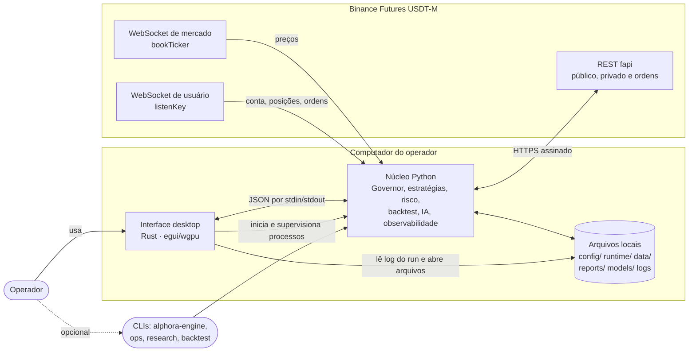
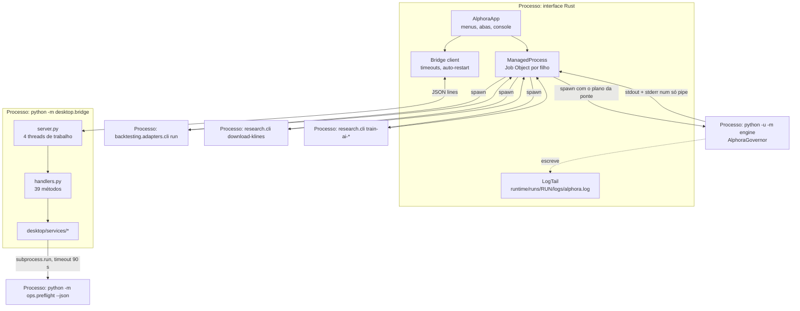
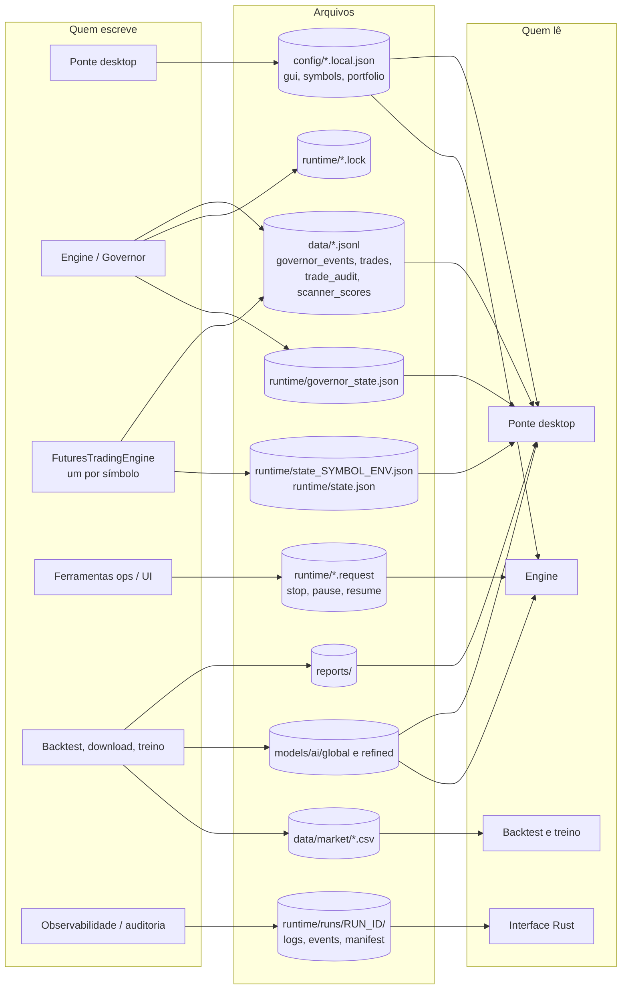
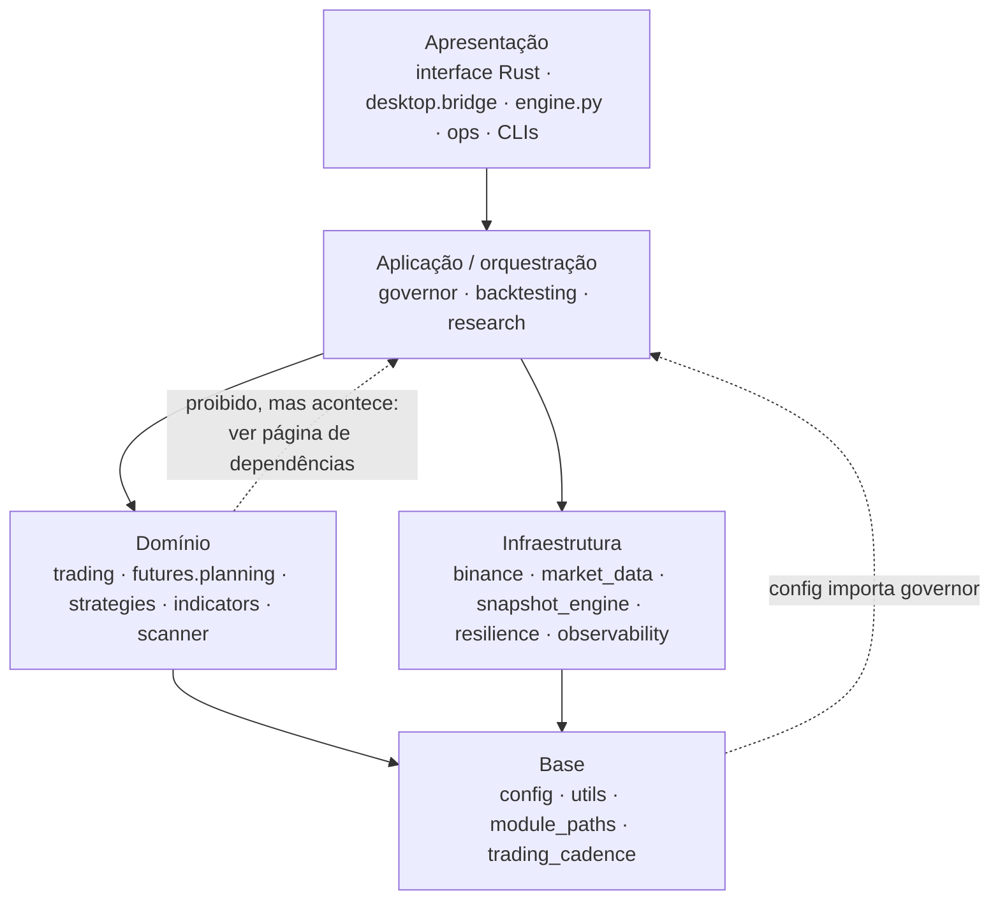

# Mapa de arquitetura do Alphora

> Retrato **do que existe hoje** no código, com caixas e setas.
> Baseline: `main` em `01e2f6e` (12/11/2026). Números medidos por análise estática (AST) do repositório.
>
> Documentos irmãos: **[Plano Diretor de Engenharia](../ALPHORA_SOFTWARE_ENGINEERING_OPTIMIZATION_PLAN.md)** (o porquê e o quê) ·
> **[Plano de Migração](../MIGRATION_PLAN.md)** (o como, passo a passo).
>
> **Atualização da fase M1:** os 11 ciclos entre pacotes foram quebrados, e alguns módulos citados aqui mudaram de
> lugar (por exemplo, `governor/symbol_context.py` → `config/`, `futures/models.py` → `domain/`,
> `governor/state_reconciliation.py` e `governor/trade_audit.py` → `execution/`). Os caminhos antigos continuam
> importáveis até o fim da M1. A lista completa está no [Plano de Migração, M1.1](../MIGRATION_PLAN.md#m11-movimentos-realizados).

---

## Navegação

| Página | O que mostra |
|---|---|
| **Esta página** | Contexto, processos, contratos em disco e números da baseline |
| [Pacotes e dependências](pacotes-e-dependencias.md) | Tamanho de cada pacote, grafo de imports, ciclos e violações de camada |
| [Governor](governor.md) | Composição, boot, loop, ciclo, os 22 estágios, threads e acoplamento entre mixins |
| [Decisão, risco e execução](decisao-e-execucao.md) | Da estratégia à ordem na Binance, camadas de risco, fontes de verdade e duplicações |
| [Dados de mercado e resiliência](dados-e-resiliencia.md) | WebSocket, snapshots, candles, user data stream, endpoints, retry e budget |
| [Pesquisa, observabilidade e desktop](pesquisa-observabilidade-desktop.md) | Backtest, treino de IA, logs/auditoria e a interface Rust com a ponte Python |

**Como ler:** os diagramas são Mermaid e o GitHub permite ampliar e arrastar cada um. Tabelas abaixo
dos diagramas apontam o arquivo e a linha no código. Blocos **▶ Detalhes** abrem informações extras.

---

## 1. Números da baseline

| Indicador | Valor |
|---|---:|
| Linhas de código Python em `src/` (sem brancos/comentários) | **93.389** em 430 arquivos |
| Linhas Rust em `interface/src/` | **11.632** em 22 arquivos |
| Maior pacote | `governor/` — **26.975** linhas, 61 arquivos, 122 classes |
| Funções com mais de 150 linhas | **60** (166 acima de 80 linhas, de 3.814) |
| Maior função | `config/loaders.py:50 load_config` — **724** linhas |
| Pares de pacotes com dependência cíclica | **11** |
| Mixins compondo o `AlphoraGovernor` | **7** (mais 5 no `FuturesTradingEngine`) |
| Estágios do pipeline de avaliação por símbolo | **22** (8 leves + 14 pesados) |
| Threads de longa duração no engine | **6** tipos + 1 pool de prefetch |
| Métodos expostos pela ponte desktop | **39** |
| Referências ao nome antigo “coalestra” após a internalização (sem diferenciar maiúsculas) | **693** em 41 arquivos |

▶ Testes por área (funções de teste)

| Área | Testes | Linhas de código da área | Testes por 1.000 linhas |
|---|---:|---:|---:|
| `retry_engine` | 1.455 | 5.360 | 271 |
| `market_data` (inclui `snapshot_engine`, 11.299) | 698 | 12.087 | 58 |
| `governor` | 329 | 26.975 | 12 |
| `trading` + `learning` | 434 | 5.593 | 78 |
| `observability` | 134 | 2.732 | 49 |
| `strategies` | 120 | 2.785 | 43 |
| `desktop` | 100 | 7.636 | 13 |
| `backtesting` | 62 | 9.118 | **7** |
| `config` | 61 | 2.110 | 29 |

A densidade é só um indicador de onde faltam testes de comportamento; não mede cobertura.
O **Governor** e o **backtesting** são as áreas grandes com menor densidade.

---

## 2. Contexto: quem fala com quem

---

## 3. Processos em execução

Cada caixa é um **processo do sistema operacional**. As setas dizem como eles se comunicam.

| Fato | Onde |
|---|---|
| A ponte **não** inicia o engine: ela monta o plano (comando + ambiente) e roda o preflight; quem faz o *spawn* é o Rust | `interface/src/pages/operation.rs` (`launch`), `src/desktop/bridge/handlers.py` (`operation_*`) |
| Todo filho roda em um Job Object com `KILL_ON_JOB_CLOSE`: se a interface morrer, os filhos morrem junto | `interface/src/process.rs` |
| Parada graciosa do engine é por **arquivo** (`runtime/governor_stop.request`), com parada forçada após 15 s | `interface/src/pages/operation.rs`, `src/governor/control_requests.py` |
| O preflight é o único processo que a ponte cria | `src/desktop/services/preflight_service.py:58` |

---

## 4. Contratos em disco

Boa parte da integração entre processos acontece por **arquivos**. Esta é a matriz de quem escreve e quem lê.

▶ Detalhes dos arquivos principais

| Arquivo | Formato | Escrito por | Lido por | Observação |
|---|---|---|---|---|
| `config/alphora_gui.local.json` | JSON (inclui credenciais) | ponte (`SettingsStore`, escrita atômica) | ponte | O engine **não** lê: recebe tudo como variáveis de ambiente do plano |
| `config/alphora_symbols.local.json` | JSON | ponte | engine (`ALPHORA_SYMBOL_PROFILES_PATH`), ponte | Perfis por símbolo |
| `config/alphora_portfolio.local.json` | JSON | ponte | engine, ponte, backtest | Limites de portfólio |
| `runtime/governor_stop.request` | texto | interface Rust | Governor (`GovernorControlRequests`) | Consumido e apagado no próximo ciclo |
| `runtime/{pause,resume,stop}_SYMBOL.request` | texto | `ops/*_symbol.py` | Governor | Controle por símbolo |
| `runtime/governor_state.json` | JSON | `GovernorStateWriter` | ponte (`symbols.rows`), `ops/governor_status` | Lido a cada 3 s pela interface quando visível |
| `data/governor_events.jsonl` | JSONL | Governor **e** `ExecutionEngine` (dois escritores) | ponte (Monitor) | Ver duplicações |
| `runtime/runs/RUN_ID/` | logs + JSONL + manifest | observabilidade / `audit_logger` | interface (tail do `alphora.log`) | `RUN_ID` vem da interface (`ALPHORA_RUN_ID`) |

---

## 5. Camadas em uma figura

A seta tracejada é o principal problema estrutural: pacotes de base e de domínio importam o Governor.
Os detalhes estão em [Pacotes e dependências](pacotes-e-dependencias.md).
