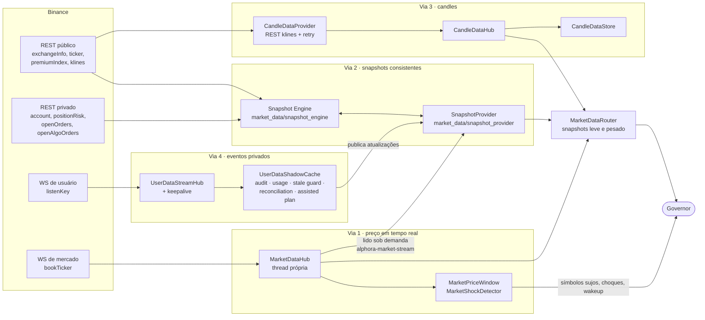
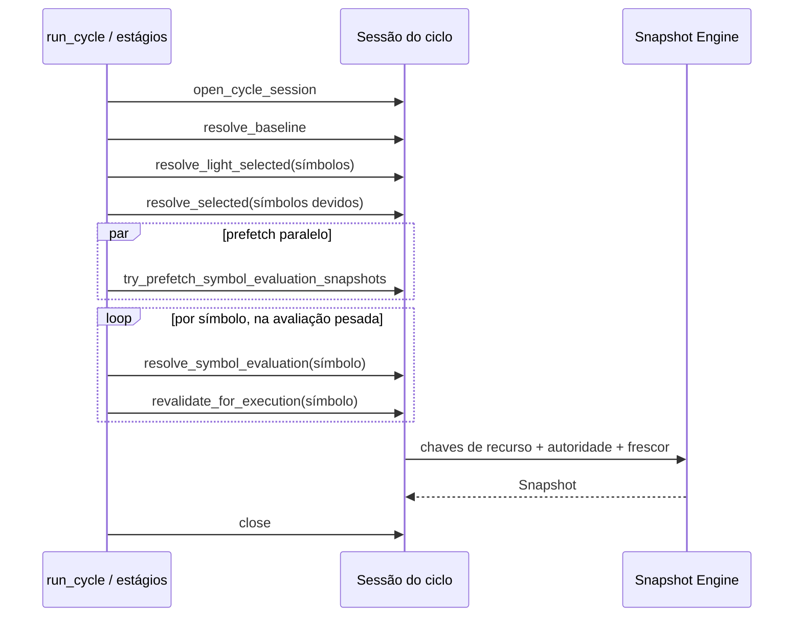
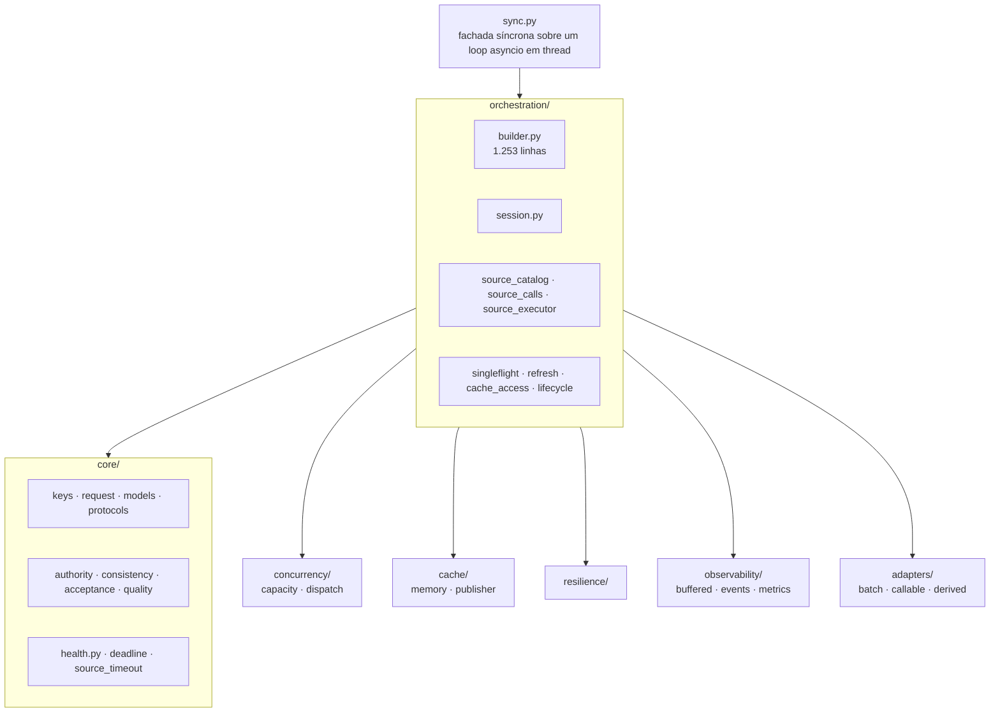
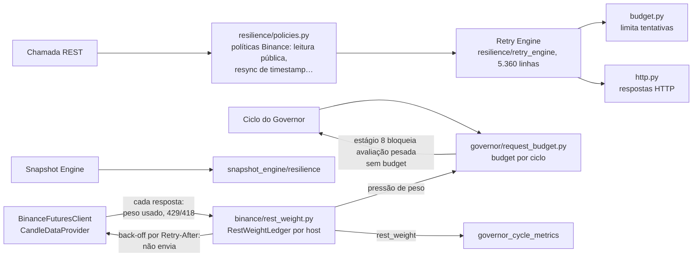

# Dados de mercado e resiliência

[← Decisão, risco e execução](decisao-e-execucao.md) · [Índice](README.md) · [Pesquisa, observabilidade e desktop →](pesquisa-observabilidade-desktop.md)

---

## 1. As quatro vias de dados

| Observação | Evidência |
|---|---|
| O preço do WebSocket entra no Snapshot Engine **por leitura sob demanda**: a fonte `alphora-market-stream` (autoridade 200) consulta o `MarketDataHub` na resolução e o REST (autoridade 40) só responde sem stream; não há publicação por tick | [ADR-001](ADR-001-market-stream-snapshot-boundary.md), [ADR-003](ADR-003-websocket-price-in-snapshot-engine.md) |
| Candles vêm do endpoint **real** da Binance em todos os modos, inclusive `TESTNET`, por decisão explícita: `ALPHORA_CANDLE_KLINES_URL` (campo `candle_klines_url`) define o endpoint, validado, mostrado no resumo de configuração e no evento `candle_hub_started` | [ADR-004](ADR-004-candle-endpoint.md), `governor/composition.py` |

---

## 2. Como o Governor pede dados ao provider

Cada ciclo abre uma **sessão** (`SnapshotCycleSession`) e pede conjuntos de recursos cada vez mais específicos:

Desde a M5 o provider é o pacote `market_data/snapshot_provider/`, dividido por responsabilidade (nenhum módulo acima
de 800 linhas, medido pela catraca): `provider.py` (fachada), `session.py` (sessão do ciclo e revalidação para
execução), `policies.py` e `readiness.py` (aceitação, consistência, degradação e prontidão por perfil), `builder.py`,
`fetchers.py` e `transport.py` (fontes, frescor e orçamento REST), `user_data.py`, `submissions.py` e
`reconciliation.py` (eventos privados), `health.py`, `diagnostics.py` e `engine_errors.py` (observabilidade) e
`wire_names.py` (nomes persistidos herdados, [ADR-002](ADR-002-snapshot-provider-naming.md)).

---

## 3. Dentro do Snapshot Engine (11.299 linhas)

---

## 4. Endpoints da Binance usados

▶ REST (cliente em <code>src/binance/futures_client.py</code>)

| Endpoint | Tipo | Uso |
|---|---|---|
| `fapi/v1/ping`, `fapi/v1/time` | público | conectividade e sincronização de relógio |
| `fapi/v1/exchangeInfo` | público | regras dos símbolos, *bootstrap* no início |
| `fapi/v2/ticker/price`, `fapi/v1/premiumIndex` | público | preço e *mark price* |
| `fapi/v1/klines` | público | candles (via `CandleDataProvider` e downloaders) |
| `fapi/v2/account`, `fapi/v1/income` | privado | saldo, margem, funding/PnL |
| `fapi/v2/positionRisk`, `fapi/v1/positionSide/dual` | privado | posições e modo de posição |
| `fapi/v1/openOrders`, `fapi/v1/openAlgoOrders` | privado | ordens abertas e proteções |
| `fapi/v1/listenKey` | privado | User Data Stream |
| `fapi/v1/order` (POST, DELETE, GET), `fapi/v1/order/test` | mutação | entrada, saída, consulta |
| `fapi/v1/algoOrder`, `fapi/v1/algoOpenOrders`, `fapi/v1/allOpenOrders` | mutação | proteções e cancelamentos |
| `fapi/v1/marginType`, `fapi/v1/leverage` | mutação | configuração do símbolo no boot |

---

## 5. Resiliência e orçamento de requisições

Existem três mecanismos de controle de pressão: o Retry Engine com budgets, o budget de requisições do ciclo e a
resiliência própria do Snapshot Engine. Desde a M5 eles compartilham **uma contagem**
([ADR-005](ADR-005-rest-weight-ledger.md)): o `RestWeightLedger` registra cada resposta REST com o peso informado pela
Binance, abre um back-off do host num 429/418 que todos os chamadores obedecem (o cliente falha na hora em vez de
estender um banimento), e o budget de checagens pesadas lê a mesma pressão (`OBSERVE` por padrão, `ENFORCE` adia
checagens opcionais). O consumo aparece em `rest_weight` nas métricas do ciclo.

---

## 6. Cadências conhecidas

| Parâmetro | Valor | Onde |
|---|---|---|
| Intervalo do loop | 3 s (padrão da interface) | `loop_interval_seconds` |
| Intervalo máximo entre avaliações de um símbolo | 300 s | `PriorityScheduler(max_interval_seconds=300)` |
| Idade máxima dos dados no scheduler | 30 s | `PriorityScheduler(max_data_age_seconds=30)` |
| Ping dos WebSockets | 20 s (timeout 10 s) | `market_data_hub.py`, `user_data_stream.py` |
| Keepalive do listenKey | 1800 s (padrão da interface) | `user_data_stream_keepalive_seconds` |
| Atualização da tabela de símbolos na interface | 3 s, só com a tela visível | `interface/src/pages/symbols.rs`, `operation.rs` |
| Atualização do Monitor na interface | 5 s, só com a tela visível | `interface/src/pages/observability.rs` |

[← Decisão, risco e execução](decisao-e-execucao.md) · [Índice](README.md) · [Pesquisa, observabilidade e desktop →](pesquisa-observabilidade-desktop.md)
