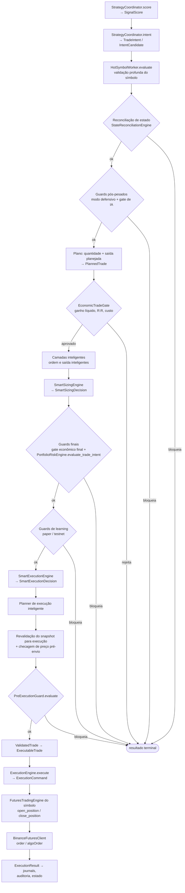
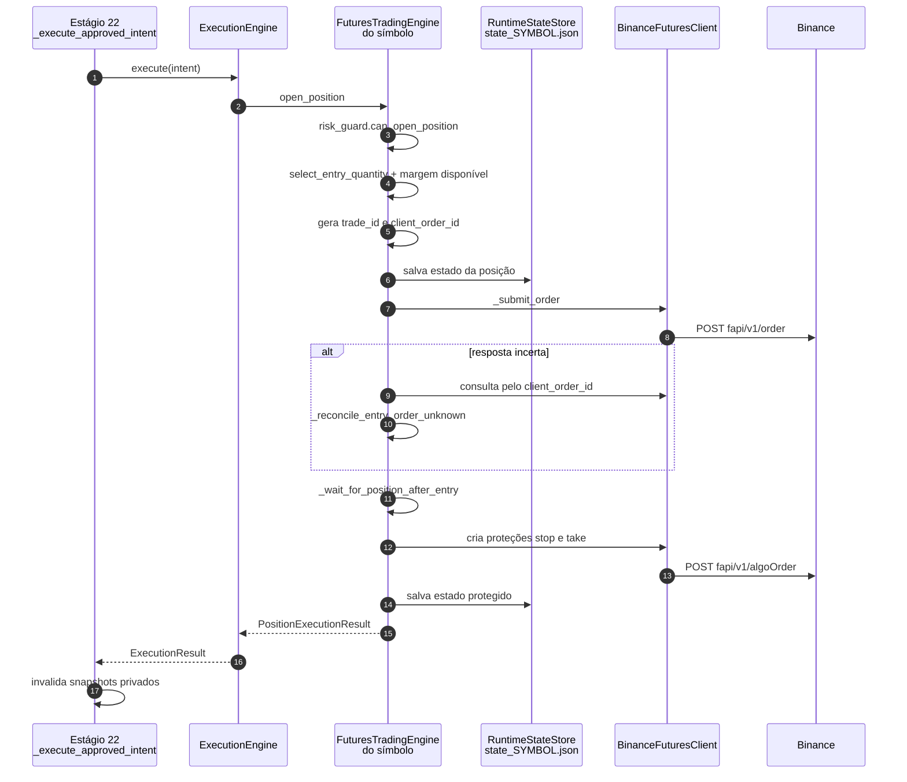
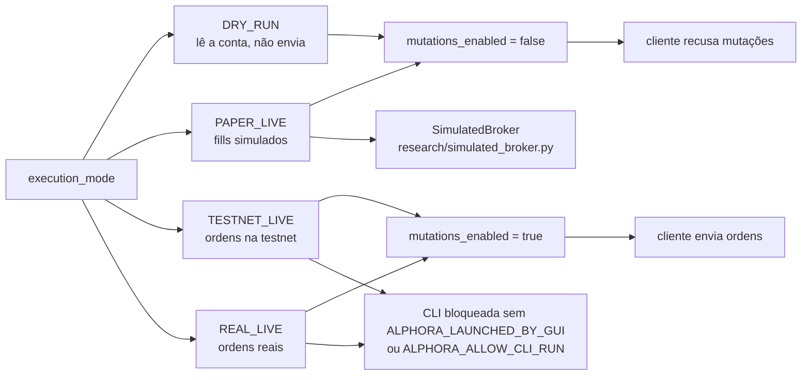
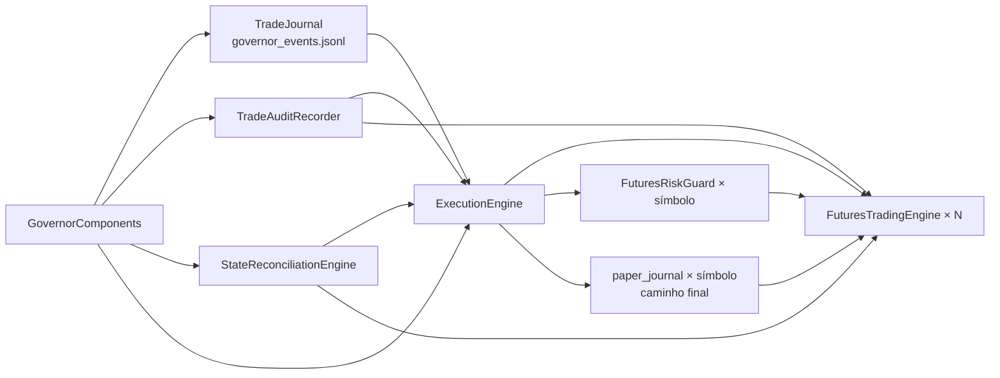
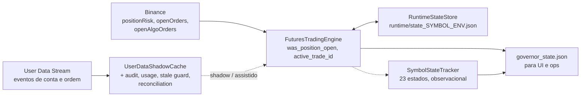

# Decisão, risco e execução

[← Governor](governor.md) · [Índice](README.md) · [Dados de mercado e resiliência →](dados-e-resiliencia.md)

---

## 1. Da estratégia à ordem: a cadeia real

Ordem dos estágios pesados com os objetos que passam de um para o outro. Cada losango pode encerrar a avaliação.

**Diferença em relação ao Plano Diretor (versão 1):** o risco de portfólio é avaliado **depois** do plano e do sizing
(estágio 18), não antes. O gate econômico roda **duas vezes** (estágios 15 e 18).

---

## 2. Camadas de risco: onde cada limite mora

```mermaid
flowchart LR
    subgraph CONTA["Conta e dia"]
        DM["DefensiveModeEvaluator<br/>governor/defensive_mode.py"]
        DPM["DailyPortfolioMetricsReader"]
    end
    subgraph PORT["Portfólio"]
        PRE["PortfolioRiskEngine<br/>governor/portfolio_risk_engine.py"]
    end
    subgraph OPER["Operação"]
        EG["EconomicTradeGate<br/>futures/planning/economic_gate.py"]
        SZ["SmartSizingEngine"]
        RM["FuturesRiskManager<br/>quantidade, filtros"]
        AIG["Gate de probabilidade da IA<br/>AIGateMixin"]
    end
    subgraph EXECR["Execução"]
        PEG["PreExecutionGuard<br/>348 linhas"]
        FRG["FuturesRiskGuard<br/>limites diários por símbolo"]
        PROT["Proteções stop/take<br/>futures/protection.py"]
        SR["StateReconciliationEngine"]
    end
    CONTA --> PORT --> OPER --> EXECR
```

Os limites existem e estão separados por camada, mas **sem um contrato comum**. Cada um devolve um tipo diferente
(`DefensiveModeEvaluation`, `PortfolioRiskDecision`, `EconomicGateDecision`, `PreExecutionGuardDecision`,
`RiskGuardDecision`…), e o pipeline traduz cada resultado para `_mark_blocked` / `_make_terminal_result`.

---

## 3. Abrindo uma posição até a Binance

▶ O que já existe e o Plano Diretor v1 tratava como novo

| Capacidade | Onde já existe |
|---|---|
| ID de cliente por ordem | `_new_client_order_id` em `futures/engine_position_mixin.py` |
| Estado salvo em torno do envio | `_save_state_for_position` |
| Reconciliação de resultado incerto | `_reconcile_entry_order_unknown`, `_reconcile_close_order_unknown` |
| Proteções revalidadas | `_refresh_position_for_protection_operation`, `_assert_protection_triggers_not_breached` |
| Pausa do engine em falha | `_pause_engine` |

O que falta não é a capacidade em si, e sim **um modelo único e explícito** do ciclo de vida da ordem: hoje essa lógica
está espalhada por funções de 250 a 480 linhas.

---

## 4. Modos de execução e permissão de mutação

A barreira é aplicada em **mais de um lugar**: na configuração, no cliente Binance e no ponto de entrada.
O broker de paper trading fica em `futures/simulated_broker.py`; a antiga reexportação em `research/` foi removida na
M1.

---

## 5. Componentes compartilhados

A raiz de composição da M2 define um dono e injeta as instâncias compartilhadas:

| Componente | Cardinalidade e dono |
|---|---|
| `data/governor_events.jsonl` | 1 `TradeJournal`, criado pela raiz e injetado no `ExecutionEngine` |
| `TradeAuditRecorder` | 1 por Governor, compartilhado com o executor e todas as engines por símbolo |
| `StateReconciliationEngine` | 1 por Governor, usado pelo estágio de avaliação e por todas as engines |
| `FuturesRiskGuard` | 1 por símbolo, armazenado no cache do `ExecutionEngine` |
| `paper_journal` | 1 por engine de símbolo, criado diretamente com o caminho final |

---

## 6. Onde está a “verdade” sobre uma posição

Esse diagrama registra a arquitetura medida antes da M4. A implementação atual centraliza a posição local e as
intenções de ordem no [`PositionLedger`](../../src/execution/ledger.py). `RuntimeStateStore` persiste o mesmo estado
local no formato existente; `FuturesTradingEngine` o lê pelo ledger. A Binance é a autoridade externa e alimenta a
reconciliação. `SymbolStateTracker` descreve apenas a trajetória de avaliação, enquanto `governor_state.json` é
uma projeção para UI e operações. Os detalhes de recuperação e falhas estão em
[M4: ciclo de vida de ordens](../m4-execution-lifecycle.md).

[← Governor](governor.md) · [Índice](README.md) · [Dados de mercado e resiliência →](dados-e-resiliencia.md)
