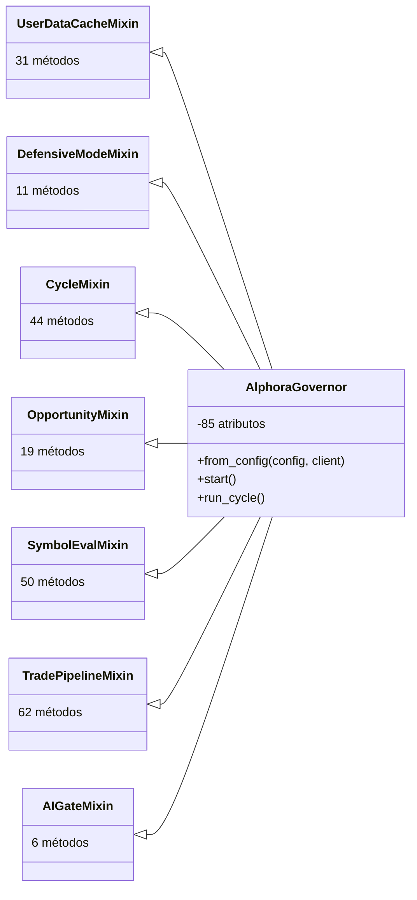
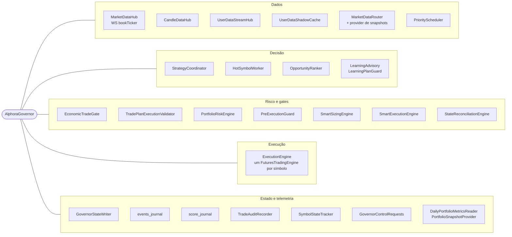
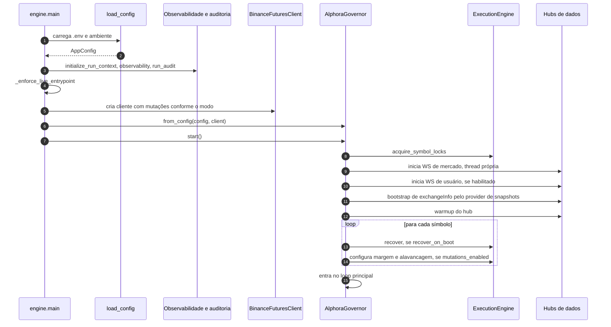
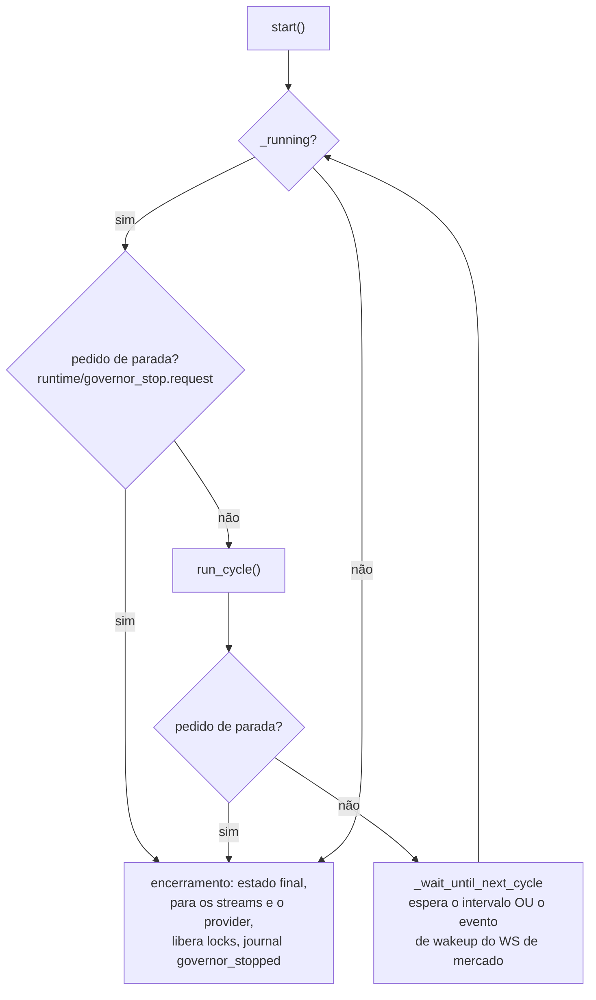
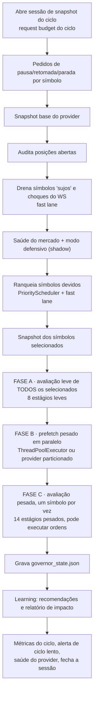
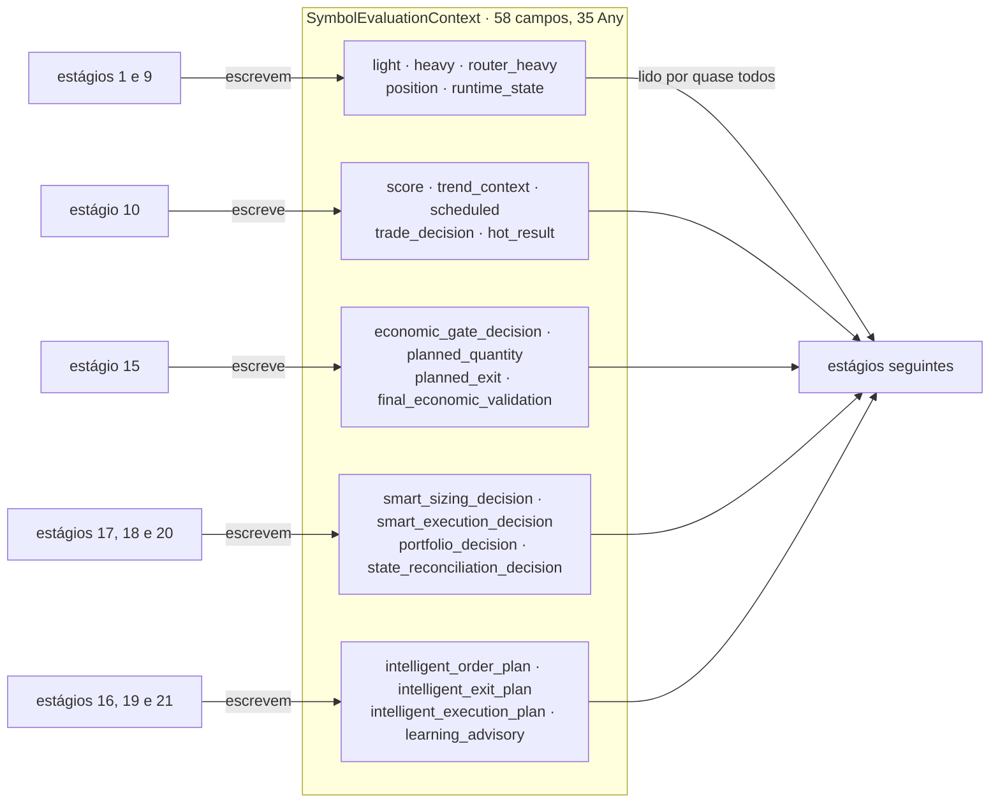
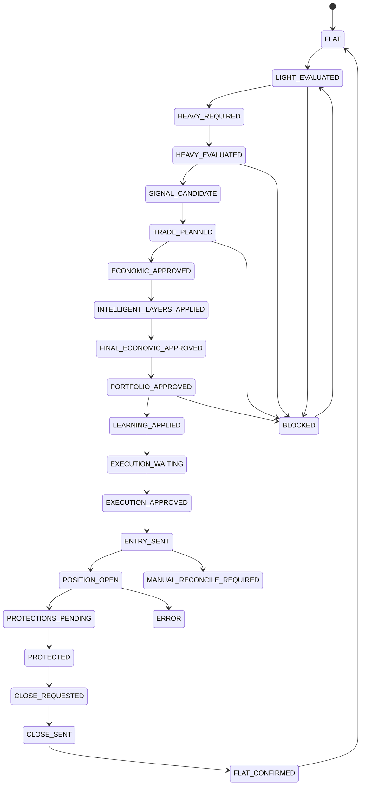
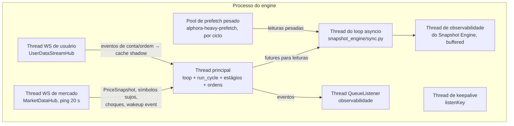
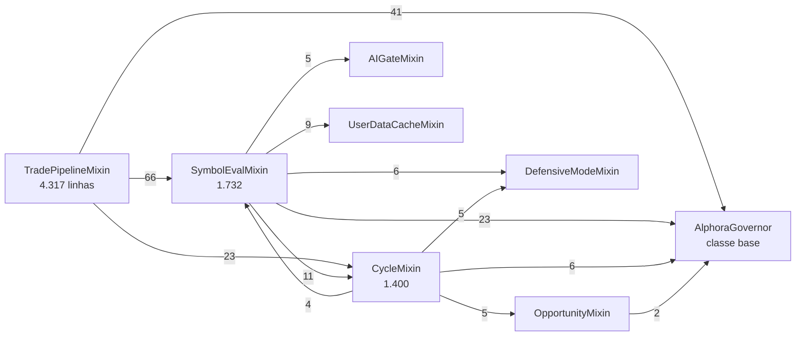

# Governor por dentro

[← Pacotes e dependências](pacotes-e-dependencias.md) · [Índice](README.md) · [Decisão, risco e execução →](decisao-e-execucao.md)

> O `AlphoraGovernor` (`src/governor/alphora_governor.py`) é o coração do engine: um objeto que herda **7 mixins**,
> cria cerca de **85 atributos** no construtor e roda o loop de decisão. Esta página mostra como ele é montado,
> como roda e onde está o acoplamento.

> **Histórico:** esta página descreve o Governor **antes da M3**. Desde a M3 ele não herda mixins: estágios em
> `governor/stages/`, serviços em `governor/services/`, ciclo em `governor/cycle/` e avaliador em
> `governor/evaluation/`. O mapa do que saiu de cada mixin está no
> [Plano de Migração, M3.1](../MIGRATION_PLAN.md#m31-implementação-realizada).

---

## 1. Composição

Componentes que o construtor cria e guarda em `self` (agrupados por função):

`governor/composition.py` é a raiz de composição. Ela devolve um `GovernorComponents` congelado, com os atributos
agrupados em dados, decisão, risco, execução e estado. O construtor do Governor apenas valida a entrada, instala esse
grafo e mantém a referência em `governor.components`. Os componentes compartilhados e seus donos estão descritos em
[Decisão, risco e execução](decisao-e-execucao.md#5-componentes-compartilhados).

---

## 2. Boot

---

## 3. Loop principal

O ciclo é **disparado por tempo** (`loop_interval_seconds`, padrão 3 s) **ou por evento**: um choque de preço no
WebSocket acorda o loop antes do prazo (`_market_wakeup_event`).

---

## 4. Anatomia de um ciclo (`run_cycle`)

`governor/cycle_mixin.py:723`, uma função de **266 linhas**.

**Ponto-chave para otimizar:** as leituras da Fase B são paralelas, mas a Fase C é sequencial de propósito, porque
uma ordem invalida os snapshots privados dos símbolos seguintes. Toda otimização do ciclo precisa respeitar isso.

---

## 5. Os 22 estágios de avaliação por símbolo

O executor de estágios já existe (`_run_symbol_evaluation_stages`, `symbol_eval_mixin.py:207`): ele roda as funções em
ordem, mede o tempo de cada uma (`stage_timings`) e para no primeiro resultado terminal. **Este pipeline é a costura
natural para a migração** (ver [Plano de Migração](../MIGRATION_PLAN.md)).

```mermaid
flowchart LR
    subgraph LEVE["Avaliação leve · todos os símbolos selecionados"]
        L1["1 contexto leve"] --> L2["2 status manual/proteção"] --> L3["3 warmup"] --> L4["4 warmup pré-pesado"]
        L4 --> L5["5 quarentena pré-pesada"] --> L6["6 guards pré-pesados<br/>defensivo + IA"] --> L7["7 só leve?"] --> L8["8 budget de requisições"]
    end
    subgraph PESADA["Avaliação pesada · um por vez"]
        H1["9 contexto pesado"] --> H2["10 decisão hot symbol<br/>estratégia → intenção"] --> H3["11 reconciliação de estado"]
        H3 --> H4["12 warmup pós"] --> H5["13 quarentena pós"] --> H6["14 guards pós-pesados"]
        H6 --> H7["15 plano + gate econômico"] --> H8["16 camadas inteligentes"] --> H9["17 smart sizing"]
        H9 --> H10["18 guards finais<br/>economia + portfólio"] --> H11["19 guards de learning"] --> H12["20 smart execution"]
        H12 --> H13["21 planner de execução"] --> H14["22 executa a intenção"]
    end
    L8 --> H1
    T(["resultado terminal:<br/>sem ação, bloqueado ou erro"])
    L3 -.-> T
    L7 -.-> T
    H6 -.-> T
    H10 -.-> T
    H14 --> X(["ordem enviada"])
```

▶ Onde está cada estágio e quanto ele mede

| # | Estágio | Arquivo:linha | Linhas |
|---:|---|---|---:|
| 1 | `_build_light_evaluation_context` | `symbol_eval_mixin.py:507` | 169 |
| 2 | `_handle_manual_or_protection_status` | `symbol_eval_mixin.py:677` | 35 |
| 3 | `_handle_warmup` | `symbol_eval_mixin.py:713` | 12 |
| 4 | `_run_symbol_warmup_pre_heavy` | `symbol_eval_mixin.py:726` | 14 |
| 5 | `_run_symbol_quarantine_pre_heavy` | `symbol_eval_mixin.py:838` | 17 |
| 6 | `_run_pre_heavy_guards` | `symbol_eval_mixin.py:1155` | 55 |
| 7 | `_handle_light_only` | `symbol_eval_mixin.py:1211` | 36 |
| 8 | `_run_request_budget_guard` | `opportunity_mixin.py:372` | 22 |
| 9 | `_build_heavy_evaluation_context` | `symbol_eval_mixin.py:1248` | 201 |
| 10 | `_run_hot_symbol_decision` | `symbol_eval_mixin.py:1450` | 120 |
| 11 | `_run_state_reconciliation_guard` | `symbol_eval_mixin.py:1671` | 68 |
| 12 | `_run_symbol_warmup_post_heavy` | `symbol_eval_mixin.py:741` | 13 |
| 13 | `_run_symbol_quarantine_post_heavy` | `symbol_eval_mixin.py:856` | 19 |
| 14 | `_run_post_heavy_guards` | `symbol_eval_mixin.py:1591` | 79 |
| 15 | `_build_and_validate_trade_plan` | `trade_pipeline_mixin.py:254` | 132 |
| 16 | `_apply_intelligent_layers` | `trade_pipeline_mixin.py:387` | 134 |
| 17 | `_run_smart_sizing` | `trade_pipeline_mixin.py:522` | 105 |
| 18 | `_run_final_execution_guards` | `trade_pipeline_mixin.py:841` | 184 |
| 19 | `_run_learning_execution_guards` | `trade_pipeline_mixin.py:1026` | 289 |
| 20 | `_run_smart_execution` | `trade_pipeline_mixin.py:669` | 93 |
| 21 | `_run_execution_planner` | `trade_pipeline_mixin.py:1316` | 78 |
| 22 | `_execute_approved_intent` | `trade_pipeline_mixin.py:1983` | **449** |

O estágio 22 ainda chama `_revalidate_evaluation_for_execution` (419 linhas) e o `PreExecutionGuard.evaluate` (348).

---

## 6. O contexto compartilhado entre os estágios

Os estágios não trocam dados por parâmetros: todos leem e escrevem no mesmo `SymbolEvaluationContext`
(`governor/symbol_evaluation_pipeline.py:36`). Ele funciona como um **quadro-negro** com 58 campos,
**35 deles tipados como `Any`**.

Consequência: não dá para testar um estágio sozinho sem montar o contexto inteiro e o Governor que o cerca.

---

## 7. Rastreador de estados

`SymbolStateTracker` (`governor/symbol_state_machine.py`) registra **23 estados** por símbolo. A docstring diz que ele
é **apenas observacional**: a posição real continua sendo de `RuntimeState`, `ExecutionEngine`, Binance/User Data
Stream e `FuturesTradingEngine`. Transições inválidas são registradas, não impedidas.

O diagrama mostra o caminho principal e as saídas típicas para `BLOCKED`, `ERROR` e `MANUAL_RECONCILE_REQUIRED`;
qualquer estado pode ir para esses três. Na M7, `docs/governor-orchestration-cycle.md` foi reescrito a partir deste
código e separa este rastreador do status exibido no painel (`SymbolRuntimeStatus`).

---

## 8. Threads e concorrência

| Recurso compartilhado | Quem escreve | Quem lê | Sincronização |
|---|---|---|---|
| Preços e janela de preços | thread do WS de mercado | thread principal | estruturas do `MarketDataHub` + evento de wakeup |
| Cache de user data | thread do WS de usuário | thread principal | `UserDataShadowCache` |
| Snapshots | loop asyncio | thread principal e pool | futures do `concurrent.futures` |
| Ordens e proteções | thread principal | — | sequencial + `RLock` de proteção no `FuturesTradingEngine` |

---

## 9. Acoplamento entre os mixins

Chamadas a métodos definidos em **outro** mixin ou na classe base, sempre através de `self`:

| Mixin | Métodos próprios | Atributos de `self` lidos | `getattr/hasattr(self, …)` |
|---|---:|---:|---:|
| `TradePipelineMixin` | 62 | 12 | 24 |
| `SymbolEvalMixin` | 50 | 12 | 17 |
| `CycleMixin` | 44 | 26 | 21 |
| `UserDataCacheMixin` | 31 | 4 | 29 |
| `OpportunityMixin` | 19 | 5 | 10 |
| `DefensiveModeMixin` | 11 | 4 | 5 |
| `AIGateMixin` | 6 | 3 | 0 |

**Leitura:** os mixins não são módulos independentes. São pedaços de **uma única classe** espalhados em arquivos.
As **106 consultas dinâmicas** com `getattr(self, …)` são contratos implícitos: dependências que nenhum tipo declara
e que o mypy não verifica. O `TradePipelineMixin` sozinho faz 130 chamadas a métodos definidos fora dele
(os números nas setas são pontos de chamada, não métodos distintos).

[← Pacotes e dependências](pacotes-e-dependencias.md) · [Índice](README.md) · [Decisão, risco e execução →](decisao-e-execucao.md)
