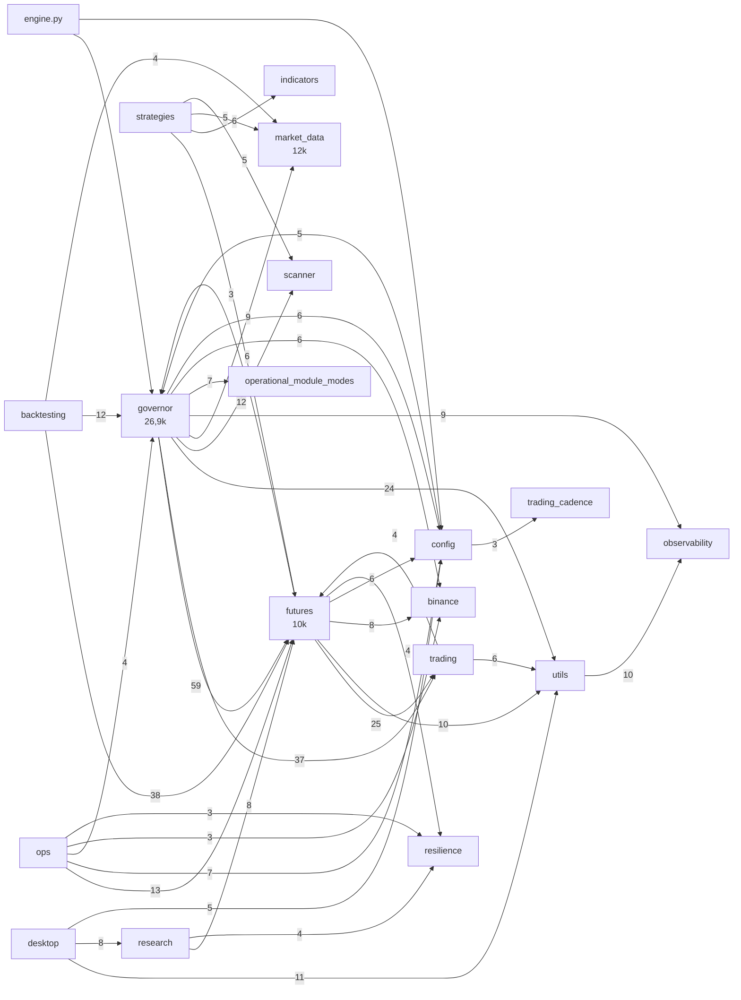

# Pacotes e dependências

[← Índice](README.md) · [Governor →](governor.md)

> Medido por AST em `src/` (commit `01e2f6e`). Uma aresta `A → B` conta cada `import`/`from … import` de `A` que aponta para `B`.

---

## 1. Tamanho por pacote

| Pacote | Linhas | Arquivos | Classes | Papel |
|---|---:|---:|---:|---|
| `governor` | 26.975 | 61 | 122 | Orquestração do ciclo, pipeline de decisão, execução, estado, user data cache |
| `market_data` | 12.087 | 60 | 150 | Candles, timeframes e o Snapshot Engine (11.299 linhas) |
| `futures` | 9.955 | 47 | 80 | Engine por símbolo, planejamento, risco, proteção, estado |
| `backtesting` | 9.118 | 31 | 43 | Motor histórico com `GovernorSimulator` próprio |
| `desktop` | 7.636 | 27 | 49 | Ponte JSON e serviços da interface |
| `resilience` | 5.672 | 70 | 62 | Retry Engine (5.360), políticas, budgets, polling |
| `trading` | 5.593 | 30 | 55 | Intenção, plano, camadas inteligentes, learning |
| `research` | 3.428 | 12 | 7 | Downloaders, treino de IA, registro de modelos, broker simulado |
| `strategies` | 2.785 | 11 | 17 | Estratégias fixas e a estratégia de IA |
| `observability` | 2.732 | 28 | 21 | Eventos, logs, crash, retenção |
| `config` | 2.110 | 9 | 13 | `load_config` → `AppConfig` |
| `ops` | 1.840 | 14 | 2 | Preflight, status, pausa, parada, emergency flatten |
| `utils` | 1.210 | 8 | 7 | `audit_logger`, journals JSONL, privacidade |
| `indicators` | 841 | 12 | 14 | ADX, ATR, Donchian, RSI, volatilidade… |
| `binance` | 455 | 2 | 4 | Cliente REST da Binance Futures |
| `scanner` | 169 | 3 | 4 | `SignalScore`, `PriorityScheduler` |
| Módulos soltos | 782 | 4 | 7 | `engine.py`, `operational_module_modes.py`, `trading_cadence.py`, `module_paths.py` |

O Governor sozinho tem **29%** do código. Junto com o `market_data` e o `futures`, essas três áreas concentram **52%**.

---

## 2. Grafo de dependências (arestas com 3 ou mais imports)

**Leitura:** `governor`, `backtesting` e `ops` dependem fortemente de `futures`. Já `futures`, `trading` e `config`
deveriam estar **abaixo** do Governor, mas importam o Governor. É isso que forma os ciclos da próxima seção.

---

## 3. Os 11 ciclos entre pacotes

Em cada par, a coluna “aresta de retorno” é o lado menor do ciclo: o import que, se removido, quebra o ciclo.

| Par | Imports (ida / volta) | Aresta de retorno | O que é importado | Correção sugerida |
|---|---:|---|---|---|
| `config` ↔ `governor` | 5 / 6 | `config/loaders.py:34-35`, `config/models.py:14-15`, `config/loaders.py:749` | `SmartExecutionSettings`, `SmartSizingSettings`, `resolve_public_market_ws_base_url` | Mover os modelos de *settings* para `config` (o Governor passa a importar de lá) |
| `futures` ↔ `governor` | 3 / 59 | `futures/engine.py:31-34`, `futures/engine_exchange_mixin.py:16` | `StateReconciliationEngine`, `TradeAuditRecorder` | Mover reconciliação e auditoria de trades para um pacote de execução/auditoria abaixo de ambos |
| `governor` ↔ `trading` | 37 / 1 | `trading/context.py:7` | `SymbolTradingConfig` | Mover `SymbolTradingConfig` para `config` |
| `futures` ↔ `research` | 2 / 8 | `futures/engine.py:36`, `futures/engine_exchange_mixin.py:20` | `SimulatedBroker` (paper trading) | Mover o broker simulado para a camada de execução (não é pesquisa) |
| `futures` ↔ `trading` | 25 / 4 | `trading/context.py:5-6`, `trading/outcome.py:7-8` | `SymbolRules`, `FuturesPosition` | Extrair modelos de mercado/posição para um módulo de domínio compartilhado |
| `futures` ↔ `strategies` | 6 / 2 | `futures/base.py:1`, `futures/strategy_loader.py:5` | `FuturesStrategy` | O contrato de estratégia deve ser um *port* do domínio, não depender do pacote concreto |
| `futures` ↔ `resilience` | 4 / 2 | `resilience/predicates.py:4-5` | `TRANSIENT_STATUS_CODES`, `FuturesPosition` | Códigos HTTP transitórios pertencem ao adaptador Binance/resiliência |
| `config` ↔ `futures` | 1 / 6 | `config/validators.py:18` | `normalize_regime_policy_mode` | Mover o enum/normalizador de regime para `config` |
| `market_data` ↔ `strategies` | 1 / 5 | `market_data/requirements.py:9` | `StrategyMetadata` | Requisitos de dados viram um contrato neutro |
| `observability` ↔ `utils` | 2 / 10 | `observability/integrations/coalestra_*_sink.py` | utilitários de journal | Inverter: sinks recebem o writer por injeção |
| `binance` ↔ `resilience` | 1 / 2 | `binance/futures_client.py:470` (import tardio) | `build_binance_timestamp_resync_policy` | Injetar a política no cliente |

> [!NOTE]
> **Situação após a fase M1:** os 11 ciclos foram quebrados (0 ciclos), e um teste de arquitetura impede que voltem.
> As correções aplicadas, e onde elas diferem da sugestão acima, estão no
> [Plano de Migração, M1.1](../MIGRATION_PLAN.md#m11-movimentos-realizados).

> **Por que isso importa para otimizar:** enquanto houver ciclos, nenhum pacote de baixo pode ser testado, reutilizado
> (por exemplo, pelo backtest) ou substituído sem carregar o Governor inteiro. Quebrar os ciclos é o **pré-requisito
> barato** para qualquer separação domínio/aplicação/infraestrutura.

---

## 4. Concentração de complexidade

### Maiores módulos

| Módulo | Linhas | Observação |
|---|---:|---|
| `governor/trade_pipeline_mixin.py` | 4.317 | 8 dos 14 estágios pesados + revalidação + despacho |
| `governor/coalestra_provider.py` | 3.207 | Fachada do Snapshot Engine para o Governor (nome herdado) |
| `backtesting/engine/decision_pipeline.py` | 1.969 | `GovernorSimulator`: reimplementa decisões do Governor |
| `futures/engine_position_mixin.py` | 1.881 | Abertura, fechamento e proteções |
| `governor/symbol_eval_mixin.py` | 1.732 | 14 estágios + o executor de estágios |
| `backtesting/engine/metrics.py` | 1.411 | Métricas do relatório |
| `governor/cycle_mixin.py` | 1.400 | `run_cycle` e serviços do ciclo |
| `desktop/bridge/handlers.py` | 1.258 | 39 métodos da ponte |
| `market_data/snapshot_engine/orchestration/builder.py` | 1.253 | Construção de snapshots |
| `governor/execution_engine.py` | 1.195 | Fachada por símbolo sobre o `FuturesTradingEngine` |

### Maiores funções

| Função | Linhas |
|---|---:|
| `config/loaders.py:50 load_config` | **724** |
| `futures/engine_position_mixin.py:62 _open_position` | 482 |
| `governor/trade_pipeline_mixin.py:1983 _execute_approved_intent` | 449 |
| `governor/trade_pipeline_mixin.py:1395 _revalidate_evaluation_for_execution` | 419 |
| `backtesting/engine/metrics.py:30 build_backtest_summary` | 363 |
| `governor/pre_execution_guard.py:37 evaluate` | 348 |
| `futures/engine_position_mixin.py:1072 _close_position` | 322 |
| `governor/user_data_cache_stale_guard.py:49 evaluate_user_data_cache_stale_guard` | 312 |
| `backtesting/engine/decision_pipeline.py:490 _process_open` | 294 |
| `governor/trade_pipeline_mixin.py:1026 _run_learning_execution_guards` | 289 |
| `governor/cycle_mixin.py:723 run_cycle` | 266 |
| `futures/engine_position_mixin.py:575 _create_protection_orders_locked` | 256 |
| `governor/portfolio_risk_engine.py:61 evaluate_trade_intent` | 247 |

São 60 funções acima de 150 linhas. As cinco maiores do caminho de ordem (`_open_position`, `_execute_approved_intent`,
`_revalidate_evaluation_for_execution`, `_close_position` e `_create_protection_orders_locked`) somam **1.928 linhas**
no trecho mais crítico do sistema.

---

## 5. Código morto, legado e nomes herdados

| Item | Evidência | Situação |
|---|---|---|
| `FuturesTradingEngine.start()` e `run_once()` | Removidos na M2 | A API morta do motor single-symbol antigo não faz mais parte do contrato |
| `futures/portfolio_risk.py` | Removido na M2 | O risco de portfólio tem como fonte única `governor/portfolio_risk_engine.py` |
| `publish_market_snapshot` | Removido na M2 conforme [ADR-001](ADR-001-market-stream-snapshot-boundary.md); a M5 manteve a leitura sob demanda ([ADR-003](ADR-003-websocket-price-in-snapshot-engine.md)) | O preço do stream entra no engine pela fonte `alphora-market-stream`, sem publicação por tick |
| Dois sistemas de eventos | `observe_event` (observability) e `audit_event` (`utils/audit_logger.py`) chamados em sequência com o mesmo conteúdo | M7: uma API em `utils/events.py`; o audit logger e o serviço de observabilidade viraram *sinks* ([ADR-006](ADR-006-single-event-api.md)) |
| Nome “coalestra” | 687 ocorrências (sem diferenciar maiúsculas) em 42 arquivos (`coalestra_provider.py`, `CoalestraReadiness`, `coalestra_event_sink`…) | M5: o código foi renomeado e o provider foi para `market_data/snapshot_provider/` ([ADR-002](ADR-002-snapshot-provider-naming.md)); restam só os valores persistidos, em módulos `wire_names.py` marcados e contados pela catraca |
| `docs/governor-orchestration-cycle.md` | Descrevia uma máquina de estados `WARMUP/ACTIVE/PAUSED` e logging via structlog | M7: reescrito a partir do código (rastreador de 23 estados, status do painel, `logging` + logprivacy) |

[← Índice](README.md) · [Governor →](governor.md)
