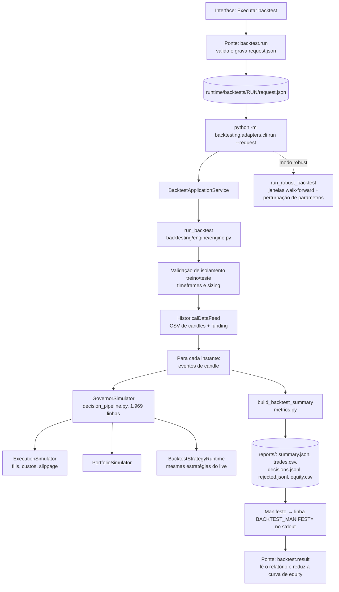
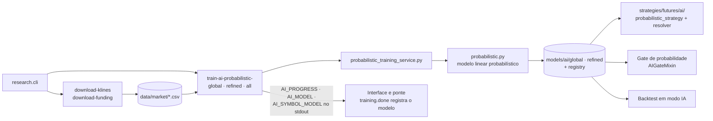
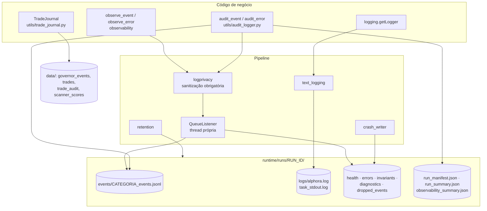
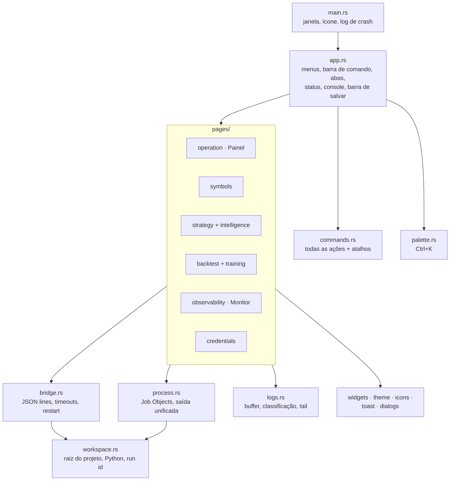
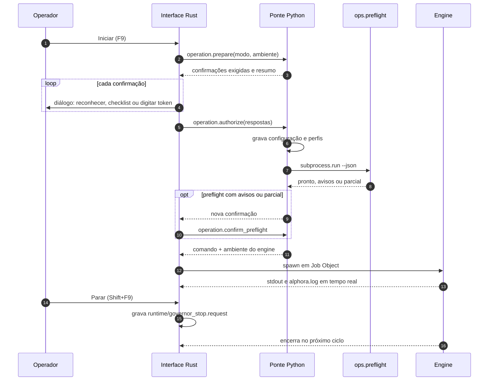

# Pesquisa, observabilidade e desktop

[← Dados de mercado e resiliência](dados-e-resiliencia.md) · [Índice](README.md)

---

## 1. Backtest

**Ponto central para otimizar:** as estratégias são as mesmas do live (`BacktestStrategyRuntime`), mas a **cadeia de
decisão não é**. O `GovernorSimulator` reimplementa sinal → plano → gates → sizing → execução em 1.969 linhas,
separado dos 22 estágios do Governor. Quando uma regra muda no live, o backtest não muda junto.

---

## 2. Pesquisa e treino de IA

O contrato entre treino e uso é feito **por linhas de texto no stdout** (`AI_MODEL:`, `BACKTEST_MANIFEST=`,
`Candles baixados:`), interpretadas pela ponte.

---

## 3. Observabilidade e auditoria

| Observação | Evidência |
|---|---|
| Dois sistemas paralelos de eventos: `observability` e `utils/audit_logger` | `engine.py` chama `audit_event` e `observe_event` em sequência com o mesmo conteúdo (`config_loaded`, `shutdown_requested`…) |
| Mais um canal de journals em `data/` | `TradeJournal` escreve `governor_events`, `trades`, `scanner_scores`, `trade_audit` |
| `utils` importa `observability` 10 vezes e vice-versa | ciclo `observability ↔ utils` |

---

## 4. Interface desktop (Rust)

### Iniciar o Alphora pela interface

| Fato | Valor |
|---|---|
| Timeout padrão de requisição à ponte | 45 s (`authorize` 150 s, preparos de pesquisa 90 s) |
| Reinício automático da ponte | até 3 tentativas com espera crescente |
| Carregamento das telas | todas as páginas carregam em segundo plano ao conectar |
| Parada forçada | 15 s após a parada graciosa, por `TerminateJobObject` |

[← Dados de mercado e resiliência](dados-e-resiliencia.md) · [Índice](README.md)
